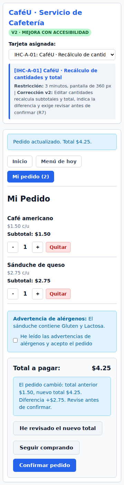
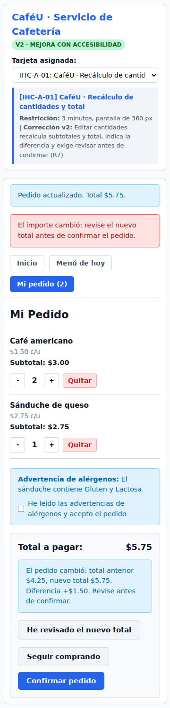
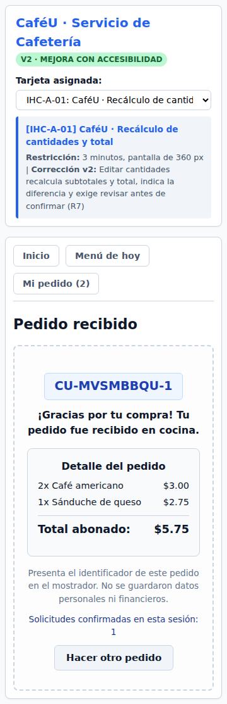
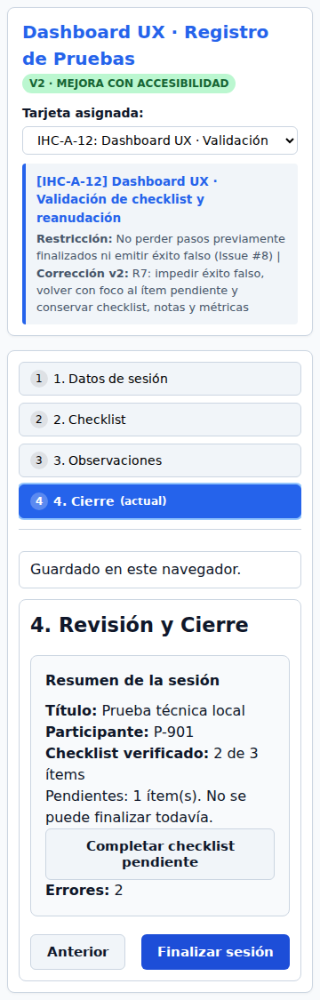
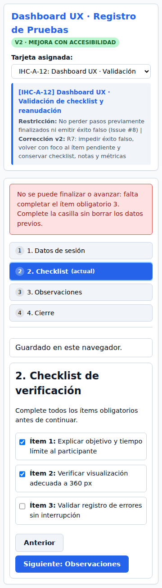
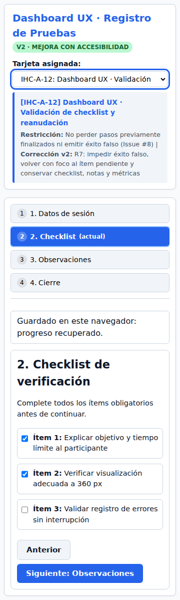
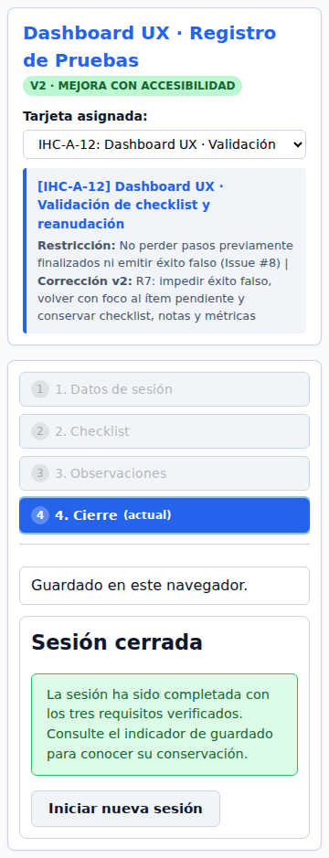

# Documentación integral de la actividad IHC

**Universidad Técnica de Ambato · Carrera de Ingeniería de Software**

**Proyecto:** Prueba 01 · IHC · Parcial 2 · CaféU y Dashboard UX

**Compilación y revisión integral:** William Martínez

**Equipo:** Manuel Cusme, Emilio Abril, William Martínez, Pablo Lozada y Jonathan Gamboa.

**Fecha:** 28 de octubre de 2026 · America/Guayaquil

**Repositorio:** [https://github.com/EMILIOABRIL05/Prueba_01_IHC_Parcial2](https://github.com/EMILIOABRIL05/Prueba_01_IHC_Parcial2)

**Rama de esta actualización:** `william/actualizacion-cierre-y-validacion`

**Integración revisada:** [PR #20](https://github.com/EMILIOABRIL05/Prueba_01_IHC_Parcial2/pull/20), fusionado en main `49abf9cadd269553594142be02dfb068fa53efc3` el 28-10-2026 a las 17:04 -05.

**Código verificado:** [`787a4fd22baded030dd132343295b952f6290790`](https://github.com/EMILIOABRIL05/Prueba_01_IHC_Parcial2/commit/787a4fd22baded030dd132343295b952f6290790)

**Estado:** documentación y correcciones técnicas con ejecución de navegador; observación humana y revisión personal pendientes según sus registros.

<!-- PAGEBREAK -->

## Índice

Contenido organizado por capítulos, tarjetas y anexos. El índice permite localizar las páginas; la fuente Markdown conserva el texto editable.

<!-- TOC -->

<!-- PAGEBREAK -->

## 1. Propósito, alcance y evidencia

El trabajo integra diagnóstico, diseño, prototipado, prueba y corrección de dos sistemas educativos. CaféU representa una compra de alimentos entre clases; Dashboard UX organiza la preparación y registro de una prueba de usabilidad. La actividad original asigna una tarjeta; el alcance acordado por el equipo en esta entrega abarca las doce tarjetas A01–A12 y las dos incidencias elegidas, A01 y A12.

El objetivo práctico es que una persona comprenda qué puede hacer, complete su tarea, reconozca el resultado y recupere errores sin perder información pertinente. El objetivo de ingeniería es mantener una cadena verificable entre necesidad, requisito, flujo, pantalla, componente, prueba y cambio registrado en Git.

La documentación corresponde al contenido del repositorio adjunto. Las pantallas no se consideran suficientes por existir: se describen sus estados y se relacionan con pruebas de las entradas reales. Las capturas actuales tienen procedencia técnica; no se convierten en tiempos, satisfacción ni declaraciones de participantes.

La revisión detectó dieciocho grupos de problemas. Se corrigieron las brechas de implementación, pruebas y coherencia documental. La falta de una observación humana auténtica se resuelve documentalmente como pendiente, con protocolo y actas; no se inventan datos para marcarla como realizada.

### 1.1 Entregables de la revisión integral

- Correcciones del pedido, revisión de importe, alérgenos, navegación, anonimato, métricas, persistencia, foco y estados.

- Doce fichas completas, 74 requisitos, 24 diagramas de navegación, doce curvas iniciales y 50 Lo-Fi, además de doce tableros SVG.

- Suite de navegador con 41 casos, 33 capturas actuales y huellas de las fuentes; regresiones de lógica y comprobadores de coherencia.

- README ampliado, registro Git, clasificación de evidencia histórica, documentación editable y este PDF.

### 1.2 Interpretación de los resultados

Un resultado OK de v1 comprueba que el defecto de referencia se conserva. Un OK de v2 comprueba una expectativa concreta de su caso. Ninguno certifica por sí solo accesibilidad global, rendimiento en toda circunstancia o satisfacción de usuarios. La mejora técnica demostrada se distingue de la mejora de experiencia que exige observación.

## 2. Fundamentos aplicados del material de clase

Las explicaciones siguientes sintetizan los siete materiales del curso adjuntos al proyecto. Se aplican al caso, sin reproducir íntegramente sus diapositivas ni atribuirles mediciones de este prototipo.

### 2.1 IHC, UX, UI y diseño de interacción

IHC estudia la relación entre personas y sistemas considerando capacidades cognitivas, contexto, dispositivos y objetivos. UX considera el recorrido y la experiencia resultante, incluida la incertidumbre o confianza. UI es la capa de controles, textos y organización con la que se opera. El diseño de interacción conecta una acción con un cambio de estado comprensible.

En CaféU, un botón bien dibujado no resuelve un total obsoleto. En Dashboard, un Stepper coloreado no garantiza una secuencia válida ni comunica el paso a quien no ve ese color. Por eso la corrección conecta presentación, lógica y feedback.

### 2.2 Efectividad, eficiencia y satisfacción

La calidad de uso se evalúa en un contexto y con una tarea concreta. Efectividad: completar correctamente el pedido o la sesión, sin falso éxito. Eficiencia: recursos requeridos, como tiempo, pasos, esfuerzo y recuperación. Satisfacción: aceptación y experiencia expresadas por la persona. La automatización comprueba condiciones de efectividad técnica; el tiempo humano y la satisfacción deben observarse.

Un total correcto, un bloqueo de cierre y la conservación del checklist son condiciones verificables. Una reducción de tiempo atribuida a una persona necesita cronometraje auténtico y consideración del aprendizaje entre versiones. Por ello no se presentan como válidas las métricas históricas A12 sin confirmar sus registros.

### 2.3 Percepción, atención y memoria

La interfaz organiza estímulos para que la persona identifique información relevante y actúe. Los avisos críticos deben estar próximos a la decisión, con jerarquía clara y texto comprensible. Mostrar productos, cantidades, diferencia de importe, etapa y progreso reduce la necesidad de recordar estados anteriores.

El carrito y el checklist actúan como memoria externa. Restaurar el foco conserva la ubicación de la interacción; perderlo después de renderizar obliga a buscar otra vez. Mantener datos al volver de un error reduce esfuerzo y evita que una recuperación produzca un fallo adicional.

### 2.4 Gestalt y carga cognitiva

La proximidad agrupa nombre, cantidad y precio del mismo producto, o etiqueta y casilla del mismo requisito. La semejanza ayuda a reconocer acciones equivalentes. La jerarquía y figura-fondo separan título, estado, contenido y acción principal. Estas decisiones favorecen el reconocimiento; no se usan como decoración desconectada de la tarea.

A 360 px, el Stepper y los botones se reorganizan verticalmente. El contenido esencial permanece dentro del viewport. Ocultar el desbordamiento no demuestra que un control sea usable; la suite comprueba también los límites de los controles visibles.

### 2.5 Heurísticas y recuperación de errores

Se aplican visibilidad del estado, consistencia, control y libertad, prevención y reconocimiento/recuperación de errores. Un aviso debe explicar qué falta y cómo continuar. Confirmar no puede equivaler a recibido mientras la operación siga pendiente. Cancelar una eliminación debe conservar el producto y devolver la ubicación.

La severidad preliminar combina impacto sobre la tarea y posibilidad de recuperación. Los tres fallos por tarjeta se tratan como candidatos de diagnóstico hasta comprobarlos. La existencia de un archivo borrador no equivale a un Issue publicado ni a un problema observado en una persona.

### 2.6 Modelos mentales, metáforas y manipulación directa

CaféU usa la metáfora de carrito: agregar, revisar, cambiar cantidades, quitar y recibir un comprobante. Dashboard usa pasos y lista de verificación para representar una preparación secuencial. La metáfora es útil cuando su comportamiento respeta la expectativa: cancelar no borra, volver no pierde datos y el cierre significa que los obligatorios fueron verificados.

Los botones de cantidad muestran inmediatamente el resultado de la edición. Ese feedback no sustituye una nueva revisión cuando cambia el importe: A01 convierte la edición en una secuencia de recálculo, explicación de diferencia, revisión y confirmación.

### 2.7 Accesibilidad, contexto y trazabilidad de interacción

El diseño inclusivo considera diversidad funcional y situacional: lesión temporal, lector de pantalla, pantalla pequeña, presión de tiempo o conectividad inestable. El estado se comunica por texto y semántica, además de color. Tab, Enter y Escape se emplean según su función; el foco indica dónde tendrá efecto la próxima acción.

El requisito accesible se transforma en comportamiento: A02 enlaza nombre por producto, diálogo, Cancelar inicial, ciclo de Tab, Escape y restitución del foco. A10 enlaza paso actual con aria-current, encabezado enfocable y región persistente de estado. La prueba nativa de foco y atributos es evidencia parcial; la experiencia con lector de pantalla se registra aparte.

## 3. Actividad y productos solicitados

La guía plantea un trabajo de 120 minutos por fases, con repositorio nuevo, contribuciones individuales verificables y una incidencia al final de la sesión. Las restricciones de tiempo y autoría se describen como criterios de la actividad; esta documentación no inventa la hora del anuncio ni una defensa realizada.

| Fase | Producto requerido | Evidencia del repositorio |
|---|---|---|
| 1. Diagnóstico | 6–8 touchpoints, dos momentos de verdad, tres fallos priorizados y curva inicial | docs/diagnostico.md, fichas, curvas y Issues |
| 2. Arquitectura | Seis requisitos por tarjeta, sitemap, flujo principal/editar/error, componentes y cuatro Lo-Fi | docs/requisitos.md, diagramas/, wireframes/, trazabilidad |
| 3. Prototipo | Recorrido completo y estados normal, procesando, error y éxito; teclado y foco | prototipo/v1/, prototipo/v2/, assets/ y decisiones |
| 4. Prueba y mejora | Participante externo sin ayudas, tiempo, errores, pausas, resultado y cita; corrección v2 | pruebas/, actas por completar/validar y evidencia técnica separada |
| 5. Incidencia | Issue, requisito/flujo actualizado, cambio de prototipo, test y commit/PR | A01 #17, A12 #18, PR #19 y rama integral |

### 3.1 Rúbrica original y alcance actual

| Criterio | Puntaje original |
|---|---|
| Diagnóstico emocional | 0,35 |
| Arquitectura y trazabilidad | 0,35 |
| Prototipo, feedback y accesibilidad | 0,45 |
| Prueba observada y mejora | 0,25 |
| Colaboración GitHub | 0,35 |
| Incidencia y defensa | 0,25 |
| Total | 2,00 |

La guía original incluye defensa oral; el registro del PR #19 indica que se comunicó que esta evaluación no la tendría. Se conservan guías de estudio sin afirmar que una defensa ocurrió. La colaboración y las observaciones humanas siguen requiriendo actuaciones personales; no se deducen del número de archivos o commits.

## 4. Arquitectura y comportamiento de la solución

### 4.1 Separación entre versiones

v1 tiene recursos propios y conserva los fallos para comparación. v2 carga assets/app.js, assets/scenarios.js y assets/styles.css. No se mezclan ambas implementaciones en una página reconstruida para afirmar que se probaron sus entradas. La suite abre sus HTML por HTTP.

El laboratorio incidencias/preparacion es una tercera entrada de ensayo técnico para estudiar doce incidentes. No reemplaza las dos incidencias integradas de la entrega. La preparación general y la implementación seleccionada se identifican en carpetas y documentación distintas.

### 4.2 Catálogo, pantallas y datos

| Aspecto | v1 | v2 |
|---|---|---|
| Café | USD 1,50 | USD 1,50 |
| Sánduche | USD 2,25 | USD 2,75 |
| Café + sánduche | USD 3,75 | USD 4,25 |
| Dos cafés + sánduche | USD 5,25 | USD 5,75 |
| CaféU | Inicio, menú, detalle, carrito y estados de envío | Mismas funciones con guardas y acuse por intención |
| Dashboard | Cuatro etapas y estado final con fallos de referencia | Datos, Checklist, Observaciones, Revisión y estado cerrado verificado |

El límite USD 4,25 aplica exclusivamente a A05. La demostración de A01 debe permitir confirmar USD 5,75 después de revisar. No se comparan importes entre versiones sin tener en cuenta sus catálogos.

### 4.3 Estado y validación

La aplicación mantiene tarjeta, vista, carrito, revisión del total, aceptación de avisos, operación pendiente y recibo. El cambio de carrito invalida la revisión y aceptación correspondientes. Al enviar se captura una instantánea; el reintento conserva referencia mientras no se edite. Un acuse existente no se vuelve a enviar; otro pedido exige una acción explícita.

Dashboard conserva título, código, tres verificaciones, errores y notas. Los validadores comunes se utilizan por Siguiente, Stepper y cierre. A07 requiere sus tres verificaciones para salir del Checklist. A12 permite revisar una sesión incompleta, pero el cierre la devuelve al primer requisito pendiente. Los errores se aceptan como enteros no negativos y el código como P-001 a P-999.

A08 y A12 guardan en el navegador y muestran el resultado. El dato recuperado se valida antes de usarse, incluyendo longitud y tipo del checklist. Una sesión cerrada coherente se restaura como cerrada. Un fallo de almacenamiento no se presenta como cierre guardado: se conservan datos y se permite reintentar.

### 4.4 Seguridad del contenido y privacidad

No se solicitan datos personales o financieros en CaféU. Dashboard usa códigos y recomienda no introducir identificadores reales en notas. Los valores escritos se escapan antes de incorporarse al HTML: se muestran como texto y no como marcado ejecutable. El almacenamiento es local al origen del navegador; no se describe como un servicio remoto ni como una garantía de conservación entre dispositivos.

### 4.5 Interacción, teclado y foco

Las ediciones usan identificadores estables para devolver el foco al control pertinente. Cambiar de pantalla enfoca su encabezado. Un error enfoca el primer campo o casilla a corregir. El modal hace inerte el fondo y mantiene Tab/Shift+Tab entre Cancelar y Quitar; Escape conserva el pedido. La región de estado permanece fuera del contenedor que se reconstruye.

## 5. Desarrollo de las doce tarjetas

Cada ficha siguiente contiene contexto, diagnóstico, requisitos, arquitectura, evidencia y límites. Los enlaces apuntan a los archivos del repositorio. Las curvas son iniciales y estimadas; se mantienen consistentes con sus tablas.

<!-- PAGEBREAK -->

## IHC-A-01 · CaféU · Compra rápida y revisión del importe

**Procedencia:** arquitectura base de Emilio Abril y diagnóstico del equipo; revisión integral de William Martínez. Los commits de cada integrante se conservan en Git.

### Persona, tarea y contexto
- Persona: Estudiante de primer nivel que compra entre clases.
- Tarea: Agregar café y sánduche, variar cantidad y confirmar.
- Restricción: Tres minutos; pantalla de 360 px.
- Fallo de referencia en v1: El total permanece obsoleto al variar cantidades.
- Complemento entre recursos: se aplica arquitectura confirmar/editar de CaféU y evaluación emocional/Stepper/checklist del Dashboard.

### Fase 1 · Diagnóstico emocional
Las emociones siguientes son **estimaciones de diseño**, no mediciones de participantes. La curva inicial utiliza la misma escala de -3 a +3 y los mismos valores que esta tabla.

| Punto | Touchpoint | Importancia | Emoción estimada | Evidencia |
|---|---|---|---|---|
| T1 | Abrir inicio | Punto de contacto | +1 | Hipótesis, sin observación humana |
| T2 | Explorar menú | Punto de contacto | +1 | Hipótesis, sin observación humana |
| T3 | Consultar detalle | Punto de contacto | 0 | Hipótesis, sin observación humana |
| T4 | Agregar producto | Punto de contacto | −2 | Hipótesis, sin observación humana |
| T5 | Editar cantidades y comprobar el nuevo total | Momento de verdad 1 | −2 | Hipótesis, sin observación humana |
| T6 | Revisar total y advertencias | Punto de contacto | 0 | Hipótesis, sin observación humana |
| T7 | Confirmar solicitud | Punto de contacto | 0 | Hipótesis, sin observación humana |
| T8 | Comprobar el acuse y el importe del pedido recibido | Momento de verdad 2 | 0 | Hipótesis, sin observación humana |

**Momentos de verdad:** T5 y T8. Visibilidad del estado y prevención de errores: el importe revisado corresponde al pedido enviado.
[Curva inicial](https://github.com/EMILIOABRIL05/Prueba_01_IHC_Parcial2/blob/william/correcciones-integrales-documentacion/diagramas/IHC-A-01-curva-antes.svg). No se presenta una curva posterior como observada sin datos de una sesión.

| ID | Hallazgo candidato | Severidad preliminar | Fundamento |
|---|---|---|---|
| P1 | El total permanece obsoleto al variar cantidades | Alta | Visibilidad del estado y prevención de errores: el importe revisado corresponde al pedido enviado. |
| P2 | Incertidumbre durante transición o recuperación | Media | Visibilidad del estado: comprobar el mensaje y la posibilidad de recuperar. |
| P3 | Jerarquía o agrupación puede aumentar esfuerzo de búsqueda | Media | Gestalt y carga cognitiva: validar proximidad, orden y reconocimiento en la tarea concreta. |

Borradores: `github/issues/IHC-A-01-P1.md`, P2 y P3. Solo los Issues publicados y enlazados acreditan seguimiento en GitHub.

### Fase 2 · Requisitos verificables

| ID | Requisito | Criterio de aceptación |
|---|---|---|
| R01 | Completar la tarea: Agregar café y sánduche, variar cantidad y confirmar. | Recorrer Inicio, Menú, Detalle, Mi pedido y acuse; se permite volver antes de enviar. |
| R02 | Cada cambio del pedido actualiza subtotales y total; en A01 se exige revisar la versión vigente del carrito antes de confirmar. | Un café y un sánduche suman USD 4,25; dos cafés y un sánduche USD 5,75. Agregar, quitar y variar cantidades invalidan la revisión. Antes de revisarla no se envía. |
| R03 | Editar, cancelar o regresar sin perder datos pertinentes. | Cancelar o Escape desde el aviso mantiene productos; editar conserva las otras cantidades. |
| R04 | Comunicar estado normal, validación, procesamiento, error y resultado. | Pendiente no es éxito; un error ofrece recuperación y un acuse identifica el pedido. |
| R05 | Permitir teclado, foco visible y nombres semánticos de las acciones. | Tab y Enter operan los controles; Escape cancela el diálogo o vuelve de Detalle; la edición conserva el foco. |
| R06 | Cumplir la restricción contextual: Tres minutos; pantalla de 360 px. | Un café y un sánduche suman USD 4,25; dos cafés y un sánduche USD 5,75. Agregar, quitar y variar cantidades invalidan la revisión. Antes de revisarla no se envía. |
| R7 | Toda mutación del pedido invalida la revisión del total vigente; mostrar diferencia y solicitar revisión antes de confirmar. | Un café y un sánduche suman USD 4,25; dos cafés y un sánduche USD 5,75. Agregar, quitar y variar cantidades invalidan la revisión. Antes de revisarla no se envía. |

#### Arquitectura, componentes y trazabilidad
- [Sitemap](https://github.com/EMILIOABRIL05/Prueba_01_IHC_Parcial2/blob/william/correcciones-integrales-documentacion/diagramas/IHC-A-01-sitemap.mmd).
- [Flujo F1/E1/X1](https://github.com/EMILIOABRIL05/Prueba_01_IHC_Parcial2/blob/william/correcciones-integrales-documentacion/diagramas/IHC-A-01-flujo.mmd).
- Componente crítico: Subtotal, total, diferencia y revisión explícita.
- Implementación: `cartChanged / cartSignature / handleConfirm` en `assets/app.js`, con estilos en `assets/styles.css`.

| Requisito | Flujo | Pantalla | Componente | Wireframe |
|---|---|---|---|---|
| R01 | F1 | Inicio y menú | Subtotal, total, diferencia y revisión explícita | [inicio](https://github.com/EMILIOABRIL05/Prueba_01_IHC_Parcial2/blob/william/correcciones-integrales-documentacion/wireframes/IHC-A-01-inicio.svg) |
| R02 | F1/E1/X1 | Mi pedido / Detalle | Subtotal, total, diferencia y revisión explícita | [accion](https://github.com/EMILIOABRIL05/Prueba_01_IHC_Parcial2/blob/william/correcciones-integrales-documentacion/wireframes/IHC-A-01-accion.svg) |
| R03 | E1 | Edición y retorno | Subtotal, total, diferencia y revisión explícita | [accion](https://github.com/EMILIOABRIL05/Prueba_01_IHC_Parcial2/blob/william/correcciones-integrales-documentacion/wireframes/IHC-A-01-accion.svg) |
| R04 | F1/E1/X1 | Procesando / error / acuse | Subtotal, total, diferencia y revisión explícita | [confirmacion](https://github.com/EMILIOABRIL05/Prueba_01_IHC_Parcial2/blob/william/correcciones-integrales-documentacion/wireframes/IHC-A-01-confirmacion.svg) |
| R05 | F1/E1/X1 | Controles de la etapa actual | Subtotal, total, diferencia y revisión explícita | [accion](https://github.com/EMILIOABRIL05/Prueba_01_IHC_Parcial2/blob/william/correcciones-integrales-documentacion/wireframes/IHC-A-01-accion.svg) |
| R06 | F1/E1/X1 | Estado crítico y recuperación | Subtotal, total, diferencia y revisión explícita | [error](https://github.com/EMILIOABRIL05/Prueba_01_IHC_Parcial2/blob/william/correcciones-integrales-documentacion/wireframes/IHC-A-01-error.svg) |
| R7 | E1/X1/F1 | Mi pedido / Detalle | Subtotal, total, diferencia y revisión explícita | [Estado R7](https://github.com/EMILIOABRIL05/Prueba_01_IHC_Parcial2/blob/william/correcciones-integrales-documentacion/wireframes/IHC-A-01-revision-R7.svg) |

### Fase 3 · Prototipos y estados
- v1: `prototipo/v1/index.html`, implementación independiente que conserva el fallo de referencia.
- v2: `prototipo/v2/index.html`, aplicación corregida compartida para doce tarjetas.
- Fidelidad: Lo-Fi en SVG para estructura; media/alta en HTML/CSS/JS para validar interacción real de navegador.
- El prototipo local no integra pagos, cocina, red de pedidos ni un servicio de investigación real.
- v1 y v2 tienen catálogos distintos: sánduche USD 2,25 en v1 y USD 2,75 en v2. Comparar comportamiento y calcular cada importe con su catálogo.

### Fase 4 · Verificación técnica y prueba con participante
- [Captura técnica v1](https://github.com/EMILIOABRIL05/Prueba_01_IHC_Parcial2/blob/william/correcciones-integrales-documentacion/evidencias/ejecucion-actual/IHC-A-01-v1.png) y [captura técnica v2](https://github.com/EMILIOABRIL05/Prueba_01_IHC_Parcial2/blob/william/correcciones-integrales-documentacion/evidencias/ejecucion-actual/IHC-A-01-v2.png).
- Casos: `A01-agregar-invalida-revision; A01-quitar-invalida-revision` y `IHC-A-01-v2`, ejecutados por `tests/navegador_integral.py` sobre las entradas HTTP reales.
- [Resultado, entorno y huellas de fuentes](https://github.com/EMILIOABRIL05/Prueba_01_IHC_Parcial2/blob/william/correcciones-integrales-documentacion/evidencias/ejecucion-actual/README.md). Estas comprobaciones no son una sesión humana.
- [Acta de la tarjeta](https://github.com/EMILIOABRIL05/Prueba_01_IHC_Parcial2/blob/william/correcciones-integrales-documentacion/pruebas/IHC-A-01-sesion.md): registrar participante de otro equipo, tarea sin ayuda, tiempo, errores, pausas, resultado y cita literal cuando se ejecute.
- La mejora técnica puede comprobarse en código/navegador; la mejora de experiencia exige observación. No se infieren tiempos o satisfacción de las capturas.

### Fase 5 · Incidencia y control de cambios
- Incidencia seleccionada: [Issue #17](https://github.com/EMILIOABRIL05/Prueba_01_IHC_Parcial2/issues/17), integrada inicialmente por [PR #19](https://github.com/EMILIOABRIL05/Prueba_01_IHC_Parcial2/pull/19).
- Esta rama completa regresiones y documentación; la fecha de anuncio docente solo se registra si existe evidencia auténtica.
- [Trazabilidad de las dos incidencias](https://github.com/EMILIOABRIL05/Prueba_01_IHC_Parcial2/blob/william/correcciones-integrales-documentacion/docs/incidencias-seleccionadas-A01-A12.md).

### Estado de evidencia

La especificación y los casos técnicos cuentan con evidencia de navegador. La observación humana, el lector de pantalla y la revisión personal se acreditan por separado según el registro del proyecto.

<!-- PAGEBREAK -->

## IHC-A-02 · CaféU · Pedido completo por teclado

**Procedencia:** arquitectura base de Emilio Abril y diagnóstico del equipo; revisión integral de William Martínez. Los commits de cada integrante se conservan en Git.

### Persona, tarea y contexto
- Persona: Estudiante que usa teclado por una lesión temporal.
- Tarea: Editar y finalizar un pedido con Tab, Enter y Escape.
- Restricción: Operar sin ratón y mantener el foco visible.
- Fallo de referencia en v1: Quitar no identifica el producto y elimina sin confirmación.
- Complemento entre recursos: se aplica arquitectura confirmar/editar de CaféU y evaluación emocional/Stepper/checklist del Dashboard.

### Fase 1 · Diagnóstico emocional
Las emociones siguientes son **estimaciones de diseño**, no mediciones de participantes. La curva inicial utiliza la misma escala de -3 a +3 y los mismos valores que esta tabla.

| Punto | Touchpoint | Importancia | Emoción estimada | Evidencia |
|---|---|---|---|---|
| T1 | Abrir inicio | Punto de contacto | +1 | Hipótesis, sin observación humana |
| T2 | Explorar menú | Punto de contacto | +1 | Hipótesis, sin observación humana |
| T3 | Consultar detalle | Punto de contacto | 0 | Hipótesis, sin observación humana |
| T4 | Agregar producto | Punto de contacto | −2 | Hipótesis, sin observación humana |
| T5 | Quitar un producto y decidir si se conserva | Momento de verdad 1 | −2 | Hipótesis, sin observación humana |
| T6 | Revisar total y advertencias | Punto de contacto | 0 | Hipótesis, sin observación humana |
| T7 | Confirmar solicitud | Punto de contacto | 0 | Hipótesis, sin observación humana |
| T8 | Confirmar el resultado sin perder la ubicación del teclado | Momento de verdad 2 | 0 | Hipótesis, sin observación humana |

**Momentos de verdad:** T5 y T8. Control y libertad; reconocimiento de la acción; prevención del borrado accidental.
[Curva inicial](https://github.com/EMILIOABRIL05/Prueba_01_IHC_Parcial2/blob/william/correcciones-integrales-documentacion/diagramas/IHC-A-02-curva-antes.svg). No se presenta una curva posterior como observada sin datos de una sesión.

| ID | Hallazgo candidato | Severidad preliminar | Fundamento |
|---|---|---|---|
| P1 | Quitar no identifica el producto y elimina sin confirmación | Alta | Control y libertad; reconocimiento de la acción; prevención del borrado accidental. |
| P2 | Incertidumbre durante transición o recuperación | Media | Visibilidad del estado: comprobar el mensaje y la posibilidad de recuperar. |
| P3 | Jerarquía o agrupación puede aumentar esfuerzo de búsqueda | Media | Gestalt y carga cognitiva: validar proximidad, orden y reconocimiento en la tarea concreta. |

Borradores: `github/issues/IHC-A-02-P1.md`, P2 y P3. Solo los Issues publicados y enlazados acreditan seguimiento en GitHub.

### Fase 2 · Requisitos verificables

| ID | Requisito | Criterio de aceptación |
|---|---|---|
| R01 | Completar la tarea: Editar y finalizar un pedido con Tab, Enter y Escape. | Recorrer Inicio, Menú, Detalle, Mi pedido y acuse; se permite volver antes de enviar. |
| R02 | Quitar identifica acción y producto; abre un diálogo con Cancelar inicial, Escape, ciclo de foco y retorno al disparador. | Cancelar o Escape conserva el producto y enfoca el control que abrió el aviso; confirmar elimina solo el elegido. Reducir la última unidad también pide confirmación. |
| R03 | Editar, cancelar o regresar sin perder datos pertinentes. | Cancelar o Escape desde el aviso mantiene productos; editar conserva las otras cantidades. |
| R04 | Comunicar estado normal, validación, procesamiento, error y resultado. | Pendiente no es éxito; un error ofrece recuperación y un acuse identifica el pedido. |
| R05 | Permitir teclado, foco visible y nombres semánticos de las acciones. | Tab y Enter operan los controles; Escape cancela el diálogo o vuelve de Detalle; la edición conserva el foco. |
| R06 | Cumplir la restricción contextual: Operar sin ratón y mantener el foco visible. | Cancelar o Escape conserva el producto y enfoca el control que abrió el aviso; confirmar elimina solo el elegido. Reducir la última unidad también pide confirmación. |

#### Arquitectura, componentes y trazabilidad
- [Sitemap](https://github.com/EMILIOABRIL05/Prueba_01_IHC_Parcial2/blob/william/correcciones-integrales-documentacion/diagramas/IHC-A-02-sitemap.mmd).
- [Flujo F1/E1/X1](https://github.com/EMILIOABRIL05/Prueba_01_IHC_Parcial2/blob/william/correcciones-integrales-documentacion/diagramas/IHC-A-02-flujo.mmd).
- Componente crítico: Quitar, diálogo, Cancelar y foco por producto.
- Implementación: `openRemoval / closeRemoval / render` en `assets/app.js`, con estilos en `assets/styles.css`.

| Requisito | Flujo | Pantalla | Componente | Wireframe |
|---|---|---|---|---|
| R01 | F1 | Inicio y menú | Quitar, diálogo, Cancelar y foco por producto | [inicio](https://github.com/EMILIOABRIL05/Prueba_01_IHC_Parcial2/blob/william/correcciones-integrales-documentacion/wireframes/IHC-A-02-inicio.svg) |
| R02 | F1/E1/X1 | Mi pedido / Detalle | Quitar, diálogo, Cancelar y foco por producto | [accion](https://github.com/EMILIOABRIL05/Prueba_01_IHC_Parcial2/blob/william/correcciones-integrales-documentacion/wireframes/IHC-A-02-accion.svg) |
| R03 | E1 | Edición y retorno | Quitar, diálogo, Cancelar y foco por producto | [accion](https://github.com/EMILIOABRIL05/Prueba_01_IHC_Parcial2/blob/william/correcciones-integrales-documentacion/wireframes/IHC-A-02-accion.svg) |
| R04 | F1/E1/X1 | Procesando / error / acuse | Quitar, diálogo, Cancelar y foco por producto | [confirmacion](https://github.com/EMILIOABRIL05/Prueba_01_IHC_Parcial2/blob/william/correcciones-integrales-documentacion/wireframes/IHC-A-02-confirmacion.svg) |
| R05 | F1/E1/X1 | Controles de la etapa actual | Quitar, diálogo, Cancelar y foco por producto | [accion](https://github.com/EMILIOABRIL05/Prueba_01_IHC_Parcial2/blob/william/correcciones-integrales-documentacion/wireframes/IHC-A-02-accion.svg) |
| R06 | F1/E1/X1 | Estado crítico y recuperación | Quitar, diálogo, Cancelar y foco por producto | [error](https://github.com/EMILIOABRIL05/Prueba_01_IHC_Parcial2/blob/william/correcciones-integrales-documentacion/wireframes/IHC-A-02-error.svg) |

### Fase 3 · Prototipos y estados
- v1: `prototipo/v1/index.html`, implementación independiente que conserva el fallo de referencia.
- v2: `prototipo/v2/index.html`, aplicación corregida compartida para doce tarjetas.
- Fidelidad: Lo-Fi en SVG para estructura; media/alta en HTML/CSS/JS para validar interacción real de navegador.
- El prototipo local no integra pagos, cocina, red de pedidos ni un servicio de investigación real.
- v1 y v2 tienen catálogos distintos: sánduche USD 2,25 en v1 y USD 2,75 en v2. Comparar comportamiento y calcular cada importe con su catálogo.

### Fase 4 · Verificación técnica y prueba con participante
- [Captura técnica v1](https://github.com/EMILIOABRIL05/Prueba_01_IHC_Parcial2/blob/william/correcciones-integrales-documentacion/evidencias/ejecucion-actual/IHC-A-02-v1.png) y [captura técnica v2](https://github.com/EMILIOABRIL05/Prueba_01_IHC_Parcial2/blob/william/correcciones-integrales-documentacion/evidencias/ejecucion-actual/IHC-A-02-v2.png).
- Casos: `IHC-A-02-v2; A04-detalle-Escape` y `IHC-A-02-v2`, ejecutados por `tests/navegador_integral.py` sobre las entradas HTTP reales.
- [Resultado, entorno y huellas de fuentes](https://github.com/EMILIOABRIL05/Prueba_01_IHC_Parcial2/blob/william/correcciones-integrales-documentacion/evidencias/ejecucion-actual/README.md). Estas comprobaciones no son una sesión humana.
- [Acta de la tarjeta](https://github.com/EMILIOABRIL05/Prueba_01_IHC_Parcial2/blob/william/correcciones-integrales-documentacion/pruebas/IHC-A-02-sesion.md): registrar participante de otro equipo, tarea sin ayuda, tiempo, errores, pausas, resultado y cita literal cuando se ejecute.
- La mejora técnica puede comprobarse en código/navegador; la mejora de experiencia exige observación. No se infieren tiempos o satisfacción de las capturas.

### Fase 5 · Incidencia y control de cambios
- El laboratorio `incidencias/preparacion/` es material de ensayo; no representa incidencias oficiales adicionales asignadas a esta tarjeta.

### Estado de evidencia

La especificación y los casos técnicos cuentan con evidencia de navegador. La observación humana, el lector de pantalla y la revisión personal se acreditan por separado según el registro del proyecto.

<!-- PAGEBREAK -->

## IHC-A-03 · CaféU · Acuse visible y privacidad

**Procedencia:** arquitectura base de Emilio Abril y diagnóstico del equipo; revisión integral de William Martínez. Los commits de cada integrante se conservan en Git.

### Persona, tarea y contexto
- Persona: Estudiante que comparte el dispositivo y debe retirarse.
- Tarea: Confirmar un pedido y comprobar que se recibió.
- Restricción: No solicitar ni conservar datos personales o financieros.
- Fallo de referencia en v1: El resultado dice Listo sin número ni desglose.
- Complemento entre recursos: se aplica arquitectura confirmar/editar de CaféU y evaluación emocional/Stepper/checklist del Dashboard.

### Fase 1 · Diagnóstico emocional
Las emociones siguientes son **estimaciones de diseño**, no mediciones de participantes. La curva inicial utiliza la misma escala de -3 a +3 y los mismos valores que esta tabla.

| Punto | Touchpoint | Importancia | Emoción estimada | Evidencia |
|---|---|---|---|---|
| T1 | Abrir inicio | Punto de contacto | +1 | Hipótesis, sin observación humana |
| T2 | Explorar menú | Punto de contacto | +1 | Hipótesis, sin observación humana |
| T3 | Consultar detalle | Punto de contacto | 0 | Hipótesis, sin observación humana |
| T4 | Agregar producto | Punto de contacto | −2 | Hipótesis, sin observación humana |
| T5 | Editar cantidades | Punto de contacto | −2 | Hipótesis, sin observación humana |
| T6 | Revisar total y advertencias | Punto de contacto | 0 | Hipótesis, sin observación humana |
| T7 | Enviar la solicitud y reconocer que sigue pendiente | Momento de verdad 1 | 0 | Hipótesis, sin observación humana |
| T8 | Leer el identificador y comprobar el detalle recibido | Momento de verdad 2 | 0 | Hipótesis, sin observación humana |

**Momentos de verdad:** T7 y T8. Visibilidad del estado, reconocimiento y minimización de datos.
[Curva inicial](https://github.com/EMILIOABRIL05/Prueba_01_IHC_Parcial2/blob/william/correcciones-integrales-documentacion/diagramas/IHC-A-03-curva-antes.svg). No se presenta una curva posterior como observada sin datos de una sesión.

| ID | Hallazgo candidato | Severidad preliminar | Fundamento |
|---|---|---|---|
| P1 | El resultado dice Listo sin número ni desglose | Alta | Visibilidad del estado, reconocimiento y minimización de datos. |
| P2 | Incertidumbre durante transición o recuperación | Media | Visibilidad del estado: comprobar el mensaje y la posibilidad de recuperar. |
| P3 | Jerarquía o agrupación puede aumentar esfuerzo de búsqueda | Media | Gestalt y carga cognitiva: validar proximidad, orden y reconocimiento en la tarea concreta. |

Borradores: `github/issues/IHC-A-03-P1.md`, P2 y P3. Solo los Issues publicados y enlazados acreditan seguimiento en GitHub.

### Fase 2 · Requisitos verificables

| ID | Requisito | Criterio de aceptación |
|---|---|---|
| R01 | Completar la tarea: Confirmar un pedido y comprobar que se recibió. | Recorrer Inicio, Menú, Detalle, Mi pedido y acuse; se permite volver antes de enviar. |
| R02 | El acuse identifica el pedido y muestra sus productos, cantidades y total, sin datos personales. | El recibo utiliza la instantánea del envío. Hacer otro pedido vacía el carrito y produce otra referencia; regresar al carrito no reenvía el pedido recibido. |
| R03 | Editar, cancelar o regresar sin perder datos pertinentes. | Cancelar o Escape desde el aviso mantiene productos; editar conserva las otras cantidades. |
| R04 | Comunicar estado normal, validación, procesamiento, error y resultado. | Pendiente no es éxito; un error ofrece recuperación y un acuse identifica el pedido. |
| R05 | Permitir teclado, foco visible y nombres semánticos de las acciones. | Tab y Enter operan los controles; Escape cancela el diálogo o vuelve de Detalle; la edición conserva el foco. |
| R06 | Cumplir la restricción contextual: No solicitar ni conservar datos personales o financieros. | El recibo utiliza la instantánea del envío. Hacer otro pedido vacía el carrito y produce otra referencia; regresar al carrito no reenvía el pedido recibido. |

#### Arquitectura, componentes y trazabilidad
- [Sitemap](https://github.com/EMILIOABRIL05/Prueba_01_IHC_Parcial2/blob/william/correcciones-integrales-documentacion/diagramas/IHC-A-03-sitemap.mmd).
- [Flujo F1/E1/X1](https://github.com/EMILIOABRIL05/Prueba_01_IHC_Parcial2/blob/william/correcciones-integrales-documentacion/diagramas/IHC-A-03-flujo.mmd).
- Componente crítico: Recibo, identificador por intención y nuevo pedido.
- Implementación: `handleConfirm / pendingOrder / receipt / startNewOrder` en `assets/app.js`, con estilos en `assets/styles.css`.

| Requisito | Flujo | Pantalla | Componente | Wireframe |
|---|---|---|---|---|
| R01 | F1 | Inicio y menú | Recibo, identificador por intención y nuevo pedido | [inicio](https://github.com/EMILIOABRIL05/Prueba_01_IHC_Parcial2/blob/william/correcciones-integrales-documentacion/wireframes/IHC-A-03-inicio.svg) |
| R02 | F1/E1/X1 | Mi pedido / Detalle | Recibo, identificador por intención y nuevo pedido | [accion](https://github.com/EMILIOABRIL05/Prueba_01_IHC_Parcial2/blob/william/correcciones-integrales-documentacion/wireframes/IHC-A-03-accion.svg) |
| R03 | E1 | Edición y retorno | Recibo, identificador por intención y nuevo pedido | [accion](https://github.com/EMILIOABRIL05/Prueba_01_IHC_Parcial2/blob/william/correcciones-integrales-documentacion/wireframes/IHC-A-03-accion.svg) |
| R04 | F1/E1/X1 | Procesando / error / acuse | Recibo, identificador por intención y nuevo pedido | [confirmacion](https://github.com/EMILIOABRIL05/Prueba_01_IHC_Parcial2/blob/william/correcciones-integrales-documentacion/wireframes/IHC-A-03-confirmacion.svg) |
| R05 | F1/E1/X1 | Controles de la etapa actual | Recibo, identificador por intención y nuevo pedido | [accion](https://github.com/EMILIOABRIL05/Prueba_01_IHC_Parcial2/blob/william/correcciones-integrales-documentacion/wireframes/IHC-A-03-accion.svg) |
| R06 | F1/E1/X1 | Estado crítico y recuperación | Recibo, identificador por intención y nuevo pedido | [error](https://github.com/EMILIOABRIL05/Prueba_01_IHC_Parcial2/blob/william/correcciones-integrales-documentacion/wireframes/IHC-A-03-error.svg) |

### Fase 3 · Prototipos y estados
- v1: `prototipo/v1/index.html`, implementación independiente que conserva el fallo de referencia.
- v2: `prototipo/v2/index.html`, aplicación corregida compartida para doce tarjetas.
- Fidelidad: Lo-Fi en SVG para estructura; media/alta en HTML/CSS/JS para validar interacción real de navegador.
- El prototipo local no integra pagos, cocina, red de pedidos ni un servicio de investigación real.
- v1 y v2 tienen catálogos distintos: sánduche USD 2,25 en v1 y USD 2,75 en v2. Comparar comportamiento y calcular cada importe con su catálogo.

### Fase 4 · Verificación técnica y prueba con participante
- [Captura técnica v1](https://github.com/EMILIOABRIL05/Prueba_01_IHC_Parcial2/blob/william/correcciones-integrales-documentacion/evidencias/ejecucion-actual/IHC-A-03-v1.png) y [captura técnica v2](https://github.com/EMILIOABRIL05/Prueba_01_IHC_Parcial2/blob/william/correcciones-integrales-documentacion/evidencias/ejecucion-actual/IHC-A-03-v2.png).
- Casos: `A03-pedido-nuevo-e-identificador` y `IHC-A-03-v2`, ejecutados por `tests/navegador_integral.py` sobre las entradas HTTP reales.
- [Resultado, entorno y huellas de fuentes](https://github.com/EMILIOABRIL05/Prueba_01_IHC_Parcial2/blob/william/correcciones-integrales-documentacion/evidencias/ejecucion-actual/README.md). Estas comprobaciones no son una sesión humana.
- [Acta de la tarjeta](https://github.com/EMILIOABRIL05/Prueba_01_IHC_Parcial2/blob/william/correcciones-integrales-documentacion/pruebas/IHC-A-03-sesion.md): registrar participante de otro equipo, tarea sin ayuda, tiempo, errores, pausas, resultado y cita literal cuando se ejecute.
- La mejora técnica puede comprobarse en código/navegador; la mejora de experiencia exige observación. No se infieren tiempos o satisfacción de las capturas.

### Fase 5 · Incidencia y control de cambios
- El laboratorio `incidencias/preparacion/` es material de ensayo; no representa incidencias oficiales adicionales asignadas a esta tarjeta.

### Estado de evidencia

La especificación y los casos técnicos cuentan con evidencia de navegador. La observación humana, el lector de pantalla y la revisión personal se acreditan por separado según el registro del proyecto.

<!-- PAGEBREAK -->

## IHC-A-04 · CaféU · Ingredientes, alérgenos y corrección

**Procedencia:** arquitectura base de Emilio Abril y diagnóstico del equipo; revisión integral de William Martínez. Los commits de cada integrante se conservan en Git.

### Persona, tarea y contexto
- Persona: Estudiante con una alergia alimentaria declarada.
- Tarea: Consultar el detalle de producto, revisar alérgenos y corregir el pedido.
- Restricción: Mostrar advertencias antes de confirmar y permitir volver sin perder el carrito.
- Fallo de referencia en v1: Se permite confirmar sin reconocer la advertencia.
- Complemento entre recursos: se aplica arquitectura confirmar/editar de CaféU y evaluación emocional/Stepper/checklist del Dashboard.

### Fase 1 · Diagnóstico emocional
Las emociones siguientes son **estimaciones de diseño**, no mediciones de participantes. La curva inicial utiliza la misma escala de -3 a +3 y los mismos valores que esta tabla.

| Punto | Touchpoint | Importancia | Emoción estimada | Evidencia |
|---|---|---|---|---|
| T1 | Abrir inicio | Punto de contacto | +1 | Hipótesis, sin observación humana |
| T2 | Explorar menú | Punto de contacto | +1 | Hipótesis, sin observación humana |
| T3 | Consultar ingredientes y alérgenos del producto | Momento de verdad 1 | 0 | Hipótesis, sin observación humana |
| T4 | Agregar producto | Punto de contacto | −2 | Hipótesis, sin observación humana |
| T5 | Editar cantidades | Punto de contacto | −2 | Hipótesis, sin observación humana |
| T6 | Revisar total y advertencias | Punto de contacto | 0 | Hipótesis, sin observación humana |
| T7 | Revisar la advertencia antes de confirmar | Momento de verdad 2 | 0 | Hipótesis, sin observación humana |
| T8 | Ver resultado | Punto de contacto | 0 | Hipótesis, sin observación humana |

**Momentos de verdad:** T3 y T7. Prevención de errores y proximidad entre información de riesgo y acción.
[Curva inicial](https://github.com/EMILIOABRIL05/Prueba_01_IHC_Parcial2/blob/william/correcciones-integrales-documentacion/diagramas/IHC-A-04-curva-antes.svg). No se presenta una curva posterior como observada sin datos de una sesión.

| ID | Hallazgo candidato | Severidad preliminar | Fundamento |
|---|---|---|---|
| P1 | Se permite confirmar sin reconocer la advertencia | Alta | Prevención de errores y proximidad entre información de riesgo y acción. |
| P2 | Incertidumbre durante transición o recuperación | Media | Visibilidad del estado: comprobar el mensaje y la posibilidad de recuperar. |
| P3 | Jerarquía o agrupación puede aumentar esfuerzo de búsqueda | Media | Gestalt y carga cognitiva: validar proximidad, orden y reconocimiento en la tarea concreta. |

Borradores: `github/issues/IHC-A-04-P1.md`, P2 y P3. Solo los Issues publicados y enlazados acreditan seguimiento en GitHub.

### Fase 2 · Requisitos verificables

| ID | Requisito | Criterio de aceptación |
|---|---|---|
| R01 | Completar la tarea: Consultar el detalle de producto, revisar alérgenos y corregir el pedido. | Recorrer Inicio, Menú, Detalle, Mi pedido y acuse; se permite volver antes de enviar. |
| R02 | Detalle y carrito exponen los alérgenos. El pedido con sánduche no se confirma sin aceptar el aviso correspondiente al carrito actual. | Sin marcar la aceptación, Confirmar enfoca su casilla y explica el bloqueo. Nueva tarjeta o edición invalida la aceptación. Escape desde Detalle vuelve sin cambiar el carrito. |
| R03 | Editar, cancelar o regresar sin perder datos pertinentes. | Cancelar o Escape desde el aviso mantiene productos; editar conserva las otras cantidades. |
| R04 | Comunicar estado normal, validación, procesamiento, error y resultado. | Pendiente no es éxito; un error ofrece recuperación y un acuse identifica el pedido. |
| R05 | Permitir teclado, foco visible y nombres semánticos de las acciones. | Tab y Enter operan los controles; Escape cancela el diálogo o vuelve de Detalle; la edición conserva el foco. |
| R06 | Cumplir la restricción contextual: Mostrar advertencias antes de confirmar y permitir volver sin perder el carrito. | Sin marcar la aceptación, Confirmar enfoca su casilla y explica el bloqueo. Nueva tarjeta o edición invalida la aceptación. Escape desde Detalle vuelve sin cambiar el carrito. |

#### Arquitectura, componentes y trazabilidad
- [Sitemap](https://github.com/EMILIOABRIL05/Prueba_01_IHC_Parcial2/blob/william/correcciones-integrales-documentacion/diagramas/IHC-A-04-sitemap.mmd).
- [Flujo F1/E1/X1](https://github.com/EMILIOABRIL05/Prueba_01_IHC_Parcial2/blob/william/correcciones-integrales-documentacion/diagramas/IHC-A-04-flujo.mmd).
- Componente crítico: Detalle, aviso de Gluten/Lactosa y casilla de aceptación.
- Implementación: `renderCafeU detail / ackAllergens / cartChanged / handleConfirm` en `assets/app.js`, con estilos en `assets/styles.css`.

| Requisito | Flujo | Pantalla | Componente | Wireframe |
|---|---|---|---|---|
| R01 | F1 | Inicio y menú | Detalle, aviso de Gluten/Lactosa y casilla de aceptación | [inicio](https://github.com/EMILIOABRIL05/Prueba_01_IHC_Parcial2/blob/william/correcciones-integrales-documentacion/wireframes/IHC-A-04-inicio.svg) |
| R02 | F1/E1/X1 | Mi pedido / Detalle | Detalle, aviso de Gluten/Lactosa y casilla de aceptación | [accion](https://github.com/EMILIOABRIL05/Prueba_01_IHC_Parcial2/blob/william/correcciones-integrales-documentacion/wireframes/IHC-A-04-accion.svg) |
| R03 | E1 | Edición y retorno | Detalle, aviso de Gluten/Lactosa y casilla de aceptación | [accion](https://github.com/EMILIOABRIL05/Prueba_01_IHC_Parcial2/blob/william/correcciones-integrales-documentacion/wireframes/IHC-A-04-accion.svg) |
| R04 | F1/E1/X1 | Procesando / error / acuse | Detalle, aviso de Gluten/Lactosa y casilla de aceptación | [confirmacion](https://github.com/EMILIOABRIL05/Prueba_01_IHC_Parcial2/blob/william/correcciones-integrales-documentacion/wireframes/IHC-A-04-confirmacion.svg) |
| R05 | F1/E1/X1 | Controles de la etapa actual | Detalle, aviso de Gluten/Lactosa y casilla de aceptación | [accion](https://github.com/EMILIOABRIL05/Prueba_01_IHC_Parcial2/blob/william/correcciones-integrales-documentacion/wireframes/IHC-A-04-accion.svg) |
| R06 | F1/E1/X1 | Estado crítico y recuperación | Detalle, aviso de Gluten/Lactosa y casilla de aceptación | [error](https://github.com/EMILIOABRIL05/Prueba_01_IHC_Parcial2/blob/william/correcciones-integrales-documentacion/wireframes/IHC-A-04-error.svg) |

### Fase 3 · Prototipos y estados
- v1: `prototipo/v1/index.html`, implementación independiente que conserva el fallo de referencia.
- v2: `prototipo/v2/index.html`, aplicación corregida compartida para doce tarjetas.
- Fidelidad: Lo-Fi en SVG para estructura; media/alta en HTML/CSS/JS para validar interacción real de navegador.
- El prototipo local no integra pagos, cocina, red de pedidos ni un servicio de investigación real.
- v1 y v2 tienen catálogos distintos: sánduche USD 2,25 en v1 y USD 2,75 en v2. Comparar comportamiento y calcular cada importe con su catálogo.

### Fase 4 · Verificación técnica y prueba con participante
- [Captura técnica v1](https://github.com/EMILIOABRIL05/Prueba_01_IHC_Parcial2/blob/william/correcciones-integrales-documentacion/evidencias/ejecucion-actual/IHC-A-04-v1.png) y [captura técnica v2](https://github.com/EMILIOABRIL05/Prueba_01_IHC_Parcial2/blob/william/correcciones-integrales-documentacion/evidencias/ejecucion-actual/IHC-A-04-v2.png).
- Casos: `A04-aceptacion-contextual; A04-detalle-Escape` y `IHC-A-04-v2`, ejecutados por `tests/navegador_integral.py` sobre las entradas HTTP reales.
- [Resultado, entorno y huellas de fuentes](https://github.com/EMILIOABRIL05/Prueba_01_IHC_Parcial2/blob/william/correcciones-integrales-documentacion/evidencias/ejecucion-actual/README.md). Estas comprobaciones no son una sesión humana.
- [Acta de la tarjeta](https://github.com/EMILIOABRIL05/Prueba_01_IHC_Parcial2/blob/william/correcciones-integrales-documentacion/pruebas/IHC-A-04-sesion.md): registrar participante de otro equipo, tarea sin ayuda, tiempo, errores, pausas, resultado y cita literal cuando se ejecute.
- La mejora técnica puede comprobarse en código/navegador; la mejora de experiencia exige observación. No se infieren tiempos o satisfacción de las capturas.

### Fase 5 · Incidencia y control de cambios
- El laboratorio `incidencias/preparacion/` es material de ensayo; no representa incidencias oficiales adicionales asignadas a esta tarjeta.

### Estado de evidencia

La especificación y los casos técnicos cuentan con evidencia de navegador. La observación humana, el lector de pantalla y la revisión personal se acreditan por separado según el registro del proyecto.

<!-- PAGEBREAK -->

## IHC-A-05 · CaféU · Pedido dentro del presupuesto

**Procedencia:** arquitectura base de Emilio Abril y diagnóstico del equipo; revisión integral de William Martínez. Los commits de cada integrante se conservan en Git.

### Persona, tarea y contexto
- Persona: Estudiante con presupuesto máximo de USD 4,25.
- Tarea: Agregar productos y ajustar cantidades antes de confirmar.
- Restricción: Advertir el exceso y no enviar un pedido superior a USD 4,25.
- Fallo de referencia en v1: La edición produce un sobrecosto sin aviso.
- Complemento entre recursos: se aplica arquitectura confirmar/editar de CaféU y evaluación emocional/Stepper/checklist del Dashboard.

### Fase 1 · Diagnóstico emocional
Las emociones siguientes son **estimaciones de diseño**, no mediciones de participantes. La curva inicial utiliza la misma escala de -3 a +3 y los mismos valores que esta tabla.

| Punto | Touchpoint | Importancia | Emoción estimada | Evidencia |
|---|---|---|---|---|
| T1 | Abrir inicio | Punto de contacto | +1 | Hipótesis, sin observación humana |
| T2 | Explorar menú | Punto de contacto | +1 | Hipótesis, sin observación humana |
| T3 | Consultar detalle | Punto de contacto | 0 | Hipótesis, sin observación humana |
| T4 | Agregar producto | Punto de contacto | −2 | Hipótesis, sin observación humana |
| T5 | Ajustar las cantidades al presupuesto | Momento de verdad 1 | −2 | Hipótesis, sin observación humana |
| T6 | Comparar total y límite antes de enviar | Momento de verdad 2 | 0 | Hipótesis, sin observación humana |
| T7 | Confirmar solicitud | Punto de contacto | 0 | Hipótesis, sin observación humana |
| T8 | Ver resultado | Punto de contacto | 0 | Hipótesis, sin observación humana |

**Momentos de verdad:** T5 y T6. Prevención de errores y carga cognitiva: el usuario compara importes visibles.
[Curva inicial](https://github.com/EMILIOABRIL05/Prueba_01_IHC_Parcial2/blob/william/correcciones-integrales-documentacion/diagramas/IHC-A-05-curva-antes.svg). No se presenta una curva posterior como observada sin datos de una sesión.

| ID | Hallazgo candidato | Severidad preliminar | Fundamento |
|---|---|---|---|
| P1 | La edición produce un sobrecosto sin aviso | Alta | Prevención de errores y carga cognitiva: el usuario compara importes visibles. |
| P2 | Incertidumbre durante transición o recuperación | Media | Visibilidad del estado: comprobar el mensaje y la posibilidad de recuperar. |
| P3 | Jerarquía o agrupación puede aumentar esfuerzo de búsqueda | Media | Gestalt y carga cognitiva: validar proximidad, orden y reconocimiento en la tarea concreta. |

Borradores: `github/issues/IHC-A-05-P1.md`, P2 y P3. Solo los Issues publicados y enlazados acreditan seguimiento en GitHub.

### Fase 2 · Requisitos verificables

| ID | Requisito | Criterio de aceptación |
|---|---|---|
| R01 | Completar la tarea: Agregar productos y ajustar cantidades antes de confirmar. | Recorrer Inicio, Menú, Detalle, Mi pedido y acuse; se permite volver antes de enviar. |
| R02 | El carrito muestra el total y alerta si excede USD 4,25; la confirmación queda bloqueada hasta ajustar. | USD 4,25 es admisible. USD 5,75 muestra exceso y no se procesa. Reducir cantidades conserva los demás productos y permite confirmar tras revisar los avisos aplicables. |
| R03 | Editar, cancelar o regresar sin perder datos pertinentes. | Cancelar o Escape desde el aviso mantiene productos; editar conserva las otras cantidades. |
| R04 | Comunicar estado normal, validación, procesamiento, error y resultado. | Pendiente no es éxito; un error ofrece recuperación y un acuse identifica el pedido. |
| R05 | Permitir teclado, foco visible y nombres semánticos de las acciones. | Tab y Enter operan los controles; Escape cancela el diálogo o vuelve de Detalle; la edición conserva el foco. |
| R06 | Cumplir la restricción contextual: Advertir el exceso y no enviar un pedido superior a USD 4,25. | USD 4,25 es admisible. USD 5,75 muestra exceso y no se procesa. Reducir cantidades conserva los demás productos y permite confirmar tras revisar los avisos aplicables. |

#### Arquitectura, componentes y trazabilidad
- [Sitemap](https://github.com/EMILIOABRIL05/Prueba_01_IHC_Parcial2/blob/william/correcciones-integrales-documentacion/diagramas/IHC-A-05-sitemap.mmd).
- [Flujo F1/E1/X1](https://github.com/EMILIOABRIL05/Prueba_01_IHC_Parcial2/blob/william/correcciones-integrales-documentacion/diagramas/IHC-A-05-flujo.mmd).
- Componente crítico: Total, límite, aviso de exceso y cantidades.
- Implementación: `calculateCartTotal / renderCafeU / handleConfirm A05` en `assets/app.js`, con estilos en `assets/styles.css`.

| Requisito | Flujo | Pantalla | Componente | Wireframe |
|---|---|---|---|---|
| R01 | F1 | Inicio y menú | Total, límite, aviso de exceso y cantidades | [inicio](https://github.com/EMILIOABRIL05/Prueba_01_IHC_Parcial2/blob/william/correcciones-integrales-documentacion/wireframes/IHC-A-05-inicio.svg) |
| R02 | F1/E1/X1 | Mi pedido / Detalle | Total, límite, aviso de exceso y cantidades | [accion](https://github.com/EMILIOABRIL05/Prueba_01_IHC_Parcial2/blob/william/correcciones-integrales-documentacion/wireframes/IHC-A-05-accion.svg) |
| R03 | E1 | Edición y retorno | Total, límite, aviso de exceso y cantidades | [accion](https://github.com/EMILIOABRIL05/Prueba_01_IHC_Parcial2/blob/william/correcciones-integrales-documentacion/wireframes/IHC-A-05-accion.svg) |
| R04 | F1/E1/X1 | Procesando / error / acuse | Total, límite, aviso de exceso y cantidades | [confirmacion](https://github.com/EMILIOABRIL05/Prueba_01_IHC_Parcial2/blob/william/correcciones-integrales-documentacion/wireframes/IHC-A-05-confirmacion.svg) |
| R05 | F1/E1/X1 | Controles de la etapa actual | Total, límite, aviso de exceso y cantidades | [accion](https://github.com/EMILIOABRIL05/Prueba_01_IHC_Parcial2/blob/william/correcciones-integrales-documentacion/wireframes/IHC-A-05-accion.svg) |
| R06 | F1/E1/X1 | Estado crítico y recuperación | Total, límite, aviso de exceso y cantidades | [error](https://github.com/EMILIOABRIL05/Prueba_01_IHC_Parcial2/blob/william/correcciones-integrales-documentacion/wireframes/IHC-A-05-error.svg) |

### Fase 3 · Prototipos y estados
- v1: `prototipo/v1/index.html`, implementación independiente que conserva el fallo de referencia.
- v2: `prototipo/v2/index.html`, aplicación corregida compartida para doce tarjetas.
- Fidelidad: Lo-Fi en SVG para estructura; media/alta en HTML/CSS/JS para validar interacción real de navegador.
- El prototipo local no integra pagos, cocina, red de pedidos ni un servicio de investigación real.
- v1 y v2 tienen catálogos distintos: sánduche USD 2,25 en v1 y USD 2,75 en v2. Comparar comportamiento y calcular cada importe con su catálogo.

### Fase 4 · Verificación técnica y prueba con participante
- [Captura técnica v1](https://github.com/EMILIOABRIL05/Prueba_01_IHC_Parcial2/blob/william/correcciones-integrales-documentacion/evidencias/ejecucion-actual/IHC-A-05-v1.png) y [captura técnica v2](https://github.com/EMILIOABRIL05/Prueba_01_IHC_Parcial2/blob/william/correcciones-integrales-documentacion/evidencias/ejecucion-actual/IHC-A-05-v2.png).
- Casos: `IHC-A-05-v2` y `IHC-A-05-v2`, ejecutados por `tests/navegador_integral.py` sobre las entradas HTTP reales.
- [Resultado, entorno y huellas de fuentes](https://github.com/EMILIOABRIL05/Prueba_01_IHC_Parcial2/blob/william/correcciones-integrales-documentacion/evidencias/ejecucion-actual/README.md). Estas comprobaciones no son una sesión humana.
- [Acta de la tarjeta](https://github.com/EMILIOABRIL05/Prueba_01_IHC_Parcial2/blob/william/correcciones-integrales-documentacion/pruebas/IHC-A-05-sesion.md): registrar participante de otro equipo, tarea sin ayuda, tiempo, errores, pausas, resultado y cita literal cuando se ejecute.
- La mejora técnica puede comprobarse en código/navegador; la mejora de experiencia exige observación. No se infieren tiempos o satisfacción de las capturas.

### Fase 5 · Incidencia y control de cambios
- El laboratorio `incidencias/preparacion/` es material de ensayo; no representa incidencias oficiales adicionales asignadas a esta tarjeta.

### Estado de evidencia

La especificación y los casos técnicos cuentan con evidencia de navegador. La observación humana, el lector de pantalla y la revisión personal se acreditan por separado según el registro del proyecto.

<!-- PAGEBREAK -->

## IHC-A-06 · CaféU · Envío único y conexión inestable

**Procedencia:** arquitectura base de Emilio Abril y diagnóstico del equipo; revisión integral de William Martínez. Los commits de cada integrante se conservan en Git.

### Persona, tarea y contexto
- Persona: Estudiante que confirma desde una red móvil inestable.
- Tarea: Confirmar una vez, reconocer un fallo y reintentar sin duplicar.
- Restricción: Distinguir pendiente, no confirmado y recibido.
- Fallo de referencia en v1: Pulsar dos veces genera solicitudes duplicadas.
- Complemento entre recursos: se aplica arquitectura confirmar/editar de CaféU y evaluación emocional/Stepper/checklist del Dashboard.

### Fase 1 · Diagnóstico emocional
Las emociones siguientes son **estimaciones de diseño**, no mediciones de participantes. La curva inicial utiliza la misma escala de -3 a +3 y los mismos valores que esta tabla.

| Punto | Touchpoint | Importancia | Emoción estimada | Evidencia |
|---|---|---|---|---|
| T1 | Abrir inicio | Punto de contacto | +1 | Hipótesis, sin observación humana |
| T2 | Explorar menú | Punto de contacto | +1 | Hipótesis, sin observación humana |
| T3 | Consultar detalle | Punto de contacto | 0 | Hipótesis, sin observación humana |
| T4 | Agregar producto | Punto de contacto | −2 | Hipótesis, sin observación humana |
| T5 | Editar cantidades | Punto de contacto | −2 | Hipótesis, sin observación humana |
| T6 | Revisar total y advertencias | Punto de contacto | 0 | Hipótesis, sin observación humana |
| T7 | Enviar y esperar sin repetir la intención | Momento de verdad 1 | 0 | Hipótesis, sin observación humana |
| T8 | Distinguir el fallo del acuse confirmado | Momento de verdad 2 | 0 | Hipótesis, sin observación humana |

**Momentos de verdad:** T7 y T8. Visibilidad del estado, consistencia y recuperación de errores.
[Curva inicial](https://github.com/EMILIOABRIL05/Prueba_01_IHC_Parcial2/blob/william/correcciones-integrales-documentacion/diagramas/IHC-A-06-curva-antes.svg). No se presenta una curva posterior como observada sin datos de una sesión.

| ID | Hallazgo candidato | Severidad preliminar | Fundamento |
|---|---|---|---|
| P1 | Pulsar dos veces genera solicitudes duplicadas | Alta | Visibilidad del estado, consistencia y recuperación de errores. |
| P2 | Incertidumbre durante transición o recuperación | Media | Visibilidad del estado: comprobar el mensaje y la posibilidad de recuperar. |
| P3 | Jerarquía o agrupación puede aumentar esfuerzo de búsqueda | Media | Gestalt y carga cognitiva: validar proximidad, orden y reconocimiento en la tarea concreta. |

Borradores: `github/issues/IHC-A-06-P1.md`, P2 y P3. Solo los Issues publicados y enlazados acreditan seguimiento en GitHub.

### Fase 2 · Requisitos verificables

| ID | Requisito | Criterio de aceptación |
|---|---|---|
| R01 | Completar la tarea: Confirmar una vez, reconocer un fallo y reintentar sin duplicar. | Recorrer Inicio, Menú, Detalle, Mi pedido y acuse; se permite volver antes de enviar. |
| R02 | Mientras se procesa se bloquean las mutaciones y el reenvío. El reintento conserva la referencia lógica y el recibo describe la instantánea enviada. | Durante pendiente no aparece éxito. Un fallo conserva datos y referencia; Reintentar puede completar una sola confirmación. Cambiar de tarjeta invalida callbacks anteriores. |
| R03 | Editar, cancelar o regresar sin perder datos pertinentes. | Cancelar o Escape desde el aviso mantiene productos; editar conserva las otras cantidades. |
| R04 | Comunicar estado normal, validación, procesamiento, error y resultado. | Pendiente no es éxito; un error ofrece recuperación y un acuse identifica el pedido. |
| R05 | Permitir teclado, foco visible y nombres semánticos de las acciones. | Tab y Enter operan los controles; Escape cancela el diálogo o vuelve de Detalle; la edición conserva el foco. |
| R06 | Cumplir la restricción contextual: Distinguir pendiente, no confirmado y recibido. | Durante pendiente no aparece éxito. Un fallo conserva datos y referencia; Reintentar puede completar una sola confirmación. Cambiar de tarjeta invalida callbacks anteriores. |

#### Arquitectura, componentes y trazabilidad
- [Sitemap](https://github.com/EMILIOABRIL05/Prueba_01_IHC_Parcial2/blob/william/correcciones-integrales-documentacion/diagramas/IHC-A-06-sitemap.mmd).
- [Flujo F1/E1/X1](https://github.com/EMILIOABRIL05/Prueba_01_IHC_Parcial2/blob/william/correcciones-integrales-documentacion/diagramas/IHC-A-06-flujo.mmd).
- Componente crítico: Pendiente, referencia, error, reintento y recibo inmutable.
- Implementación: `operation / pendingOrder / handleConfirm / cancelOperation` en `assets/app.js`, con estilos en `assets/styles.css`.

| Requisito | Flujo | Pantalla | Componente | Wireframe |
|---|---|---|---|---|
| R01 | F1 | Inicio y menú | Pendiente, referencia, error, reintento y recibo inmutable | [inicio](https://github.com/EMILIOABRIL05/Prueba_01_IHC_Parcial2/blob/william/correcciones-integrales-documentacion/wireframes/IHC-A-06-inicio.svg) |
| R02 | F1/E1/X1 | Mi pedido / Detalle | Pendiente, referencia, error, reintento y recibo inmutable | [accion](https://github.com/EMILIOABRIL05/Prueba_01_IHC_Parcial2/blob/william/correcciones-integrales-documentacion/wireframes/IHC-A-06-accion.svg) |
| R03 | E1 | Edición y retorno | Pendiente, referencia, error, reintento y recibo inmutable | [accion](https://github.com/EMILIOABRIL05/Prueba_01_IHC_Parcial2/blob/william/correcciones-integrales-documentacion/wireframes/IHC-A-06-accion.svg) |
| R04 | F1/E1/X1 | Procesando / error / acuse | Pendiente, referencia, error, reintento y recibo inmutable | [confirmacion](https://github.com/EMILIOABRIL05/Prueba_01_IHC_Parcial2/blob/william/correcciones-integrales-documentacion/wireframes/IHC-A-06-confirmacion.svg) |
| R05 | F1/E1/X1 | Controles de la etapa actual | Pendiente, referencia, error, reintento y recibo inmutable | [accion](https://github.com/EMILIOABRIL05/Prueba_01_IHC_Parcial2/blob/william/correcciones-integrales-documentacion/wireframes/IHC-A-06-accion.svg) |
| R06 | F1/E1/X1 | Estado crítico y recuperación | Pendiente, referencia, error, reintento y recibo inmutable | [error](https://github.com/EMILIOABRIL05/Prueba_01_IHC_Parcial2/blob/william/correcciones-integrales-documentacion/wireframes/IHC-A-06-error.svg) |

### Fase 3 · Prototipos y estados
- v1: `prototipo/v1/index.html`, implementación independiente que conserva el fallo de referencia.
- v2: `prototipo/v2/index.html`, aplicación corregida compartida para doce tarjetas.
- Fidelidad: Lo-Fi en SVG para estructura; media/alta en HTML/CSS/JS para validar interacción real de navegador.
- El prototipo local no integra pagos, cocina, red de pedidos ni un servicio de investigación real.
- v1 y v2 tienen catálogos distintos: sánduche USD 2,25 en v1 y USD 2,75 en v2. Comparar comportamiento y calcular cada importe con su catálogo.

### Fase 4 · Verificación técnica y prueba con participante
- [Captura técnica v1](https://github.com/EMILIOABRIL05/Prueba_01_IHC_Parcial2/blob/william/correcciones-integrales-documentacion/evidencias/ejecucion-actual/IHC-A-06-v1.png) y [captura técnica v2](https://github.com/EMILIOABRIL05/Prueba_01_IHC_Parcial2/blob/william/correcciones-integrales-documentacion/evidencias/ejecucion-actual/IHC-A-06-v2.png).
- Casos: `A06-pedido-inmutable-y-sin-reenvio; A06-cancelar-operacion-al-cambiar-tarjeta` y `IHC-A-06-v2`, ejecutados por `tests/navegador_integral.py` sobre las entradas HTTP reales.
- [Resultado, entorno y huellas de fuentes](https://github.com/EMILIOABRIL05/Prueba_01_IHC_Parcial2/blob/william/correcciones-integrales-documentacion/evidencias/ejecucion-actual/README.md). Estas comprobaciones no son una sesión humana.
- [Acta de la tarjeta](https://github.com/EMILIOABRIL05/Prueba_01_IHC_Parcial2/blob/william/correcciones-integrales-documentacion/pruebas/IHC-A-06-sesion.md): registrar participante de otro equipo, tarea sin ayuda, tiempo, errores, pausas, resultado y cita literal cuando se ejecute.
- La mejora técnica puede comprobarse en código/navegador; la mejora de experiencia exige observación. No se infieren tiempos o satisfacción de las capturas.

### Fase 5 · Incidencia y control de cambios
- El laboratorio `incidencias/preparacion/` es material de ensayo; no representa incidencias oficiales adicionales asignadas a esta tarjeta.

### Estado de evidencia

La especificación y los casos técnicos cuentan con evidencia de navegador. La observación humana, el lector de pantalla y la revisión personal se acreditan por separado según el registro del proyecto.

<!-- PAGEBREAK -->

## IHC-A-07 · Dashboard UX · Secuencia obligatoria y paso actual

**Procedencia:** arquitectura base de Emilio Abril y diagnóstico del equipo; revisión integral de William Martínez. Los commits de cada integrante se conservan en Git.

### Persona, tarea y contexto
- Persona: Investigadora novata que prepara una prueba de usabilidad.
- Tarea: Configurar datos, completar checklist y avanzar por etapas.
- Restricción: Identificar el paso actual y bloquear omisiones de pasos obligatorios.
- Fallo de referencia en v1: El Stepper permite saltar verificaciones incompletas.
- Complemento entre recursos: se aplica arquitectura confirmar/editar de CaféU y evaluación emocional/Stepper/checklist del Dashboard.

### Fase 1 · Diagnóstico emocional
Las emociones siguientes son **estimaciones de diseño**, no mediciones de participantes. La curva inicial utiliza la misma escala de -3 a +3 y los mismos valores que esta tabla.

| Punto | Touchpoint | Importancia | Emoción estimada | Evidencia |
|---|---|---|---|---|
| T1 | Abrir o recuperar sesión | Punto de contacto | +1 | Hipótesis, sin observación humana |
| T2 | Configurar datos y revisar procedimiento | Punto de contacto | +1 | Hipótesis, sin observación humana |
| T3 | Reconocer el paso actual y la secuencia | Momento de verdad 1 | 0 | Hipótesis, sin observación humana |
| T4 | Intentar avanzar con verificaciones pendientes | Momento de verdad 2 | −2 | Hipótesis, sin observación humana |
| T5 | Registrar errores y observaciones | Punto de contacto | −2 | Hipótesis, sin observación humana |
| T6 | Revisar resumen | Punto de contacto | 0 | Hipótesis, sin observación humana |
| T7 | Cerrar sesión | Punto de contacto | 0 | Hipótesis, sin observación humana |

**Momentos de verdad:** T3 y T4. Consistencia, reconocimiento y prevención de errores de secuencia.
[Curva inicial](https://github.com/EMILIOABRIL05/Prueba_01_IHC_Parcial2/blob/william/correcciones-integrales-documentacion/diagramas/IHC-A-07-curva-antes.svg). No se presenta una curva posterior como observada sin datos de una sesión.

| ID | Hallazgo candidato | Severidad preliminar | Fundamento |
|---|---|---|---|
| P1 | El Stepper permite saltar verificaciones incompletas | Alta | Consistencia, reconocimiento y prevención de errores de secuencia. |
| P2 | Incertidumbre durante transición o recuperación | Media | Visibilidad del estado: comprobar el mensaje y la posibilidad de recuperar. |
| P3 | Jerarquía o agrupación puede aumentar esfuerzo de búsqueda | Media | Gestalt y carga cognitiva: validar proximidad, orden y reconocimiento en la tarea concreta. |

Borradores: `github/issues/IHC-A-07-P1.md`, P2 y P3. Solo los Issues publicados y enlazados acreditan seguimiento en GitHub.

### Fase 2 · Requisitos verificables

| ID | Requisito | Criterio de aceptación |
|---|---|---|
| R01 | Completar la tarea: Configurar datos, completar checklist y avanzar por etapas. | Recorrer Datos, Checklist, Observaciones, Revisión y cierre; la guía aparece antes de iniciar. |
| R02 | Siguiente y Stepper comparten validación. En A07, salir del Checklist requiere sus tres verificaciones. | Con 0/3 o 2/3, Siguiente y el Stepper permanecen en Checklist, explican la falta y enfocan la casilla. Con 3/3 se permite avanzar sin perder marcas. |
| R03 | Editar, cancelar o regresar sin perder datos pertinentes. | Volver conserva título, código, métricas y marcas; nueva sesión requiere una acción explícita. |
| R04 | Comunicar estado normal, validación, procesamiento, error y resultado. | Un campo inválido se identifica y enfoca; Verificando precede al cierre y el guardado refleja su resultado real. |
| R05 | Permitir teclado, foco visible y nombres semánticos de las acciones. | Tab y Enter operan etapas y casillas; el paso actual tiene texto, número y aria-current; el cambio enfoca encabezado o campo inválido. |
| R06 | Cumplir la restricción contextual: Identificar el paso actual y bloquear omisiones de pasos obligatorios. | Con 0/3 o 2/3, Siguiente y el Stepper permanecen en Checklist, explican la falta y enfocan la casilla. Con 3/3 se permite avanzar sin perder marcas. |

#### Arquitectura, componentes y trazabilidad
- [Sitemap](https://github.com/EMILIOABRIL05/Prueba_01_IHC_Parcial2/blob/william/correcciones-integrales-documentacion/diagramas/IHC-A-07-sitemap.mmd).
- [Flujo F1/E1/X1](https://github.com/EMILIOABRIL05/Prueba_01_IHC_Parcial2/blob/william/correcciones-integrales-documentacion/diagramas/IHC-A-07-flujo.mmd).
- Componente crítico: Stepper, validación compartida y primer campo pendiente.
- Implementación: `navigationProblem / handleStepClick / checklistProblem` en `assets/app.js`, con estilos en `assets/styles.css`.

| Requisito | Flujo | Pantalla | Componente | Wireframe |
|---|---|---|---|---|
| R01 | F1 | Datos y guía | Stepper, validación compartida y primer campo pendiente | [inicio](https://github.com/EMILIOABRIL05/Prueba_01_IHC_Parcial2/blob/william/correcciones-integrales-documentacion/wireframes/IHC-A-07-inicio.svg) |
| R02 | F1/E1/X1 | Checklist / Datos | Stepper, validación compartida y primer campo pendiente | [accion](https://github.com/EMILIOABRIL05/Prueba_01_IHC_Parcial2/blob/william/correcciones-integrales-documentacion/wireframes/IHC-A-07-accion.svg) |
| R03 | E1 | Edición y retorno | Stepper, validación compartida y primer campo pendiente | [accion](https://github.com/EMILIOABRIL05/Prueba_01_IHC_Parcial2/blob/william/correcciones-integrales-documentacion/wireframes/IHC-A-07-accion.svg) |
| R04 | F1/E1/X1 | Revisión / verificación / cierre | Stepper, validación compartida y primer campo pendiente | [confirmacion](https://github.com/EMILIOABRIL05/Prueba_01_IHC_Parcial2/blob/william/correcciones-integrales-documentacion/wireframes/IHC-A-07-confirmacion.svg) |
| R05 | F1/E1/X1 | Controles de la etapa actual | Stepper, validación compartida y primer campo pendiente | [accion](https://github.com/EMILIOABRIL05/Prueba_01_IHC_Parcial2/blob/william/correcciones-integrales-documentacion/wireframes/IHC-A-07-accion.svg) |
| R06 | F1/E1/X1 | Estado crítico y recuperación | Stepper, validación compartida y primer campo pendiente | [error](https://github.com/EMILIOABRIL05/Prueba_01_IHC_Parcial2/blob/william/correcciones-integrales-documentacion/wireframes/IHC-A-07-error.svg) |

### Fase 3 · Prototipos y estados
- v1: `prototipo/v1/index.html`, implementación independiente que conserva el fallo de referencia.
- v2: `prototipo/v2/index.html`, aplicación corregida compartida para doce tarjetas.
- Fidelidad: Lo-Fi en SVG para estructura; media/alta en HTML/CSS/JS para validar interacción real de navegador.
- El prototipo local no integra pagos, cocina, red de pedidos ni un servicio de investigación real.
- v1 y v2 tienen catálogos distintos: sánduche USD 2,25 en v1 y USD 2,75 en v2. Comparar comportamiento y calcular cada importe con su catálogo.

### Fase 4 · Verificación técnica y prueba con participante
- [Captura técnica v1](https://github.com/EMILIOABRIL05/Prueba_01_IHC_Parcial2/blob/william/correcciones-integrales-documentacion/evidencias/ejecucion-actual/IHC-A-07-v1.png) y [captura técnica v2](https://github.com/EMILIOABRIL05/Prueba_01_IHC_Parcial2/blob/william/correcciones-integrales-documentacion/evidencias/ejecucion-actual/IHC-A-07-v2.png).
- Casos: `IHC-A-07-v2` y `IHC-A-07-v2`, ejecutados por `tests/navegador_integral.py` sobre las entradas HTTP reales.
- [Resultado, entorno y huellas de fuentes](https://github.com/EMILIOABRIL05/Prueba_01_IHC_Parcial2/blob/william/correcciones-integrales-documentacion/evidencias/ejecucion-actual/README.md). Estas comprobaciones no son una sesión humana.
- [Acta de la tarjeta](https://github.com/EMILIOABRIL05/Prueba_01_IHC_Parcial2/blob/william/correcciones-integrales-documentacion/pruebas/IHC-A-07-sesion.md): registrar participante de otro equipo, tarea sin ayuda, tiempo, errores, pausas, resultado y cita literal cuando se ejecute.
- La mejora técnica puede comprobarse en código/navegador; la mejora de experiencia exige observación. No se infieren tiempos o satisfacción de las capturas.

### Fase 5 · Incidencia y control de cambios
- El laboratorio `incidencias/preparacion/` es material de ensayo; no representa incidencias oficiales adicionales asignadas a esta tarjeta.

### Estado de evidencia

La especificación y los casos técnicos cuentan con evidencia de navegador. La observación humana, el lector de pantalla y la revisión personal se acreditan por separado según el registro del proyecto.

<!-- PAGEBREAK -->

## IHC-A-08 · Dashboard UX · Procedimiento y guardado del checklist

**Procedencia:** arquitectura base de Emilio Abril y diagnóstico del equipo; revisión integral de William Martínez. Los commits de cada integrante se conservan en Git.

### Persona, tarea y contexto
- Persona: Docente evaluador que prepara una sesión contrarreloj.
- Tarea: Leer el procedimiento y completar datos y checklist.
- Restricción: Conservar marcas e informar el estado de guardado.
- Fallo de referencia en v1: Las casillas se pierden al cambiar de etapa.
- Complemento entre recursos: se aplica arquitectura confirmar/editar de CaféU y evaluación emocional/Stepper/checklist del Dashboard.

### Fase 1 · Diagnóstico emocional
Las emociones siguientes son **estimaciones de diseño**, no mediciones de participantes. La curva inicial utiliza la misma escala de -3 a +3 y los mismos valores que esta tabla.

| Punto | Touchpoint | Importancia | Emoción estimada | Evidencia |
|---|---|---|---|---|
| T1 | Abrir o recuperar sesión | Punto de contacto | +1 | Hipótesis, sin observación humana |
| T2 | Comprender el procedimiento antes de comenzar | Momento de verdad 1 | +1 | Hipótesis, sin observación humana |
| T3 | Identificar paso actual | Punto de contacto | 0 | Hipótesis, sin observación humana |
| T4 | Guardar y recuperar las verificaciones marcadas | Momento de verdad 2 | −2 | Hipótesis, sin observación humana |
| T5 | Registrar errores y observaciones | Punto de contacto | −2 | Hipótesis, sin observación humana |
| T6 | Revisar resumen | Punto de contacto | 0 | Hipótesis, sin observación humana |
| T7 | Cerrar sesión | Punto de contacto | 0 | Hipótesis, sin observación humana |

**Momentos de verdad:** T2 y T4. Memoria externa, consistencia y feedback sobre conservación.
[Curva inicial](https://github.com/EMILIOABRIL05/Prueba_01_IHC_Parcial2/blob/william/correcciones-integrales-documentacion/diagramas/IHC-A-08-curva-antes.svg). No se presenta una curva posterior como observada sin datos de una sesión.

| ID | Hallazgo candidato | Severidad preliminar | Fundamento |
|---|---|---|---|
| P1 | Las casillas se pierden al cambiar de etapa | Alta | Memoria externa, consistencia y feedback sobre conservación. |
| P2 | Incertidumbre durante transición o recuperación | Media | Visibilidad del estado: comprobar el mensaje y la posibilidad de recuperar. |
| P3 | Jerarquía o agrupación puede aumentar esfuerzo de búsqueda | Media | Gestalt y carga cognitiva: validar proximidad, orden y reconocimiento en la tarea concreta. |

Borradores: `github/issues/IHC-A-08-P1.md`, P2 y P3. Solo los Issues publicados y enlazados acreditan seguimiento en GitHub.

### Fase 2 · Requisitos verificables

| ID | Requisito | Criterio de aceptación |
|---|---|---|
| R01 | Completar la tarea: Leer el procedimiento y completar datos y checklist. | Recorrer Datos, Checklist, Observaciones, Revisión y cierre; la guía aparece antes de iniciar. |
| R02 | La guía explica la secuencia antes de iniciar; las marcas se conservan al ir y volver, con indicador de guardado real. | Tras marcar, avanzar, volver y recargar, las marcas y campos guardados se recuperan en A08. Una excepción de almacenamiento se muestra como Sin guardar. |
| R03 | Editar, cancelar o regresar sin perder datos pertinentes. | Volver conserva título, código, métricas y marcas; nueva sesión requiere una acción explícita. |
| R04 | Comunicar estado normal, validación, procesamiento, error y resultado. | Un campo inválido se identifica y enfoca; Verificando precede al cierre y el guardado refleja su resultado real. |
| R05 | Permitir teclado, foco visible y nombres semánticos de las acciones. | Tab y Enter operan etapas y casillas; el paso actual tiene texto, número y aria-current; el cambio enfoca encabezado o campo inválido. |
| R06 | Cumplir la restricción contextual: Conservar marcas e informar el estado de guardado. | Tras marcar, avanzar, volver y recargar, las marcas y campos guardados se recuperan en A08. Una excepción de almacenamiento se muestra como Sin guardar. |

#### Arquitectura, componentes y trazabilidad
- [Sitemap](https://github.com/EMILIOABRIL05/Prueba_01_IHC_Parcial2/blob/william/correcciones-integrales-documentacion/diagramas/IHC-A-08-sitemap.mmd).
- [Flujo F1/E1/X1](https://github.com/EMILIOABRIL05/Prueba_01_IHC_Parcial2/blob/william/correcciones-integrales-documentacion/diagramas/IHC-A-08-flujo.mmd).
- Componente crítico: Guía inicial, checklist e indicador de guardado.
- Implementación: `storageKey A08 / saveStorage / loadStorage / save-status` en `assets/app.js`, con estilos en `assets/styles.css`.

| Requisito | Flujo | Pantalla | Componente | Wireframe |
|---|---|---|---|---|
| R01 | F1 | Datos y guía | Guía inicial, checklist e indicador de guardado | [inicio](https://github.com/EMILIOABRIL05/Prueba_01_IHC_Parcial2/blob/william/correcciones-integrales-documentacion/wireframes/IHC-A-08-inicio.svg) |
| R02 | F1/E1/X1 | Checklist / Datos | Guía inicial, checklist e indicador de guardado | [accion](https://github.com/EMILIOABRIL05/Prueba_01_IHC_Parcial2/blob/william/correcciones-integrales-documentacion/wireframes/IHC-A-08-accion.svg) |
| R03 | E1 | Edición y retorno | Guía inicial, checklist e indicador de guardado | [accion](https://github.com/EMILIOABRIL05/Prueba_01_IHC_Parcial2/blob/william/correcciones-integrales-documentacion/wireframes/IHC-A-08-accion.svg) |
| R04 | F1/E1/X1 | Revisión / verificación / cierre | Guía inicial, checklist e indicador de guardado | [confirmacion](https://github.com/EMILIOABRIL05/Prueba_01_IHC_Parcial2/blob/william/correcciones-integrales-documentacion/wireframes/IHC-A-08-confirmacion.svg) |
| R05 | F1/E1/X1 | Controles de la etapa actual | Guía inicial, checklist e indicador de guardado | [accion](https://github.com/EMILIOABRIL05/Prueba_01_IHC_Parcial2/blob/william/correcciones-integrales-documentacion/wireframes/IHC-A-08-accion.svg) |
| R06 | F1/E1/X1 | Estado crítico y recuperación | Guía inicial, checklist e indicador de guardado | [error](https://github.com/EMILIOABRIL05/Prueba_01_IHC_Parcial2/blob/william/correcciones-integrales-documentacion/wireframes/IHC-A-08-error.svg) |

### Fase 3 · Prototipos y estados
- v1: `prototipo/v1/index.html`, implementación independiente que conserva el fallo de referencia.
- v2: `prototipo/v2/index.html`, aplicación corregida compartida para doce tarjetas.
- Fidelidad: Lo-Fi en SVG para estructura; media/alta en HTML/CSS/JS para validar interacción real de navegador.
- El prototipo local no integra pagos, cocina, red de pedidos ni un servicio de investigación real.
- v1 y v2 tienen catálogos distintos: sánduche USD 2,25 en v1 y USD 2,75 en v2. Comparar comportamiento y calcular cada importe con su catálogo.

### Fase 4 · Verificación técnica y prueba con participante
- [Captura técnica v1](https://github.com/EMILIOABRIL05/Prueba_01_IHC_Parcial2/blob/william/correcciones-integrales-documentacion/evidencias/ejecucion-actual/IHC-A-08-v1.png) y [captura técnica v2](https://github.com/EMILIOABRIL05/Prueba_01_IHC_Parcial2/blob/william/correcciones-integrales-documentacion/evidencias/ejecucion-actual/IHC-A-08-v2.png).
- Casos: `IHC-A-08-v2` y `IHC-A-08-v2`, ejecutados por `tests/navegador_integral.py` sobre las entradas HTTP reales.
- [Resultado, entorno y huellas de fuentes](https://github.com/EMILIOABRIL05/Prueba_01_IHC_Parcial2/blob/william/correcciones-integrales-documentacion/evidencias/ejecucion-actual/README.md). Estas comprobaciones no son una sesión humana.
- [Acta de la tarjeta](https://github.com/EMILIOABRIL05/Prueba_01_IHC_Parcial2/blob/william/correcciones-integrales-documentacion/pruebas/IHC-A-08-sesion.md): registrar participante de otro equipo, tarea sin ayuda, tiempo, errores, pausas, resultado y cita literal cuando se ejecute.
- La mejora técnica puede comprobarse en código/navegador; la mejora de experiencia exige observación. No se infieren tiempos o satisfacción de las capturas.

### Fase 5 · Incidencia y control de cambios
- El laboratorio `incidencias/preparacion/` es material de ensayo; no representa incidencias oficiales adicionales asignadas a esta tarjeta.

### Estado de evidencia

La especificación y los casos técnicos cuentan con evidencia de navegador. La observación humana, el lector de pantalla y la revisión personal se acreditan por separado según el registro del proyecto.

<!-- PAGEBREAK -->

## IHC-A-09 · Dashboard UX · Resultados con código anónimo

**Procedencia:** arquitectura base de Emilio Abril y diagnóstico del equipo; revisión integral de William Martínez. Los commits de cada integrante se conservan en Git.

### Persona, tarea y contexto
- Persona: Investigadora que trabaja con participantes anónimos.
- Tarea: Registrar observaciones y cerrar sin publicar nombres.
- Restricción: Usar códigos de participante y conservar las métricas.
- Fallo de referencia en v1: El formulario exige o imprime nombre real.
- Complemento entre recursos: se aplica arquitectura confirmar/editar de CaféU y evaluación emocional/Stepper/checklist del Dashboard.

### Fase 1 · Diagnóstico emocional
Las emociones siguientes son **estimaciones de diseño**, no mediciones de participantes. La curva inicial utiliza la misma escala de -3 a +3 y los mismos valores que esta tabla.

| Punto | Touchpoint | Importancia | Emoción estimada | Evidencia |
|---|---|---|---|---|
| T1 | Abrir o recuperar sesión | Punto de contacto | +1 | Hipótesis, sin observación humana |
| T2 | Registrar el código sin identificar a la persona | Momento de verdad 1 | +1 | Hipótesis, sin observación humana |
| T3 | Identificar paso actual | Punto de contacto | 0 | Hipótesis, sin observación humana |
| T4 | Completar checklist | Punto de contacto | −2 | Hipótesis, sin observación humana |
| T5 | Registrar errores y observaciones | Punto de contacto | −2 | Hipótesis, sin observación humana |
| T6 | Revisar el resumen antes de compartir resultados | Momento de verdad 2 | 0 | Hipótesis, sin observación humana |
| T7 | Cerrar sesión | Punto de contacto | 0 | Hipótesis, sin observación humana |

**Momentos de verdad:** T2 y T6. Minimización de datos, consistencia y prevención de exposición accidental.
[Curva inicial](https://github.com/EMILIOABRIL05/Prueba_01_IHC_Parcial2/blob/william/correcciones-integrales-documentacion/diagramas/IHC-A-09-curva-antes.svg). No se presenta una curva posterior como observada sin datos de una sesión.

| ID | Hallazgo candidato | Severidad preliminar | Fundamento |
|---|---|---|---|
| P1 | El formulario exige o imprime nombre real | Alta | Minimización de datos, consistencia y prevención de exposición accidental. |
| P2 | Incertidumbre durante transición o recuperación | Media | Visibilidad del estado: comprobar el mensaje y la posibilidad de recuperar. |
| P3 | Jerarquía o agrupación puede aumentar esfuerzo de búsqueda | Media | Gestalt y carga cognitiva: validar proximidad, orden y reconocimiento en la tarea concreta. |

Borradores: `github/issues/IHC-A-09-P1.md`, P2 y P3. Solo los Issues publicados y enlazados acreditan seguimiento en GitHub.

### Fase 2 · Requisitos verificables

| ID | Requisito | Criterio de aceptación |
|---|---|---|
| R01 | Completar la tarea: Registrar observaciones y cerrar sin publicar nombres. | Recorrer Datos, Checklist, Observaciones, Revisión y cierre; la guía aparece antes de iniciar. |
| R02 | El dato de participante es un código P-001 a P-999; cualquier ruta de avance o cierre valida ese formato. | Nombres, P-000 y códigos fuera del formato se rechazan con foco y explicación. P-001 y P-999 son válidos. El resumen muestra código y nunca interpreta notas como HTML. |
| R03 | Editar, cancelar o regresar sin perder datos pertinentes. | Volver conserva título, código, métricas y marcas; nueva sesión requiere una acción explícita. |
| R04 | Comunicar estado normal, validación, procesamiento, error y resultado. | Un campo inválido se identifica y enfoca; Verificando precede al cierre y el guardado refleja su resultado real. |
| R05 | Permitir teclado, foco visible y nombres semánticos de las acciones. | Tab y Enter operan etapas y casillas; el paso actual tiene texto, número y aria-current; el cambio enfoca encabezado o campo inválido. |
| R06 | Cumplir la restricción contextual: Usar códigos de participante y conservar las métricas. | Nombres, P-000 y códigos fuera del formato se rechazan con foco y explicación. P-001 y P-999 son válidos. El resumen muestra código y nunca interpreta notas como HTML. |

#### Arquitectura, componentes y trazabilidad
- [Sitemap](https://github.com/EMILIOABRIL05/Prueba_01_IHC_Parcial2/blob/william/correcciones-integrales-documentacion/diagramas/IHC-A-09-sitemap.mmd).
- [Flujo F1/E1/X1](https://github.com/EMILIOABRIL05/Prueba_01_IHC_Parcial2/blob/william/correcciones-integrales-documentacion/diagramas/IHC-A-09-flujo.mmd).
- Componente crítico: Campo Código, validador común y resumen de texto seguro.
- Implementación: `dataProblem / escapeHtml / navigationProblem / finishProblem` en `assets/app.js`, con estilos en `assets/styles.css`.

| Requisito | Flujo | Pantalla | Componente | Wireframe |
|---|---|---|---|---|
| R01 | F1 | Datos y guía | Campo Código, validador común y resumen de texto seguro | [inicio](https://github.com/EMILIOABRIL05/Prueba_01_IHC_Parcial2/blob/william/correcciones-integrales-documentacion/wireframes/IHC-A-09-inicio.svg) |
| R02 | F1/E1/X1 | Checklist / Datos | Campo Código, validador común y resumen de texto seguro | [accion](https://github.com/EMILIOABRIL05/Prueba_01_IHC_Parcial2/blob/william/correcciones-integrales-documentacion/wireframes/IHC-A-09-accion.svg) |
| R03 | E1 | Edición y retorno | Campo Código, validador común y resumen de texto seguro | [accion](https://github.com/EMILIOABRIL05/Prueba_01_IHC_Parcial2/blob/william/correcciones-integrales-documentacion/wireframes/IHC-A-09-accion.svg) |
| R04 | F1/E1/X1 | Revisión / verificación / cierre | Campo Código, validador común y resumen de texto seguro | [confirmacion](https://github.com/EMILIOABRIL05/Prueba_01_IHC_Parcial2/blob/william/correcciones-integrales-documentacion/wireframes/IHC-A-09-confirmacion.svg) |
| R05 | F1/E1/X1 | Controles de la etapa actual | Campo Código, validador común y resumen de texto seguro | [accion](https://github.com/EMILIOABRIL05/Prueba_01_IHC_Parcial2/blob/william/correcciones-integrales-documentacion/wireframes/IHC-A-09-accion.svg) |
| R06 | F1/E1/X1 | Estado crítico y recuperación | Campo Código, validador común y resumen de texto seguro | [error](https://github.com/EMILIOABRIL05/Prueba_01_IHC_Parcial2/blob/william/correcciones-integrales-documentacion/wireframes/IHC-A-09-error.svg) |

### Fase 3 · Prototipos y estados
- v1: `prototipo/v1/index.html`, implementación independiente que conserva el fallo de referencia.
- v2: `prototipo/v2/index.html`, aplicación corregida compartida para doce tarjetas.
- Fidelidad: Lo-Fi en SVG para estructura; media/alta en HTML/CSS/JS para validar interacción real de navegador.
- El prototipo local no integra pagos, cocina, red de pedidos ni un servicio de investigación real.
- v1 y v2 tienen catálogos distintos: sánduche USD 2,25 en v1 y USD 2,75 en v2. Comparar comportamiento y calcular cada importe con su catálogo.

### Fase 4 · Verificación técnica y prueba con participante
- [Captura técnica v1](https://github.com/EMILIOABRIL05/Prueba_01_IHC_Parcial2/blob/william/correcciones-integrales-documentacion/evidencias/ejecucion-actual/IHC-A-09-v1.png) y [captura técnica v2](https://github.com/EMILIOABRIL05/Prueba_01_IHC_Parcial2/blob/william/correcciones-integrales-documentacion/evidencias/ejecucion-actual/IHC-A-09-v2.png).
- Casos: `A09-limites-de-codigo; Dashboard-texto-no-inserta-HTML` y `IHC-A-09-v2`, ejecutados por `tests/navegador_integral.py` sobre las entradas HTTP reales.
- [Resultado, entorno y huellas de fuentes](https://github.com/EMILIOABRIL05/Prueba_01_IHC_Parcial2/blob/william/correcciones-integrales-documentacion/evidencias/ejecucion-actual/README.md). Estas comprobaciones no son una sesión humana.
- [Acta de la tarjeta](https://github.com/EMILIOABRIL05/Prueba_01_IHC_Parcial2/blob/william/correcciones-integrales-documentacion/pruebas/IHC-A-09-sesion.md): registrar participante de otro equipo, tarea sin ayuda, tiempo, errores, pausas, resultado y cita literal cuando se ejecute.
- La mejora técnica puede comprobarse en código/navegador; la mejora de experiencia exige observación. No se infieren tiempos o satisfacción de las capturas.

### Fase 5 · Incidencia y control de cambios
- El laboratorio `incidencias/preparacion/` es material de ensayo; no representa incidencias oficiales adicionales asignadas a esta tarjeta.

### Estado de evidencia

La especificación y los casos técnicos cuentan con evidencia de navegador. La observación humana, el lector de pantalla y la revisión personal se acreditan por separado según el registro del proyecto.

<!-- PAGEBREAK -->

## IHC-A-10 · Dashboard UX · Stepper y estados accesibles

**Procedencia:** arquitectura base de Emilio Abril y diagnóstico del equipo; revisión integral de William Martínez. Los commits de cada integrante se conservan en Git.

### Persona, tarea y contexto
- Persona: Evaluador que utiliza lector de pantalla.
- Tarea: Navegar por etapas y operar el checklist.
- Restricción: Comunicar acción, estado y resultado sin depender del color.
- Fallo de referencia en v1: El paso actual solo se diferencia visualmente.
- Complemento entre recursos: se aplica arquitectura confirmar/editar de CaféU y evaluación emocional/Stepper/checklist del Dashboard.

### Fase 1 · Diagnóstico emocional
Las emociones siguientes son **estimaciones de diseño**, no mediciones de participantes. La curva inicial utiliza la misma escala de -3 a +3 y los mismos valores que esta tabla.

| Punto | Touchpoint | Importancia | Emoción estimada | Evidencia |
|---|---|---|---|---|
| T1 | Abrir o recuperar sesión | Punto de contacto | +1 | Hipótesis, sin observación humana |
| T2 | Configurar datos y revisar procedimiento | Punto de contacto | +1 | Hipótesis, sin observación humana |
| T3 | Reconocer semánticamente el paso actual | Momento de verdad 1 | 0 | Hipótesis, sin observación humana |
| T4 | Operar y conocer el estado de una casilla | Momento de verdad 2 | −2 | Hipótesis, sin observación humana |
| T5 | Registrar errores y observaciones | Punto de contacto | −2 | Hipótesis, sin observación humana |
| T6 | Revisar resumen | Punto de contacto | 0 | Hipótesis, sin observación humana |
| T7 | Cerrar sesión | Punto de contacto | 0 | Hipótesis, sin observación humana |

**Momentos de verdad:** T3 y T4. Diseño inclusivo y redundancia visual/semántica del feedback.
[Curva inicial](https://github.com/EMILIOABRIL05/Prueba_01_IHC_Parcial2/blob/william/correcciones-integrales-documentacion/diagramas/IHC-A-10-curva-antes.svg). No se presenta una curva posterior como observada sin datos de una sesión.

| ID | Hallazgo candidato | Severidad preliminar | Fundamento |
|---|---|---|---|
| P1 | El paso actual solo se diferencia visualmente | Alta | Diseño inclusivo y redundancia visual/semántica del feedback. |
| P2 | Incertidumbre durante transición o recuperación | Media | Visibilidad del estado: comprobar el mensaje y la posibilidad de recuperar. |
| P3 | Jerarquía o agrupación puede aumentar esfuerzo de búsqueda | Media | Gestalt y carga cognitiva: validar proximidad, orden y reconocimiento en la tarea concreta. |

Borradores: `github/issues/IHC-A-10-P1.md`, P2 y P3. Solo los Issues publicados y enlazados acreditan seguimiento en GitHub.

### Fase 2 · Requisitos verificables

| ID | Requisito | Criterio de aceptación |
|---|---|---|
| R01 | Completar la tarea: Navegar por etapas y operar el checklist. | Recorrer Datos, Checklist, Observaciones, Revisión y cierre; la guía aparece antes de iniciar. |
| R02 | El paso actual tiene texto y aria-current=step; el cambio de pantalla enfoca su encabezado y actualiza una región de estado persistente. | Tab y Enter recorren las etapas; después de avanzar el encabezado recibe foco y el estado textual cambia. La inspección de atributos y foco no reemplaza un ensayo con lector. |
| R03 | Editar, cancelar o regresar sin perder datos pertinentes. | Volver conserva título, código, métricas y marcas; nueva sesión requiere una acción explícita. |
| R04 | Comunicar estado normal, validación, procesamiento, error y resultado. | Un campo inválido se identifica y enfoca; Verificando precede al cierre y el guardado refleja su resultado real. |
| R05 | Permitir teclado, foco visible y nombres semánticos de las acciones. | Tab y Enter operan etapas y casillas; el paso actual tiene texto, número y aria-current; el cambio enfoca encabezado o campo inválido. |
| R06 | Cumplir la restricción contextual: Comunicar acción, estado y resultado sin depender del color. | Tab y Enter recorren las etapas; después de avanzar el encabezado recibe foco y el estado textual cambia. La inspección de atributos y foco no reemplaza un ensayo con lector. |

#### Arquitectura, componentes y trazabilidad
- [Sitemap](https://github.com/EMILIOABRIL05/Prueba_01_IHC_Parcial2/blob/william/correcciones-integrales-documentacion/diagramas/IHC-A-10-sitemap.mmd).
- [Flujo F1/E1/X1](https://github.com/EMILIOABRIL05/Prueba_01_IHC_Parcial2/blob/william/correcciones-integrales-documentacion/diagramas/IHC-A-10-flujo.mmd).
- Componente crítico: Encabezado enfocable, aria-current y región de estado.
- Implementación: `render focusId / announce / live-status / renderDashboard` en `assets/app.js`, con estilos en `assets/styles.css`.

| Requisito | Flujo | Pantalla | Componente | Wireframe |
|---|---|---|---|---|
| R01 | F1 | Datos y guía | Encabezado enfocable, aria-current y región de estado | [inicio](https://github.com/EMILIOABRIL05/Prueba_01_IHC_Parcial2/blob/william/correcciones-integrales-documentacion/wireframes/IHC-A-10-inicio.svg) |
| R02 | F1/E1/X1 | Checklist / Datos | Encabezado enfocable, aria-current y región de estado | [accion](https://github.com/EMILIOABRIL05/Prueba_01_IHC_Parcial2/blob/william/correcciones-integrales-documentacion/wireframes/IHC-A-10-accion.svg) |
| R03 | E1 | Edición y retorno | Encabezado enfocable, aria-current y región de estado | [accion](https://github.com/EMILIOABRIL05/Prueba_01_IHC_Parcial2/blob/william/correcciones-integrales-documentacion/wireframes/IHC-A-10-accion.svg) |
| R04 | F1/E1/X1 | Revisión / verificación / cierre | Encabezado enfocable, aria-current y región de estado | [confirmacion](https://github.com/EMILIOABRIL05/Prueba_01_IHC_Parcial2/blob/william/correcciones-integrales-documentacion/wireframes/IHC-A-10-confirmacion.svg) |
| R05 | F1/E1/X1 | Controles de la etapa actual | Encabezado enfocable, aria-current y región de estado | [accion](https://github.com/EMILIOABRIL05/Prueba_01_IHC_Parcial2/blob/william/correcciones-integrales-documentacion/wireframes/IHC-A-10-accion.svg) |
| R06 | F1/E1/X1 | Estado crítico y recuperación | Encabezado enfocable, aria-current y región de estado | [error](https://github.com/EMILIOABRIL05/Prueba_01_IHC_Parcial2/blob/william/correcciones-integrales-documentacion/wireframes/IHC-A-10-error.svg) |

### Fase 3 · Prototipos y estados
- v1: `prototipo/v1/index.html`, implementación independiente que conserva el fallo de referencia.
- v2: `prototipo/v2/index.html`, aplicación corregida compartida para doce tarjetas.
- Fidelidad: Lo-Fi en SVG para estructura; media/alta en HTML/CSS/JS para validar interacción real de navegador.
- El prototipo local no integra pagos, cocina, red de pedidos ni un servicio de investigación real.
- v1 y v2 tienen catálogos distintos: sánduche USD 2,25 en v1 y USD 2,75 en v2. Comparar comportamiento y calcular cada importe con su catálogo.

### Fase 4 · Verificación técnica y prueba con participante
- [Captura técnica v1](https://github.com/EMILIOABRIL05/Prueba_01_IHC_Parcial2/blob/william/correcciones-integrales-documentacion/evidencias/ejecucion-actual/IHC-A-10-v1.png) y [captura técnica v2](https://github.com/EMILIOABRIL05/Prueba_01_IHC_Parcial2/blob/william/correcciones-integrales-documentacion/evidencias/ejecucion-actual/IHC-A-10-v2.png).
- Casos: `IHC-A-10-v2` y `IHC-A-10-v2`, ejecutados por `tests/navegador_integral.py` sobre las entradas HTTP reales.
- [Resultado, entorno y huellas de fuentes](https://github.com/EMILIOABRIL05/Prueba_01_IHC_Parcial2/blob/william/correcciones-integrales-documentacion/evidencias/ejecucion-actual/README.md). Estas comprobaciones no son una sesión humana.
- [Acta de la tarjeta](https://github.com/EMILIOABRIL05/Prueba_01_IHC_Parcial2/blob/william/correcciones-integrales-documentacion/pruebas/IHC-A-10-sesion.md): registrar participante de otro equipo, tarea sin ayuda, tiempo, errores, pausas, resultado y cita literal cuando se ejecute.
- La mejora técnica puede comprobarse en código/navegador; la mejora de experiencia exige observación. No se infieren tiempos o satisfacción de las capturas.

### Fase 5 · Incidencia y control de cambios
- El laboratorio `incidencias/preparacion/` es material de ensayo; no representa incidencias oficiales adicionales asignadas a esta tarjeta.

### Estado de evidencia

La especificación y los casos técnicos cuentan con evidencia de navegador. La observación humana, el lector de pantalla y la revisión personal se acreditan por separado según el registro del proyecto.

<!-- PAGEBREAK -->

## IHC-A-11 · Dashboard UX · Jerarquía y controles a 360 px

**Procedencia:** arquitectura base de Emilio Abril y diagnóstico del equipo; revisión integral de William Martínez. Los commits de cada integrante se conservan en Git.

### Persona, tarea y contexto
- Persona: Evaluadora que usa teléfono o una pantalla pequeña.
- Tarea: Registrar etapa, errores y observaciones.
- Restricción: Evitar superposición y controles ocultos a 360 px.
- Fallo de referencia en v1: La Card UI rígida desborda y dificulta el recorrido.
- Complemento entre recursos: se aplica arquitectura confirmar/editar de CaféU y evaluación emocional/Stepper/checklist del Dashboard.

### Fase 1 · Diagnóstico emocional
Las emociones siguientes son **estimaciones de diseño**, no mediciones de participantes. La curva inicial utiliza la misma escala de -3 a +3 y los mismos valores que esta tabla.

| Punto | Touchpoint | Importancia | Emoción estimada | Evidencia |
|---|---|---|---|---|
| T1 | Abrir o recuperar sesión | Punto de contacto | +1 | Hipótesis, sin observación humana |
| T2 | Configurar datos y revisar procedimiento | Punto de contacto | +1 | Hipótesis, sin observación humana |
| T3 | Ubicarse en una jerarquía legible a 360 px | Momento de verdad 1 | 0 | Hipótesis, sin observación humana |
| T4 | Completar checklist | Punto de contacto | −2 | Hipótesis, sin observación humana |
| T5 | Registrar errores y notas sin superposición | Momento de verdad 2 | −2 | Hipótesis, sin observación humana |
| T6 | Revisar resumen | Punto de contacto | 0 | Hipótesis, sin observación humana |
| T7 | Cerrar sesión | Punto de contacto | 0 | Hipótesis, sin observación humana |

**Momentos de verdad:** T3 y T5. Gestalt: proximidad y jerarquía; accesibilidad situacional.
[Curva inicial](https://github.com/EMILIOABRIL05/Prueba_01_IHC_Parcial2/blob/william/correcciones-integrales-documentacion/diagramas/IHC-A-11-curva-antes.svg). No se presenta una curva posterior como observada sin datos de una sesión.

| ID | Hallazgo candidato | Severidad preliminar | Fundamento |
|---|---|---|---|
| P1 | La Card UI rígida desborda y dificulta el recorrido | Alta | Gestalt: proximidad y jerarquía; accesibilidad situacional. |
| P2 | Incertidumbre durante transición o recuperación | Media | Visibilidad del estado: comprobar el mensaje y la posibilidad de recuperar. |
| P3 | Jerarquía o agrupación puede aumentar esfuerzo de búsqueda | Media | Gestalt y carga cognitiva: validar proximidad, orden y reconocimiento en la tarea concreta. |

Borradores: `github/issues/IHC-A-11-P1.md`, P2 y P3. Solo los Issues publicados y enlazados acreditan seguimiento en GitHub.

### Fase 2 · Requisitos verificables

| ID | Requisito | Criterio de aceptación |
|---|---|---|
| R01 | Completar la tarea: Registrar etapa, errores y observaciones. | Recorrer Datos, Checklist, Observaciones, Revisión y cierre; la guía aparece antes de iniciar. |
| R02 | Stepper, formularios y botones se reorganizan verticalmente; el contenido esencial queda dentro del viewport y el foco sigue el orden DOM. | A 360 x 800, los controles visibles no exceden el ancho y el documento no requiere desplazamiento horizontal. Se verifica Datos, Checklist, Observaciones, Revisión y Cierre. |
| R03 | Editar, cancelar o regresar sin perder datos pertinentes. | Volver conserva título, código, métricas y marcas; nueva sesión requiere una acción explícita. |
| R04 | Comunicar estado normal, validación, procesamiento, error y resultado. | Un campo inválido se identifica y enfoca; Verificando precede al cierre y el guardado refleja su resultado real. |
| R05 | Permitir teclado, foco visible y nombres semánticos de las acciones. | Tab y Enter operan etapas y casillas; el paso actual tiene texto, número y aria-current; el cambio enfoca encabezado o campo inválido. |
| R06 | Cumplir la restricción contextual: Evitar superposición y controles ocultos a 360 px. | A 360 x 800, los controles visibles no exceden el ancho y el documento no requiere desplazamiento horizontal. Se verifica Datos, Checklist, Observaciones, Revisión y Cierre. |

#### Arquitectura, componentes y trazabilidad
- [Sitemap](https://github.com/EMILIOABRIL05/Prueba_01_IHC_Parcial2/blob/william/correcciones-integrales-documentacion/diagramas/IHC-A-11-sitemap.mmd).
- [Flujo F1/E1/X1](https://github.com/EMILIOABRIL05/Prueba_01_IHC_Parcial2/blob/william/correcciones-integrales-documentacion/diagramas/IHC-A-11-flujo.mmd).
- Componente crítico: Card fluida, Stepper vertical y botones adaptables.
- Implementación: `assets/styles.css media max-width 480px / renderDashboard` en `assets/app.js`, con estilos en `assets/styles.css`.

| Requisito | Flujo | Pantalla | Componente | Wireframe |
|---|---|---|---|---|
| R01 | F1 | Datos y guía | Card fluida, Stepper vertical y botones adaptables | [inicio](https://github.com/EMILIOABRIL05/Prueba_01_IHC_Parcial2/blob/william/correcciones-integrales-documentacion/wireframes/IHC-A-11-inicio.svg) |
| R02 | F1/E1/X1 | Checklist / Datos | Card fluida, Stepper vertical y botones adaptables | [accion](https://github.com/EMILIOABRIL05/Prueba_01_IHC_Parcial2/blob/william/correcciones-integrales-documentacion/wireframes/IHC-A-11-accion.svg) |
| R03 | E1 | Edición y retorno | Card fluida, Stepper vertical y botones adaptables | [accion](https://github.com/EMILIOABRIL05/Prueba_01_IHC_Parcial2/blob/william/correcciones-integrales-documentacion/wireframes/IHC-A-11-accion.svg) |
| R04 | F1/E1/X1 | Revisión / verificación / cierre | Card fluida, Stepper vertical y botones adaptables | [confirmacion](https://github.com/EMILIOABRIL05/Prueba_01_IHC_Parcial2/blob/william/correcciones-integrales-documentacion/wireframes/IHC-A-11-confirmacion.svg) |
| R05 | F1/E1/X1 | Controles de la etapa actual | Card fluida, Stepper vertical y botones adaptables | [accion](https://github.com/EMILIOABRIL05/Prueba_01_IHC_Parcial2/blob/william/correcciones-integrales-documentacion/wireframes/IHC-A-11-accion.svg) |
| R06 | F1/E1/X1 | Estado crítico y recuperación | Card fluida, Stepper vertical y botones adaptables | [error](https://github.com/EMILIOABRIL05/Prueba_01_IHC_Parcial2/blob/william/correcciones-integrales-documentacion/wireframes/IHC-A-11-error.svg) |

### Fase 3 · Prototipos y estados
- v1: `prototipo/v1/index.html`, implementación independiente que conserva el fallo de referencia.
- v2: `prototipo/v2/index.html`, aplicación corregida compartida para doce tarjetas.
- Fidelidad: Lo-Fi en SVG para estructura; media/alta en HTML/CSS/JS para validar interacción real de navegador.
- El prototipo local no integra pagos, cocina, red de pedidos ni un servicio de investigación real.
- v1 y v2 tienen catálogos distintos: sánduche USD 2,25 en v1 y USD 2,75 en v2. Comparar comportamiento y calcular cada importe con su catálogo.

### Fase 4 · Verificación técnica y prueba con participante
- [Captura técnica v1](https://github.com/EMILIOABRIL05/Prueba_01_IHC_Parcial2/blob/william/correcciones-integrales-documentacion/evidencias/ejecucion-actual/IHC-A-11-v1.png) y [captura técnica v2](https://github.com/EMILIOABRIL05/Prueba_01_IHC_Parcial2/blob/william/correcciones-integrales-documentacion/evidencias/ejecucion-actual/IHC-A-11-v2.png).
- Casos: `IHC-A-11-v2; 12-tarjetas-controles-dentro-de-360px` y `IHC-A-11-v2`, ejecutados por `tests/navegador_integral.py` sobre las entradas HTTP reales.
- [Resultado, entorno y huellas de fuentes](https://github.com/EMILIOABRIL05/Prueba_01_IHC_Parcial2/blob/william/correcciones-integrales-documentacion/evidencias/ejecucion-actual/README.md). Estas comprobaciones no son una sesión humana.
- [Acta de la tarjeta](https://github.com/EMILIOABRIL05/Prueba_01_IHC_Parcial2/blob/william/correcciones-integrales-documentacion/pruebas/IHC-A-11-sesion.md): registrar participante de otro equipo, tarea sin ayuda, tiempo, errores, pausas, resultado y cita literal cuando se ejecute.
- La mejora técnica puede comprobarse en código/navegador; la mejora de experiencia exige observación. No se infieren tiempos o satisfacción de las capturas.

### Fase 5 · Incidencia y control de cambios
- El laboratorio `incidencias/preparacion/` es material de ensayo; no representa incidencias oficiales adicionales asignadas a esta tarjeta.

### Estado de evidencia

La especificación y los casos técnicos cuentan con evidencia de navegador. La observación humana, el lector de pantalla y la revisión personal se acreditan por separado según el registro del proyecto.

<!-- PAGEBREAK -->

## IHC-A-12 · Dashboard UX · Reanudación y cierre verificado

**Procedencia:** arquitectura base de Emilio Abril y diagnóstico del equipo; revisión integral de William Martínez. Los commits de cada integrante se conservan en Git.

### Persona, tarea y contexto
- Persona: Investigadora que retoma una sesión interrumpida.
- Tarea: Recuperar el progreso, completar el checklist y cerrar.
- Restricción: No perder verificaciones ni declarar éxito incompleto.
- Fallo de referencia en v1: Se permite finalizar sin validar el checklist obligatorio.
- Complemento entre recursos: se aplica arquitectura confirmar/editar de CaféU y evaluación emocional/Stepper/checklist del Dashboard.

### Fase 1 · Diagnóstico emocional
Las emociones siguientes son **estimaciones de diseño**, no mediciones de participantes. La curva inicial utiliza la misma escala de -3 a +3 y los mismos valores que esta tabla.

| Punto | Touchpoint | Importancia | Emoción estimada | Evidencia |
|---|---|---|---|---|
| T1 | Recuperar la sesión y reconocer el progreso anterior | Momento de verdad 1 | +1 | Hipótesis, sin observación humana |
| T2 | Configurar datos y revisar procedimiento | Punto de contacto | +1 | Hipótesis, sin observación humana |
| T3 | Identificar paso actual | Punto de contacto | 0 | Hipótesis, sin observación humana |
| T4 | Completar checklist | Punto de contacto | −2 | Hipótesis, sin observación humana |
| T5 | Registrar errores y observaciones | Punto de contacto | −2 | Hipótesis, sin observación humana |
| T6 | Revisar resumen | Punto de contacto | 0 | Hipótesis, sin observación humana |
| T7 | Comprobar que el cierre valida todos los obligatorios | Momento de verdad 2 | 0 | Hipótesis, sin observación humana |

**Momentos de verdad:** T1 y T7. Prevención de falso éxito, continuidad de tarea y feedback comprobable.
[Curva inicial](https://github.com/EMILIOABRIL05/Prueba_01_IHC_Parcial2/blob/william/correcciones-integrales-documentacion/diagramas/IHC-A-12-curva-antes.svg). No se presenta una curva posterior como observada sin datos de una sesión.

| ID | Hallazgo candidato | Severidad preliminar | Fundamento |
|---|---|---|---|
| P1 | Se permite finalizar sin validar el checklist obligatorio | Alta | Prevención de falso éxito, continuidad de tarea y feedback comprobable. |
| P2 | Incertidumbre durante transición o recuperación | Media | Visibilidad del estado: comprobar el mensaje y la posibilidad de recuperar. |
| P3 | Jerarquía o agrupación puede aumentar esfuerzo de búsqueda | Media | Gestalt y carga cognitiva: validar proximidad, orden y reconocimiento en la tarea concreta. |

Borradores: `github/issues/IHC-A-12-P1.md`, P2 y P3. Solo los Issues publicados y enlazados acreditan seguimiento en GitHub.

### Fase 2 · Requisitos verificables

| ID | Requisito | Criterio de aceptación |
|---|---|---|
| R01 | Completar la tarea: Recuperar el progreso, completar el checklist y cerrar. | Recorrer Datos, Checklist, Observaciones, Revisión y cierre; la guía aparece antes de iniciar. |
| R02 | El cierre requiere datos válidos y exactamente tres verificaciones verdaderas. Falta, error de almacenamiento o datos dañados no producen cierre confirmado. | Con 2/3 se anuncia el ítem faltante y se enfoca su casilla. Se preservan campos y etapa; con 3/3 se verifica y guarda. Recargar restaura también la sesión cerrada válida. |
| R03 | Editar, cancelar o regresar sin perder datos pertinentes. | Volver conserva título, código, métricas y marcas; nueva sesión requiere una acción explícita. |
| R04 | Comunicar estado normal, validación, procesamiento, error y resultado. | Un campo inválido se identifica y enfoca; Verificando precede al cierre y el guardado refleja su resultado real. |
| R05 | Permitir teclado, foco visible y nombres semánticos de las acciones. | Tab y Enter operan etapas y casillas; el paso actual tiene texto, número y aria-current; el cambio enfoca encabezado o campo inválido. |
| R06 | Cumplir la restricción contextual: No perder verificaciones ni declarar éxito incompleto. | Con 2/3 se anuncia el ítem faltante y se enfoca su casilla. Se preservan campos y etapa; con 3/3 se verifica y guarda. Recargar restaura también la sesión cerrada válida. |
| R7 | Bloquear cierre incompleto, identificar y enfocar el ítem faltante, preservar progreso y revalidar antes de guardar el estado cerrado. | Con 2/3 se anuncia el ítem faltante y se enfoca su casilla. Se preservan campos y etapa; con 3/3 se verifica y guarda. Recargar restaura también la sesión cerrada válida. |

#### Arquitectura, componentes y trazabilidad
- [Sitemap](https://github.com/EMILIOABRIL05/Prueba_01_IHC_Parcial2/blob/william/correcciones-integrales-documentacion/diagramas/IHC-A-12-sitemap.mmd).
- [Flujo F1/E1/X1](https://github.com/EMILIOABRIL05/Prueba_01_IHC_Parcial2/blob/william/correcciones-integrales-documentacion/diagramas/IHC-A-12-flujo.mmd).
- Componente crítico: Recuperación, checklist, alerta, foco y estado cerrado.
- Implementación: `loadStorage / finishProblem / handleDashboardFinish / saveStorage` en `assets/app.js`, con estilos en `assets/styles.css`.

| Requisito | Flujo | Pantalla | Componente | Wireframe |
|---|---|---|---|---|
| R01 | F1 | Datos y guía | Recuperación, checklist, alerta, foco y estado cerrado | [inicio](https://github.com/EMILIOABRIL05/Prueba_01_IHC_Parcial2/blob/william/correcciones-integrales-documentacion/wireframes/IHC-A-12-inicio.svg) |
| R02 | F1/E1/X1 | Checklist / Datos | Recuperación, checklist, alerta, foco y estado cerrado | [accion](https://github.com/EMILIOABRIL05/Prueba_01_IHC_Parcial2/blob/william/correcciones-integrales-documentacion/wireframes/IHC-A-12-accion.svg) |
| R03 | E1 | Edición y retorno | Recuperación, checklist, alerta, foco y estado cerrado | [accion](https://github.com/EMILIOABRIL05/Prueba_01_IHC_Parcial2/blob/william/correcciones-integrales-documentacion/wireframes/IHC-A-12-accion.svg) |
| R04 | F1/E1/X1 | Revisión / verificación / cierre | Recuperación, checklist, alerta, foco y estado cerrado | [confirmacion](https://github.com/EMILIOABRIL05/Prueba_01_IHC_Parcial2/blob/william/correcciones-integrales-documentacion/wireframes/IHC-A-12-confirmacion.svg) |
| R05 | F1/E1/X1 | Controles de la etapa actual | Recuperación, checklist, alerta, foco y estado cerrado | [accion](https://github.com/EMILIOABRIL05/Prueba_01_IHC_Parcial2/blob/william/correcciones-integrales-documentacion/wireframes/IHC-A-12-accion.svg) |
| R06 | F1/E1/X1 | Estado crítico y recuperación | Recuperación, checklist, alerta, foco y estado cerrado | [error](https://github.com/EMILIOABRIL05/Prueba_01_IHC_Parcial2/blob/william/correcciones-integrales-documentacion/wireframes/IHC-A-12-error.svg) |
| R7 | E1/X1/F1 | Checklist / Datos | Recuperación, checklist, alerta, foco y estado cerrado | [Estado R7](https://github.com/EMILIOABRIL05/Prueba_01_IHC_Parcial2/blob/william/correcciones-integrales-documentacion/wireframes/IHC-A-12-pendiente-R7.svg) |

### Fase 3 · Prototipos y estados
- v1: `prototipo/v1/index.html`, implementación independiente que conserva el fallo de referencia.
- v2: `prototipo/v2/index.html`, aplicación corregida compartida para doce tarjetas.
- Fidelidad: Lo-Fi en SVG para estructura; media/alta en HTML/CSS/JS para validar interacción real de navegador.
- El prototipo local no integra pagos, cocina, red de pedidos ni un servicio de investigación real.
- v1 y v2 tienen catálogos distintos: sánduche USD 2,25 en v1 y USD 2,75 en v2. Comparar comportamiento y calcular cada importe con su catálogo.

### Fase 4 · Verificación técnica y prueba con participante
- [Captura técnica v1](https://github.com/EMILIOABRIL05/Prueba_01_IHC_Parcial2/blob/william/correcciones-integrales-documentacion/evidencias/ejecucion-actual/IHC-A-12-v1.png) y [captura técnica v2](https://github.com/EMILIOABRIL05/Prueba_01_IHC_Parcial2/blob/william/correcciones-integrales-documentacion/evidencias/ejecucion-actual/IHC-A-12-v2.png).
- Casos: `IHC-A-12-v2; A12-checklist-persistido-vacio; A12-fallo-guardado-y-reintento` y `IHC-A-12-v2`, ejecutados por `tests/navegador_integral.py` sobre las entradas HTTP reales.
- [Resultado, entorno y huellas de fuentes](https://github.com/EMILIOABRIL05/Prueba_01_IHC_Parcial2/blob/william/correcciones-integrales-documentacion/evidencias/ejecucion-actual/README.md). Estas comprobaciones no son una sesión humana.
- [Acta de la tarjeta](https://github.com/EMILIOABRIL05/Prueba_01_IHC_Parcial2/blob/william/correcciones-integrales-documentacion/pruebas/IHC-A-12-sesion.md): registrar participante de otro equipo, tarea sin ayuda, tiempo, errores, pausas, resultado y cita literal cuando se ejecute.
- La mejora técnica puede comprobarse en código/navegador; la mejora de experiencia exige observación. No se infieren tiempos o satisfacción de las capturas.

### Fase 5 · Incidencia y control de cambios
- Incidencia seleccionada: [Issue #18](https://github.com/EMILIOABRIL05/Prueba_01_IHC_Parcial2/issues/18), integrada inicialmente por [PR #19](https://github.com/EMILIOABRIL05/Prueba_01_IHC_Parcial2/pull/19).
- Esta rama completa regresiones y documentación; la fecha de anuncio docente solo se registra si existe evidencia auténtica.
- [Trazabilidad de las dos incidencias](https://github.com/EMILIOABRIL05/Prueba_01_IHC_Parcial2/blob/william/correcciones-integrales-documentacion/docs/incidencias-seleccionadas-A01-A12.md).

### Estado de evidencia

La especificación y los casos técnicos cuentan con evidencia de navegador. La observación humana, el lector de pantalla y la revisión personal se acreditan por separado según el registro del proyecto.

<!-- PAGEBREAK -->

## 6. Incidencias seleccionadas y resolución

## Dos incidencias seleccionadas: A01 CaféU y A12 Dashboard UX

### A01: precio cambia al editar · Issue #17

R7 exige recalcular subtotales y total, explicar la diferencia y solicitar revisión antes de confirmar. En v2, USD 4,25 pasa a USD 5,75 al agregar un café adicional; diferencia +USD 1,50. `cartChanged` invalida revisión ante cantidad, alta o eliminación; `cartSignature` comprueba que el pedido revisado siga vigente. El envío captura productos, precios y total; el acuse no toma un carrito posterior modificado.

[Ficha](https://github.com/EMILIOABRIL05/Prueba_01_IHC_Parcial2/blob/william/correcciones-integrales-documentacion/docs/tarjetas/IHC-A-01.md) → [Flujo](https://github.com/EMILIOABRIL05/Prueba_01_IHC_Parcial2/blob/william/correcciones-integrales-documentacion/diagramas/IHC-A-01-flujo.mmd) → Mi pedido / revisión → total, diferencia y botón He revisado → [wireframe](https://github.com/EMILIOABRIL05/Prueba_01_IHC_Parcial2/blob/william/correcciones-integrales-documentacion/wireframes/IHC-A-01-revision-R7.svg) → [capturas](https://github.com/EMILIOABRIL05/Prueba_01_IHC_Parcial2/blob/william/correcciones-integrales-documentacion/evidencias/ejecucion-actual/README.md).

### A12: finalización prematura · Issue #18

R7 exige impedir cierre falso, explicar el faltante y permitir corregir sin borrar datos. `finishProblem` valida datos, métricas y tres booleanos verdaderos. El error enfoca la casilla pendiente. Tras Verificando se revalida y guarda; si falla el guardado, se conserva la revisión y no se confirma el cierre. `loadStorage` normaliza datos dañados, conserva los válidos y restaura el cierre completo coherente.

[Ficha](https://github.com/EMILIOABRIL05/Prueba_01_IHC_Parcial2/blob/william/correcciones-integrales-documentacion/docs/tarjetas/IHC-A-12.md) → [Flujo](https://github.com/EMILIOABRIL05/Prueba_01_IHC_Parcial2/blob/william/correcciones-integrales-documentacion/diagramas/IHC-A-12-flujo.mmd) → Revisión / Checklist → validación, aviso, foco y almacenamiento → [wireframe](https://github.com/EMILIOABRIL05/Prueba_01_IHC_Parcial2/blob/william/correcciones-integrales-documentacion/wireframes/IHC-A-12-pendiente-R7.svg) → [capturas](https://github.com/EMILIOABRIL05/Prueba_01_IHC_Parcial2/blob/william/correcciones-integrales-documentacion/evidencias/ejecucion-actual/README.md).

### Git y resultados

Implementación inicial: [PR #19](https://github.com/EMILIOABRIL05/Prueba_01_IHC_Parcial2/pull/19). Revisión integral: rama `william/correcciones-integrales-documentacion`, commit de código [787a4fd](https://github.com/EMILIOABRIL05/Prueba_01_IHC_Parcial2/commit/787a4fd22baded030dd132343295b952f6290790). La [ejecución actual](https://github.com/EMILIOABRIL05/Prueba_01_IHC_Parcial2/blob/william/correcciones-integrales-documentacion/evidencias/ejecucion-actual/resultado.json) identifica esa revisión y SHA-256 de cada fuente: **41/41 casos de navegador**.

El [registro de Edge aportado por Emilio](https://github.com/EMILIOABRIL05/Prueba_01_IHC_Parcial2/blob/william/correcciones-integrales-documentacion/docs/verificacion-navegador-real-A01-A12.md) se incorpora con su procedencia. Las nuevas capturas acreditan una ejecución técnica. Participante, lector de pantalla, revisión personal de PR y hora oficial del anuncio se documentan únicamente cuando existan.

### 6.1 A01: secuencia de edición

La hoja adjunta describe un total que continúa en USD 4,25 tras cambiar de uno a dos cafés. La rama E1 debe recalcular productos y total, explicar la diferencia y pedir nueva revisión. Esta revisión queda vinculada al carrito vigente; agregar o eliminar después de revisar vuelve a invalidarla. Antes de enviar se vuelven a comprobar las condiciones.

### 6.2 A12: tres estados y recuperación

Estado incompleto: la revisión identifica 2/3 y no muestra éxito. Estado de error recuperable: Finalizar explica el ítem 3, vuelve a Checklist y enfoca su casilla sin borrar campos. Estado de finalización válida: con datos y 3/3 correctos se muestra Verificando, se revalida, se guarda y se presenta Sesión cerrada. Recargar conserva ese resultado coherente.

Los tests añaden condiciones adversas: checklist almacenado vacío, JSON dañado, cuota de almacenamiento, código o métricas inválidos y cambio de tarjeta durante temporizadores. Estos casos amplían la aceptación inicial sin modificar los fallos deliberados de v1.

<!-- PAGEBREAK -->

## 7. Correcciones y decisiones de la revisión

## Resolución de hallazgos de la revisión integral

La revisión inicial examinó main 5c525296. Esta rama corrige el contenido y el comportamiento técnico; no sustituye las actuaciones humanas requeridas.

| Hallazgo | Tema | Cambio | Evidencia o límite |
|---|---|---|---|
| H01 | Procedencia A12 | Imágenes anteriores archivadas con SHA-256; acta y resumen conservados como aportes por validar; se retiró el nombre parcial. | La ratificación de la sesión requiere registros originales y observador. |
| H02 | Revisión A01 | Toda alta, baja o cantidad invalida revisión; la firma vigente del pedido se comprueba al enviar. | Regresiones de agregar y quitar, más caso R7 nativo. |
| H03 | Navegación Dashboard | Siguiente y Stepper usan el mismo validador; A07 no sale de Checklist con obligatorios pendientes. | Caso A07 por ambas rutas. |
| H04 | Anonimato A09 | Formato P-001 a P-999 validado por navegación y cierre. | Nombres y P-000 se rechazan; P-999 se admite. |
| H05 | Pedido pendiente | Instantánea de productos/precios/total; mutaciones y segundo envío bloqueados; callbacks vinculados a operación. | Ensayo de inmutabilidad y cambio de tarjeta. |
| H06 | Registro A12 inválido | Se normalizan tres booleanos y se valida el cierre; array vacío o JSON dañado no generan éxito. | Dos casos de recuperación adversa. |
| H07 | Actas sin observación | Se corrige su clasificación y se entrega protocolo completo por tarjeta. | Las doce sesiones humanas siguen pendientes de registro o ratificación auténtica. |
| H08 | Pedido nuevo | Carrito vacío explícito, recibo separado y referencia por intención; acuse no se reenvía. | Dos pedidos tienen identificadores distintos. |
| H09 | Alérgenos heredados | Se reinicia aceptación al cambiar contexto y al editar el carrito. | Regresión A04 de aceptación contextual. |
| H10 | Cierre/guardado A12 | Se restaura etapa cerrada válida; error de almacenamiento impide confirmar cierre; reintento conserva datos. | Recarga, cuota controlada y temporizadores. |
| H11 | Texto y métricas | Escape de texto/atributos; errores enteros no negativos. | Marcado no se ejecuta; negativos y decimales se rechazan. |
| H12 | Foco y anuncios | IDs estables, encabezado enfocable, región de estado persistente y modal con Cancelar inicial. | Teclado/foco nativo verificados; lector de pantalla pendiente. |
| H13 | A08 procedimiento y guardado | Guía inicial, conservación en memoria y almacenamiento de A08, indicador Guardado/Sin guardar. | Ida/vuelta y recarga con datos guardados. |
| H14 | Pruebas obsoletas | Comprobadores actualizados a 74 y nombre real de README; suite HTTP sustituye página reconstruida y rutas fijas. | 41/41 navegador, 14/14 nuevas regresiones lógicas. |
| H15 | Capturas v2 antiguas | 33 capturas nuevas con revisión, entorno y SHA-256 de fuentes; anteriores archivadas. | Directorio evidencias/ejecucion-actual. |
| H16 | Arquitectura divergente | Detalle implementado; doce flujos y sitemaps, 48 Lo-Fi específicos y tableros actualizados. | Validación de archivos y sintaxis Mermaid. |
| H17 | Documentos obsoletos | README, 74 requisitos, tabla R7 válida, referencias, precios, Figma y registro Edge alineados. | Comprobación de enlaces y fuentes. |
| H18 | Momentos genéricos | Dos momentos de verdad propios de cada tarjeta; valores de curvas preservados como hipótesis. | Doce tablas coinciden con sus curvas. |

### Evidencia actual
- Código probado: 787a4fd22baded030dd132343295b952f6290790.
- Navegador: Chromium 153.0.8010.0; 41/41 casos; fecha UTC 2026-10-28T21:20:34.474219+00:00.
- [Reporte y capturas](https://github.com/EMILIOABRIL05/Prueba_01_IHC_Parcial2/blob/william/correcciones-integrales-documentacion/evidencias/ejecucion-actual/README.md).
- [Actas y pendientes humanos](https://github.com/EMILIOABRIL05/Prueba_01_IHC_Parcial2/blob/william/correcciones-integrales-documentacion/pruebas/sesion.md).
- Los commits del equipo se conservan. La revisión integral se fusionó por PR #20 como `49abf9c`; no tenía reviews de compañeros al consultar. La nueva ejecución sobre sus 361 archivos completó 41/41 casos.

## 8. Plan de prueba y resultados

La ejecución conservada utilizó Chromium 153.0.8010.0, resolución 360 x 800 y fecha UTC 2026-10-28T21:20:34.474219+00:00. Hora local: 2026-10-28 16:20:34 -05.

Resultado: **41/41 casos de navegador**. La revisión exacta de código es 787a4fd22baded030dd132343295b952f6290790; las ocho fuentes se identifican además mediante SHA-256. La prueba usa HTTP real, con almacenamiento nativo en las rutas normales y fallas controladas solo en los casos diseñados para ello.

### 8.1 Matriz de ejecución de navegador

| Caso | Resultado | Tipo de evidencia |
|---|---|---|
| IHC-A-01-v1 | OK | Captura e interacción |
| IHC-A-01-v2 | OK | Captura e interacción |
| IHC-A-02-v1 | OK | Captura e interacción |
| IHC-A-02-v2 | OK | Captura e interacción |
| IHC-A-03-v1 | OK | Captura e interacción |
| IHC-A-03-v2 | OK | Captura e interacción |
| IHC-A-04-v1 | OK | Captura e interacción |
| IHC-A-04-v2 | OK | Captura e interacción |
| IHC-A-05-v1 | OK | Captura e interacción |
| IHC-A-05-v2 | OK | Captura e interacción |
| IHC-A-06-v1 | OK | Captura e interacción |
| IHC-A-06-v2 | OK | Captura e interacción |
| IHC-A-07-v1 | OK | Captura e interacción |
| IHC-A-07-v2 | OK | Captura e interacción |
| IHC-A-08-v1 | OK | Captura e interacción |
| IHC-A-08-v2 | OK | Captura e interacción |
| IHC-A-09-v1 | OK | Captura e interacción |
| IHC-A-09-v2 | OK | Captura e interacción |
| IHC-A-10-v1 | OK | Captura e interacción |
| IHC-A-10-v2 | OK | Captura e interacción |
| IHC-A-11-v1 | OK | Captura e interacción |
| IHC-A-11-v2 | OK | Captura e interacción |
| IHC-A-12-v1 | OK | Captura e interacción |
| IHC-A-12-v2 | OK | Captura e interacción |
| A01-agregar-invalida-revision | OK | Aserciones de interacción y estado |
| A01-quitar-invalida-revision | OK | Aserciones de interacción y estado |
| A06-pedido-inmutable-y-sin-reenvio | OK | Aserciones de interacción y estado |
| A03-pedido-nuevo-e-identificador | OK | Aserciones de interacción y estado |
| A04-aceptacion-contextual | OK | Aserciones de interacción y estado |
| A04-detalle-Escape | OK | Aserciones de interacción y estado |
| A06-cancelar-operacion-al-cambiar-tarjeta | OK | Aserciones de interacción y estado |
| A12-checklist-persistido-vacio | OK | Aserciones de interacción y estado |
| A12-JSON-danado | OK | Aserciones de interacción y estado |
| Dashboard-errores-enteros-no-negativos | OK | Aserciones de interacción y estado |
| Dashboard-texto-no-inserta-HTML | OK | Aserciones de interacción y estado |
| Dashboard-datos-invalidos-via-Stepper | OK | Aserciones de interacción y estado |
| A12-fallo-guardado-y-reintento | OK | Aserciones de interacción y estado |
| A12-cierre-no-contamina-otra-tarjeta | OK | Aserciones de interacción y estado |
| A09-limites-de-codigo | OK | Aserciones de interacción y estado |
| 12-tarjetas-controles-dentro-de-360px | OK | Aserciones de interacción y estado |
| CafeU-carrito-vacio | OK | Aserciones de interacción y estado |

### 8.2 Otras comprobaciones

| Suite | Resultado | Alcance |
|---|---|---|
| Regresiones integrales de lógica | 14/14 | Manejo de estado, datos adversos y recuperación |
| Incidencias R7 | 7/7 | A01, A12 y regresión de presupuesto A05 |
| Modal A02 | 11/11 | Eventos y HTML; complementado por foco nativo |
| Línea de base v1 | 24/24 | Reproducción y conservación de fallos |
| Preparación de incidencias | 17/17 | Modelo de doce incidentes de ensayo |
| Arquitectura | Conforme | 74 requisitos únicos y archivos de diseño |
| Curvas y severidades | 12/12 | Tabla, SVG y severidad P3 consistentes |

Los comprobadores de existencia no se interpretan como acreditación de una sesión ni como conformidad accesible. Los resultados anteriores se conservan en tests/historico y las imágenes de base en evidencias/historicas, con clasificación de procedencia.

### 8.3 Prueba cognitiva pendiente

### Registro de pruebas: estado verificable

#### Prueba técnica ejecutada

[Resultados de navegador real](https://github.com/EMILIOABRIL05/Prueba_01_IHC_Parcial2/blob/william/correcciones-integrales-documentacion/evidencias/ejecucion-actual/README.md): entradas HTTP de v1/v2, doce tarjetas, dos incidencias R7 y regresiones. El JSON registra versión de Chromium, fecha UTC, resolución y huellas de las fuentes/capturas. Es automatización técnica, no observación de una persona.

#### Prueba cognitiva con participante externo

Las doce actas `IHC-A-01-sesion.md` a `IHC-A-12-sesion.md` están disponibles para completar con registros auténticos. Las once primeras eran plantillas; A12 tenía un aporte que requiere validar. No se presentan métricas de ejemplo como observaciones comprobadas.

El [acta aportada A12](https://github.com/EMILIOABRIL05/Prueba_01_IHC_Parcial2/blob/william/correcciones-integrales-documentacion/pruebas/historico/A12-acta-aportada.md) y su [resumen anterior](https://github.com/EMILIOABRIL05/Prueba_01_IHC_Parcial2/blob/william/correcciones-integrales-documentacion/pruebas/historico/A12-resumen-aportado.md) conservan el material previo. Antes de ratificarlo se debe confirmar fecha, consentimiento, datos originales, número de pausas y citas; las imágenes asociadas eran copias técnicas.

#### Protocolo para completar cada acta

1. Elegir tarjeta y versión; registrar navegador, ancho y revisión del código.
2. Usar código P-001 a P-999, identificar equipo de procedencia y observador; no publicar nombre real.
3. Explicar la tarea sin indicar cómo realizarla y obtener consentimiento para registros.
4. Medir inicio/fin, errores y pausas con ubicación y duración; copiar solo citas escuchadas.
5. Guardar capturas propias de los estados relevantes y relacionar hallazgo con Issue, requisito y corrección.
6. Repetir en v2; documentar orden y posible aprendizaje. No atribuir causalidad general a una única sesión.

#### Pendientes personales

- Participantes externos y registros originales para las tarjetas que deban acreditarse.
- Ensayo con lector de pantalla para A10 y navegación completa con tecnologías de asistencia.
- Revisión fundamentada de un PR ajeno por cada integrante; el PR #20 se fusionó sin reviews registradas al consultar.
- Hora oficial del anuncio si se exige acreditar el carácter posterior del commit.

## 9. GitHub, autoría y colaboración

### Colaboración verificable en GitHub

Repositorio: [https://github.com/EMILIOABRIL05/Prueba_01_IHC_Parcial2](https://github.com/EMILIOABRIL05/Prueba_01_IHC_Parcial2). Integración revisada: [49abf9c](https://github.com/EMILIOABRIL05/Prueba_01_IHC_Parcial2/commit/49abf9cadd269553594142be02dfb068fa53efc3), posterior al PR #20. El [registro original](https://github.com/EMILIOABRIL05/Prueba_01_IHC_Parcial2/blob/william/actualizacion-cierre-y-validacion/docs/registro-git.json) conserva la consulta previa sobre `5c52529`; el [estado posterior a la fusión](https://github.com/EMILIOABRIL05/Prueba_01_IHC_Parcial2/blob/william/actualizacion-cierre-y-validacion/docs/estado-post-merge.json) documenta la nueva consulta sin reescribir el registro histórico.

| Persona / cuenta | Rama individual original | Issue de fase | PR de fase | Aporte |
|---|---|---|---|---|
| Manuel Cusme / ManuelCusme | manuel/diagnostico | #1 | #11 | Diagnóstico, curvas y hallazgos. |
| Emilio Abril / EMILIOABRIL05 | emilio/arquitectura | #2 | #9 | Requisitos, flujos, Lo-Fi y trazabilidad; preparación #16 y R7 #19. |
| William Martínez / william-martinez5101 | william/prototipo-v1 | #3 | #13 | v1 independiente; foco A02 en #14 y revisión integral actual. |
| Pablo Lozada / idk-Damian | pablo/prototipo-v2 | #4 | #12 | Base del prototipo v2. |
| Jonathan Gamboa / Jonathan305g | jhonatan/pruebas | #5 | #10 | Protocolos, actas y aportes de evidencia. |

### Hallazgos e incidencias

Hallazgos publicados: #6 A01, #7 A02, #8 A12. Extensiones seleccionadas: #17 A01 y #18 A12, abiertas y actualizadas con código, PR #20, capturas y resultados de navegador. Su implementación técnica está integrada; se mantienen abiertos los pendientes personales y temporales que aún no se acreditan. #15 es preparación, no un anuncio oficial. Los 36 borradores en `github/issues/` deben verificarse antes de publicarlos como hallazgos reales.

El PR #19 se fusionó y tiene aprobación de Manuel. Su texto «Todo correcto» acredita la existencia de una aprobación, pero no detalla una revisión fundamentada. Pablo sí dejó una observación técnica concreta en PR #9. No se atribuyen a William o Jonathan revisiones externas que no aparecen en GitHub; el documento de revisión de Jonathan es un aporte, no una interacción publicada en el PR.

### Rama de correcciones

`william/correcciones-integrales-documentacion` se fusionó mediante [PR #20](https://github.com/EMILIOABRIL05/Prueba_01_IHC_Parcial2/pull/20) el 28-10-2026 a las 17:04 (America/Guayaquil). Sus cuatro commits son `787a4fd` (código), `24beaa4` (pruebas/evidencias), `1f5cd01` (documentación) y `e06e679` (PDF y generador); main quedó en `49abf9c`. La nueva rama `william/actualizacion-cierre-y-validacion` parte de esa integración y actualiza únicamente documentación y registro de validación. Se conserva la atribución de aportes previos; una corrección posterior no se presenta como trabajo original del compañero.

Al consultar el PR #20 no había reviews, comentarios inline ni comentarios de conversación. Su fusión por William no equivale a aprobación de otro integrante. Esta comprobación técnica asistida tampoco se atribuye como revisión personal de un compañero.

### Revisión personal pendiente

Cada integrante debe revisar personalmente un PR ajeno, indicar archivo, caso probado, resultado y observación o aprobación razonada. Una asistencia automatizada puede preparar comprobaciones, pero no acredita esa actuación personal ni una sesión humana.

La [guía de revisión personal](https://github.com/EMILIOABRIL05/Prueba_01_IHC_Parcial2/blob/william/actualizacion-cierre-y-validacion/github/pr/GUIA-REVISION-PERSONAL.md) propone PR ajenos y casos concretos, con una plantilla que el revisor completa después de probar. No se publican aprobaciones ni comentarios en su nombre.

### Temporalidad

Los commits de GitHub se registran con su SHA y fecha; las fechas UTC se convierten a America/Guayaquil cuando se muestran como hora local. La hora exacta del anuncio docente no fue aportada. Si se exige probar cambios posteriores al anuncio, adjuntar ese dato auténtico y contrastarlo con los commits; no completar retrospectivamente un horario inventado.

### 9.1 PR registrados en main

| PR | Autor | Contenido | Fecha de integración UTC |
|---|---|---|---|
| [#9](https://github.com/EMILIOABRIL05/Prueba_01_IHC_Parcial2/pull/9) | EMILIOABRIL05 | [IHC] Arquitectura y trazabilidad de las 12 tarjetas (Emilio Abril) | 2026-10-28T16:44:10Z |
| [#10](https://github.com/EMILIOABRIL05/Prueba_01_IHC_Parcial2/pull/10) | Jonathan305g | [IHC] Protocolo de pruebas cognitivas, evidencias v1/v2 y hallazgo A12 (Jonathan Gamboa) | 2026-10-28T16:37:48Z |
| [#11](https://github.com/EMILIOABRIL05/Prueba_01_IHC_Parcial2/pull/11) | ManuelCusme | [Fase 1] Diagnóstico emocional y hallazgos UX - Manuel Cusme | 2026-10-28T17:10:18Z |
| [#12](https://github.com/EMILIOABRIL05/Prueba_01_IHC_Parcial2/pull/12) | idk-Damian | [Fase 4][Pablo Lozada] Prototipo v2, accesibilidad WCAG y comparativas antes/después | 2026-10-28T16:53:33Z |
| [#13](https://github.com/EMILIOABRIL05/Prueba_01_IHC_Parcial2/pull/13) | william-martinez5101 | feat(v1): integrar prototipo y reproducción de fallos A01–A12 (#3) | 2026-10-28T16:59:38Z |
| [#14](https://github.com/EMILIOABRIL05/Prueba_01_IHC_Parcial2/pull/14) | william-martinez5101 | fix(A02): mejorar confirmación de eliminación y restauración del foco (#7) | 2026-10-28T17:13:39Z |
| [#16](https://github.com/EMILIOABRIL05/Prueba_01_IHC_Parcial2/pull/16) | EMILIOABRIL05 | [IHC][Preparación] Simulador funcional y R7 para 12 incidencias sorpresa | 2026-10-28T17:35:00Z |
| [#19](https://github.com/EMILIOABRIL05/Prueba_01_IHC_Parcial2/pull/19) | EMILIOABRIL05 | [IHC][R7] Implementar incidencias elegidas A01 y A12 en v2 | 2026-10-28T17:47:54Z |
| [#20](https://github.com/EMILIOABRIL05/Prueba_01_IHC_Parcial2/pull/20) | william-martinez5101 | Correcciones integrales, evidencia actual y PDF | 2026-10-28T22:04:00Z |

### 9.2 Issues consultados

| Issue | Tema | Asignación | Estado consultado |
|---|---|---|---|
| [#1](https://github.com/EMILIOABRIL05/Prueba_01_IHC_Parcial2/issues/1) | [Fase 1][Manuel Cusme] Diagnóstico emocional de las 12 tarjetas | ManuelCusme | closed |
| [#2](https://github.com/EMILIOABRIL05/Prueba_01_IHC_Parcial2/issues/2) | [Fase 2][Emilio Abril] Requisitos, sitemap, user flows y trazabilidad | EMILIOABRIL05 | closed |
| [#3](https://github.com/EMILIOABRIL05/Prueba_01_IHC_Parcial2/issues/3) | [Fase 3][William Martínez] Prototipo v1 y reproducción de fallos | william-martinez5101 | closed |
| [#4](https://github.com/EMILIOABRIL05/Prueba_01_IHC_Parcial2/issues/4) | [Fase 4][Pablo Lozada] Corrección v2, accesibilidad y antes/después | idk-Damian | closed |
| [#5](https://github.com/EMILIOABRIL05/Prueba_01_IHC_Parcial2/issues/5) | [Fases 4–5][Jhonatan Gamboa] Prueba cognitiva, evidencias y defensa | Jonathan305g | closed |
| [#6](https://github.com/EMILIOABRIL05/Prueba_01_IHC_Parcial2/issues/6) | [Hallazgo][A01][Alta] Total no se actualiza al cambiar cantidades | ManuelCusme, idk-Damian | closed |
| [#7](https://github.com/EMILIOABRIL05/Prueba_01_IHC_Parcial2/issues/7) | [Hallazgo][A02][Alta] Quitar carece de nombre accesible y confirmación | idk-Damian, william-martinez5101 | closed |
| [#8](https://github.com/EMILIOABRIL05/Prueba_01_IHC_Parcial2/issues/8) | [Hallazgo][A12][Alta] Cierre exitoso sin validar checklist obligatorio | Jonathan305g, idk-Damian | closed |
| [#15](https://github.com/EMILIOABRIL05/Prueba_01_IHC_Parcial2/issues/15) | [PREPARACIÓN · NO INCIDENCIA OFICIAL] Ensayo técnico R7 de las 12 tarjetas | EMILIOABRIL05 | open |
| [#17](https://github.com/EMILIOABRIL05/Prueba_01_IHC_Parcial2/issues/17) | [IMPLEMENTACIÓN SELECCIONADA][A01] R7 — CaféU | EMILIOABRIL05 | open |
| [#18](https://github.com/EMILIOABRIL05/Prueba_01_IHC_Parcial2/issues/18) | [IMPLEMENTACIÓN SELECCIONADA][A12] R7 — Dashboard UX | EMILIOABRIL05 | open |

### 9.3 Organización de la revisión integrada y actualización

La revisión integral separó corrección funcional, pruebas/evidencias y documentación en cuatro commits, integrados mediante PR #20. La rama de actualización parte de main 49abf9c y modifica documentación y registros, conservando intacta la aplicación. El commit que agrega este propio PDF se consulta en el historial, evitando una referencia circular a su hash.

Los PR y commits permiten identificar cambios; la defensa de una contribución y la revisión fundamentada son actuaciones personales. Las aprobaciones genéricas se describen como tales. Este documento no publica comentarios ni suplanta revisiones de compañeros.

### 9.4 Cuatro commits de la revisión integral

| Commit | Cambio |
|---|---|
| [787a4fd](https://github.com/EMILIOABRIL05/Prueba_01_IHC_Parcial2/commit/787a4fd22baded030dd132343295b952f6290790) | fix(ihc): cerrar brechas de revisión, navegación, persistencia y foco |
| [24beaa4](https://github.com/EMILIOABRIL05/Prueba_01_IHC_Parcial2/commit/24beaa419eb2bda20a3596eaa50efcae70a54f90) | test(ihc): verificar 41 casos HTTP reales y conservar evidencia actual |
| [1f5cd01](https://github.com/EMILIOABRIL05/Prueba_01_IHC_Parcial2/commit/1f5cd016305ab6c81585c9f17667d9be7d49ed0b) | Documentación de las doce tarjetas, arquitectura, evidencia y README |
| [e06e679](https://github.com/EMILIOABRIL05/Prueba_01_IHC_Parcial2/commit/e06e6795adbfd6b038af8b63271ef5069821f44f) | PDF de la revisión integral y generador reproducible |

### 9.5 Actualización de seguimiento y validación

Las incidencias #17 y #18 se actualizaron con tareas técnicas verificadas, PR #20 y evidencia. Continúan abiertas porque las actuaciones personales y la temporalidad oficial no se deducen de la implementación. Se conserva #15 como preparación.

El 28-10-2026 a las 17:07:57 -05 se repitió la prueba de navegador: **41/41**, Chromium 153.0.8010.0 y viewport 360 x 800. Los 361 archivos locales coincidieron por SHA Git con main 49abf9c. Se conserva un nuevo reporte, mientras las 33 capturas anteriores mantienen su fecha y procedencia. La nueva revisión no altera las fuentes de la aplicación.

| Frente | Preparación y estado | Actuación que falta |
|---|---|---|
| Participantes | Consignas y criterios para las doce tarjetas, medición y actas. | Ejecutar tareas y aportar registros verdaderos; ratificar o repetir A12. |
| A10 | Protocolo con entorno, nueve pasos, foco y anuncios esperados. | Probar con lector real y registrar lo hablado y observado. |
| Revisiones | Guía por cuenta propia, PR ajenos y casos propuestos. | Cada compañero publica personalmente su revisión con fecha real. |
| Figma | Contraste por doce tarjetas y estados R7 preparado. | Lectura bloqueada por cuota Starter en ambos archivos; revisar lienzo o exportación actual. |

La lectura de Figma devolvió «You've reached the Figma MCP tool call limit on the Starter plan». No se obtuvieron capas o capturas remotas, ni se modificaron lienzos o conexiones. El protocolo manual de contraste no se presenta como una inspección realizada.

Recursos para completar el trabajo: [guía del equipo](https://github.com/EMILIOABRIL05/Prueba_01_IHC_Parcial2/blob/william/actualizacion-cierre-y-validacion/pruebas/GUIA-EJECUCION-EQUIPO.md), [A10 con lector](https://github.com/EMILIOABRIL05/Prueba_01_IHC_Parcial2/blob/william/actualizacion-cierre-y-validacion/pruebas/A10-lector-de-pantalla.md), [revisión personal](https://github.com/EMILIOABRIL05/Prueba_01_IHC_Parcial2/blob/william/actualizacion-cierre-y-validacion/github/pr/GUIA-REVISION-PERSONAL.md), [contraste Figma](https://github.com/EMILIOABRIL05/Prueba_01_IHC_Parcial2/blob/william/actualizacion-cierre-y-validacion/figma/CONTRASTE-CON-HTML.md), [seguimiento](https://github.com/EMILIOABRIL05/Prueba_01_IHC_Parcial2/blob/william/actualizacion-cierre-y-validacion/docs/seguimiento-cierre-equipo.md) y [reporte posterior](https://github.com/EMILIOABRIL05/Prueba_01_IHC_Parcial2/blob/william/actualizacion-cierre-y-validacion/evidencias/verificacion-post-merge/README.md).

## 10. Guía de ejecución y mantenimiento

## Guía de ejecución y reproducción

Servir desde la raíz con `python -m http.server 8000`. Abrir `/prototipo/v1/` o `/prototipo/v2/` y elegir la tarjeta. El servidor no agrega un backend de pedidos; ofrece un origen HTTP estable para archivos y almacenamiento.

### CaféU

Inicio → Menú → Ver detalle (Escape vuelve) → Agregar → Mi pedido → editar o quitar → revisar total/avisos aplicables → confirmar → pendiente → error/reintento o recibo. En A01, cualquier edición exige revisar el total vigente; A05 aplica el presupuesto USD 4,25. Durante envío se bloquean cambios; después del acuse se usa Hacer otro pedido para iniciar un carrito vacío.

### Dashboard UX

Datos y procedimiento → título/código P-001 a P-999 → Checklist → Observaciones → Revisión → Verificando → Sesión cerrada. A07 bloquea salir de Checklist incompleto. A12 permite llegar a la revisión de pendientes, pero no cerrar hasta completar 3/3; el error lleva a la casilla faltante. A08/A12 conservan el progreso y el cierre en este navegador; compruebe Guardado/Sin guardar. Errores debe ser un entero no negativo.

### Validación

Seguir [tests/README.md](https://github.com/EMILIOABRIL05/Prueba_01_IHC_Parcial2/blob/william/correcciones-integrales-documentacion/tests/README.md). La prueba HTTP usa ambas implementaciones reales, no una página reconstruida con fuentes compartidas. Capturas y metadatos se guardan en una salida nueva. [Evidencia actual](https://github.com/EMILIOABRIL05/Prueba_01_IHC_Parcial2/blob/william/correcciones-integrales-documentacion/evidencias/ejecucion-actual/README.md).

### Práctica con personas

Usar [pruebas/sesion.md](https://github.com/EMILIOABRIL05/Prueba_01_IHC_Parcial2/blob/william/correcciones-integrales-documentacion/pruebas/sesion.md). Registrar observación externa, cita auténtica y captura de esa ejecución. No reutilizar imágenes técnicas para acreditar participantes.

## Pruebas reproducibles

### Navegador real

```bash
python -m pip install -r tests/requirements.txt
python -m playwright install chromium
python tests/navegador_integral.py
```

Usa un servidor HTTP temporal y las entradas reales de v1/v2. No reconstruye la página con set_content ni reemplaza el almacenamiento en los recorridos normales. `--browser-path` permite un Chromium existente; `--salida` elige una carpeta nueva. La suite contiene 24 casos de tarjeta/versión y 17 regresiones. Casos de cuota/JSON dañados introducen expresamente una falla controlada.

Las entradas antiguas `pruebas_automaticas.py`, `verificaciones_adicionales.py` y `issue7-navegador.py` delegan a esta suite o a su grupo; se eliminaron las expectativas obsoletas y la ruta fija Linux.

Última ejecución conservada: **41/41**, Chromium 153.0.8010.0, código 787a4fd22baded030dd132343295b952f6290790, fecha UTC 2026-10-28T21:20:34.474219+00:00. [Capturas y reporte](https://github.com/EMILIOABRIL05/Prueba_01_IHC_Parcial2/blob/william/correcciones-integrales-documentacion/evidencias/ejecucion-actual/README.md).

### Lógica y coherencia

- `node tests/regresiones_integrales.cjs`: 14 regresiones de estado, sin navegador.
- `node tests/verificar_incidentes_r7.cjs`: siete casos R7/controles de regresión.
- `node tests/issue7-logica.mjs`: once casos de manejadores/HTML del modal.
- `node prototipo/v1/tests/verificar_logica.mjs`: 24 comprobaciones de la línea base.
- `python tests/comprobar_arquitectura.py`: conjunto exacto de 74 requisitos, sin duplicados, y archivos de diseño.
- `python tests/comprobar_prototipo_v2.py`: existencia y referencias estáticas; no certifica accesibilidad.
- `python tests/comprobar_pruebas_jhonatan.py`: existencia de entregables; no considera una acta ejecutada solo por existir.
- `node incidencias/preparacion/tests/verificar-modelo.cjs`: 17 casos del laboratorio preparatorio.
- `node incidencias/preparacion/tests/verificar-documentacion.cjs`: doce curvas y severidades coherentes.

Los reportes anteriores se conservan como históricos. Los tests de lógica no verifican layout nativo, lector de pantalla ni desempeño de participantes. El navegador verifica atributos/foco/360 px e interacción, pero tampoco acredita una sesión humana ni conformidad global WCAG.

### 10.1 Regenerar el documento

```bash

python -m pip install -r docs/requirements-documentacion.txt

python scripts/generar_documentacion.py

```

La fuente editable está en docs/Documentacion_Integral_IHC.md. Las figuras y capturas enlazadas pertenecen al repositorio. El generador crea el PDF; el control visual y de enlaces debe repetirse después de cambios sustanciales.

## 11. Conclusiones técnicas y pendientes

La corrección integral conecta las reglas de la actividad con las rutas ejecutables: revisión de importe vigente, eliminación recuperable, recibo por intención, advertencia contextual, validación común, códigos anónimos, guardado veraz y cierre sin falso éxito. Las pruebas de navegador confirman los casos descritos y mantienen v1 como referencia.

El contenido documental se sincroniza con cuatro etapas de Dashboard y con el catálogo propio de cada versión. Los wireframes y flujos dejan de depender de condiciones genéricas. El README ofrece ejecución, estructura, alcance y evidencia; el historial Git conserva atribución.

Para completar las partes humanas se deben ejecutar o ratificar las actas originales, comprobar experiencia con lector de pantalla cuando corresponda y registrar revisiones personales fundamentadas. La sincronización del lienzo Figma se confirma en la herramienta; la rama actualiza los tableros SVG y la implementación HTML, sin atribuir una edición remota no realizada.

## 12. Fuentes y referencias del trabajo

- Material adjunto: IntroHCI1.pdf. Relación persona, interfaz, tecnología e ingeniería de software; UI, UX y calidad de interacción.

- Material adjunto: Semana1Clase2(1).pdf. Distinción IHC/UX/UI y recorrido de la experiencia.

- Material adjunto: Semana2Clase3-4.pdf. Usabilidad, efectividad, eficiencia, satisfacción y evaluación.

- Material adjunto: Semana3Clase5.pdf. Inspección de interfaz, diversidad funcional/situacional y accesibilidad.

- Material adjunto: Semana4Clase7-8.pdf. Metáforas, modelos mentales y manipulación directa.

- Material adjunto: IHC_A(Creacion de Metaforas).pdf. Aplicación de metáforas al diseño de interacción.

- Material adjunto: Semana6(1).pdf. Percepción, atención, memoria y Gestalt aplicadas a UI.

- Guía adjunta: Prueba_IHC_Paralelo_A_Repositorios_CafeU_Dashboard.pdf. Fases, productos, autenticidad, GitHub y rúbrica.

- Tarjetas adjuntas: Tarjetas_Privadas_IHC_Paralelo_A_12.pdf. Personas, tareas, restricciones y fallos de A01 a A12.

- Hojas de incidencia adjuntas: A01 Precio cambia al editar y A12 Finalización prematura.

- Repositorio del equipo: [https://github.com/EMILIOABRIL05/Prueba_01_IHC_Parcial2](https://github.com/EMILIOABRIL05/Prueba_01_IHC_Parcial2). Fuente de código, documentación, Issues, commits y PR.

- Recurso docente: [CaféU, arquitectura](https://github.com/Sax300-cpu/HCI-2026-G2). La carpeta [presentacion](https://github.com/Sax300-cpu/HCI-2026-G2/tree/main/presentacion) forma parte del mismo repositorio.

- Recurso docente: [Dashboard UX emocional](https://github.com/maribelsailema/HCI_2026_G1).

- Figma aportado: [CaféU](https://www.figma.com/design/XQP1LByW4KtPfTxyy5ouoV/) y [Dashboard](https://www.figma.com/design/bPSF7lzSTecjbFlwLtRzUE/). El registro distingue pantallas cargadas de sincronización posterior.

<!-- PAGEBREAK -->

## Anexo A. Matriz completa de trazabilidad

## Matriz global de trazabilidad: 74 requisitos

F1: ruta principal; E1: edición y retorno; X1: bloqueo/error y recuperación. Cada fila enlaza especificación, flujo y wireframe de la implementación actual.

| Tarjeta | Requisito | Flujo | Pantalla | Componente | Wireframe |
|---|---|---|---|---|---|
| [IHC-A-01](https://github.com/EMILIOABRIL05/Prueba_01_IHC_Parcial2/blob/william/correcciones-integrales-documentacion/docs/tarjetas/IHC-A-01.md) | R01 | [F1/E1/X1](https://github.com/EMILIOABRIL05/Prueba_01_IHC_Parcial2/blob/william/correcciones-integrales-documentacion/diagramas/IHC-A-01-flujo.mmd) | Inicio y menú | Subtotal, total, diferencia y revisión explícita | [IHC-A-01-inicio.svg](https://github.com/EMILIOABRIL05/Prueba_01_IHC_Parcial2/blob/william/correcciones-integrales-documentacion/wireframes/IHC-A-01-inicio.svg) |
| [IHC-A-01](https://github.com/EMILIOABRIL05/Prueba_01_IHC_Parcial2/blob/william/correcciones-integrales-documentacion/docs/tarjetas/IHC-A-01.md) | R02 | [F1/E1/X1](https://github.com/EMILIOABRIL05/Prueba_01_IHC_Parcial2/blob/william/correcciones-integrales-documentacion/diagramas/IHC-A-01-flujo.mmd) | Mi pedido / Detalle | Subtotal, total, diferencia y revisión explícita | [IHC-A-01-accion.svg](https://github.com/EMILIOABRIL05/Prueba_01_IHC_Parcial2/blob/william/correcciones-integrales-documentacion/wireframes/IHC-A-01-accion.svg) |
| [IHC-A-01](https://github.com/EMILIOABRIL05/Prueba_01_IHC_Parcial2/blob/william/correcciones-integrales-documentacion/docs/tarjetas/IHC-A-01.md) | R03 | [F1/E1/X1](https://github.com/EMILIOABRIL05/Prueba_01_IHC_Parcial2/blob/william/correcciones-integrales-documentacion/diagramas/IHC-A-01-flujo.mmd) | Edición y retorno | Subtotal, total, diferencia y revisión explícita | [IHC-A-01-accion.svg](https://github.com/EMILIOABRIL05/Prueba_01_IHC_Parcial2/blob/william/correcciones-integrales-documentacion/wireframes/IHC-A-01-accion.svg) |
| [IHC-A-01](https://github.com/EMILIOABRIL05/Prueba_01_IHC_Parcial2/blob/william/correcciones-integrales-documentacion/docs/tarjetas/IHC-A-01.md) | R04 | [F1/E1/X1](https://github.com/EMILIOABRIL05/Prueba_01_IHC_Parcial2/blob/william/correcciones-integrales-documentacion/diagramas/IHC-A-01-flujo.mmd) | Procesando / error / acuse | Subtotal, total, diferencia y revisión explícita | [IHC-A-01-confirmacion.svg](https://github.com/EMILIOABRIL05/Prueba_01_IHC_Parcial2/blob/william/correcciones-integrales-documentacion/wireframes/IHC-A-01-confirmacion.svg) |
| [IHC-A-01](https://github.com/EMILIOABRIL05/Prueba_01_IHC_Parcial2/blob/william/correcciones-integrales-documentacion/docs/tarjetas/IHC-A-01.md) | R05 | [F1/E1/X1](https://github.com/EMILIOABRIL05/Prueba_01_IHC_Parcial2/blob/william/correcciones-integrales-documentacion/diagramas/IHC-A-01-flujo.mmd) | Controles de la etapa actual | Subtotal, total, diferencia y revisión explícita | [IHC-A-01-accion.svg](https://github.com/EMILIOABRIL05/Prueba_01_IHC_Parcial2/blob/william/correcciones-integrales-documentacion/wireframes/IHC-A-01-accion.svg) |
| [IHC-A-01](https://github.com/EMILIOABRIL05/Prueba_01_IHC_Parcial2/blob/william/correcciones-integrales-documentacion/docs/tarjetas/IHC-A-01.md) | R06 | [F1/E1/X1](https://github.com/EMILIOABRIL05/Prueba_01_IHC_Parcial2/blob/william/correcciones-integrales-documentacion/diagramas/IHC-A-01-flujo.mmd) | Estado crítico y recuperación | Subtotal, total, diferencia y revisión explícita | [IHC-A-01-error.svg](https://github.com/EMILIOABRIL05/Prueba_01_IHC_Parcial2/blob/william/correcciones-integrales-documentacion/wireframes/IHC-A-01-error.svg) |
| [IHC-A-01](https://github.com/EMILIOABRIL05/Prueba_01_IHC_Parcial2/blob/william/correcciones-integrales-documentacion/docs/tarjetas/IHC-A-01.md) | R7 | [F1/E1/X1](https://github.com/EMILIOABRIL05/Prueba_01_IHC_Parcial2/blob/william/correcciones-integrales-documentacion/diagramas/IHC-A-01-flujo.mmd) | Mi pedido / Detalle | Subtotal, total, diferencia y revisión explícita | [Estado R7](https://github.com/EMILIOABRIL05/Prueba_01_IHC_Parcial2/blob/william/correcciones-integrales-documentacion/wireframes/IHC-A-01-revision-R7.svg) |
| [IHC-A-02](https://github.com/EMILIOABRIL05/Prueba_01_IHC_Parcial2/blob/william/correcciones-integrales-documentacion/docs/tarjetas/IHC-A-02.md) | R01 | [F1/E1/X1](https://github.com/EMILIOABRIL05/Prueba_01_IHC_Parcial2/blob/william/correcciones-integrales-documentacion/diagramas/IHC-A-02-flujo.mmd) | Inicio y menú | Quitar, diálogo, Cancelar y foco por producto | [IHC-A-02-inicio.svg](https://github.com/EMILIOABRIL05/Prueba_01_IHC_Parcial2/blob/william/correcciones-integrales-documentacion/wireframes/IHC-A-02-inicio.svg) |
| [IHC-A-02](https://github.com/EMILIOABRIL05/Prueba_01_IHC_Parcial2/blob/william/correcciones-integrales-documentacion/docs/tarjetas/IHC-A-02.md) | R02 | [F1/E1/X1](https://github.com/EMILIOABRIL05/Prueba_01_IHC_Parcial2/blob/william/correcciones-integrales-documentacion/diagramas/IHC-A-02-flujo.mmd) | Mi pedido / Detalle | Quitar, diálogo, Cancelar y foco por producto | [IHC-A-02-accion.svg](https://github.com/EMILIOABRIL05/Prueba_01_IHC_Parcial2/blob/william/correcciones-integrales-documentacion/wireframes/IHC-A-02-accion.svg) |
| [IHC-A-02](https://github.com/EMILIOABRIL05/Prueba_01_IHC_Parcial2/blob/william/correcciones-integrales-documentacion/docs/tarjetas/IHC-A-02.md) | R03 | [F1/E1/X1](https://github.com/EMILIOABRIL05/Prueba_01_IHC_Parcial2/blob/william/correcciones-integrales-documentacion/diagramas/IHC-A-02-flujo.mmd) | Edición y retorno | Quitar, diálogo, Cancelar y foco por producto | [IHC-A-02-accion.svg](https://github.com/EMILIOABRIL05/Prueba_01_IHC_Parcial2/blob/william/correcciones-integrales-documentacion/wireframes/IHC-A-02-accion.svg) |
| [IHC-A-02](https://github.com/EMILIOABRIL05/Prueba_01_IHC_Parcial2/blob/william/correcciones-integrales-documentacion/docs/tarjetas/IHC-A-02.md) | R04 | [F1/E1/X1](https://github.com/EMILIOABRIL05/Prueba_01_IHC_Parcial2/blob/william/correcciones-integrales-documentacion/diagramas/IHC-A-02-flujo.mmd) | Procesando / error / acuse | Quitar, diálogo, Cancelar y foco por producto | [IHC-A-02-confirmacion.svg](https://github.com/EMILIOABRIL05/Prueba_01_IHC_Parcial2/blob/william/correcciones-integrales-documentacion/wireframes/IHC-A-02-confirmacion.svg) |
| [IHC-A-02](https://github.com/EMILIOABRIL05/Prueba_01_IHC_Parcial2/blob/william/correcciones-integrales-documentacion/docs/tarjetas/IHC-A-02.md) | R05 | [F1/E1/X1](https://github.com/EMILIOABRIL05/Prueba_01_IHC_Parcial2/blob/william/correcciones-integrales-documentacion/diagramas/IHC-A-02-flujo.mmd) | Controles de la etapa actual | Quitar, diálogo, Cancelar y foco por producto | [IHC-A-02-accion.svg](https://github.com/EMILIOABRIL05/Prueba_01_IHC_Parcial2/blob/william/correcciones-integrales-documentacion/wireframes/IHC-A-02-accion.svg) |
| [IHC-A-02](https://github.com/EMILIOABRIL05/Prueba_01_IHC_Parcial2/blob/william/correcciones-integrales-documentacion/docs/tarjetas/IHC-A-02.md) | R06 | [F1/E1/X1](https://github.com/EMILIOABRIL05/Prueba_01_IHC_Parcial2/blob/william/correcciones-integrales-documentacion/diagramas/IHC-A-02-flujo.mmd) | Estado crítico y recuperación | Quitar, diálogo, Cancelar y foco por producto | [IHC-A-02-error.svg](https://github.com/EMILIOABRIL05/Prueba_01_IHC_Parcial2/blob/william/correcciones-integrales-documentacion/wireframes/IHC-A-02-error.svg) |
| [IHC-A-03](https://github.com/EMILIOABRIL05/Prueba_01_IHC_Parcial2/blob/william/correcciones-integrales-documentacion/docs/tarjetas/IHC-A-03.md) | R01 | [F1/E1/X1](https://github.com/EMILIOABRIL05/Prueba_01_IHC_Parcial2/blob/william/correcciones-integrales-documentacion/diagramas/IHC-A-03-flujo.mmd) | Inicio y menú | Recibo, identificador por intención y nuevo pedido | [IHC-A-03-inicio.svg](https://github.com/EMILIOABRIL05/Prueba_01_IHC_Parcial2/blob/william/correcciones-integrales-documentacion/wireframes/IHC-A-03-inicio.svg) |
| [IHC-A-03](https://github.com/EMILIOABRIL05/Prueba_01_IHC_Parcial2/blob/william/correcciones-integrales-documentacion/docs/tarjetas/IHC-A-03.md) | R02 | [F1/E1/X1](https://github.com/EMILIOABRIL05/Prueba_01_IHC_Parcial2/blob/william/correcciones-integrales-documentacion/diagramas/IHC-A-03-flujo.mmd) | Mi pedido / Detalle | Recibo, identificador por intención y nuevo pedido | [IHC-A-03-accion.svg](https://github.com/EMILIOABRIL05/Prueba_01_IHC_Parcial2/blob/william/correcciones-integrales-documentacion/wireframes/IHC-A-03-accion.svg) |
| [IHC-A-03](https://github.com/EMILIOABRIL05/Prueba_01_IHC_Parcial2/blob/william/correcciones-integrales-documentacion/docs/tarjetas/IHC-A-03.md) | R03 | [F1/E1/X1](https://github.com/EMILIOABRIL05/Prueba_01_IHC_Parcial2/blob/william/correcciones-integrales-documentacion/diagramas/IHC-A-03-flujo.mmd) | Edición y retorno | Recibo, identificador por intención y nuevo pedido | [IHC-A-03-accion.svg](https://github.com/EMILIOABRIL05/Prueba_01_IHC_Parcial2/blob/william/correcciones-integrales-documentacion/wireframes/IHC-A-03-accion.svg) |
| [IHC-A-03](https://github.com/EMILIOABRIL05/Prueba_01_IHC_Parcial2/blob/william/correcciones-integrales-documentacion/docs/tarjetas/IHC-A-03.md) | R04 | [F1/E1/X1](https://github.com/EMILIOABRIL05/Prueba_01_IHC_Parcial2/blob/william/correcciones-integrales-documentacion/diagramas/IHC-A-03-flujo.mmd) | Procesando / error / acuse | Recibo, identificador por intención y nuevo pedido | [IHC-A-03-confirmacion.svg](https://github.com/EMILIOABRIL05/Prueba_01_IHC_Parcial2/blob/william/correcciones-integrales-documentacion/wireframes/IHC-A-03-confirmacion.svg) |
| [IHC-A-03](https://github.com/EMILIOABRIL05/Prueba_01_IHC_Parcial2/blob/william/correcciones-integrales-documentacion/docs/tarjetas/IHC-A-03.md) | R05 | [F1/E1/X1](https://github.com/EMILIOABRIL05/Prueba_01_IHC_Parcial2/blob/william/correcciones-integrales-documentacion/diagramas/IHC-A-03-flujo.mmd) | Controles de la etapa actual | Recibo, identificador por intención y nuevo pedido | [IHC-A-03-accion.svg](https://github.com/EMILIOABRIL05/Prueba_01_IHC_Parcial2/blob/william/correcciones-integrales-documentacion/wireframes/IHC-A-03-accion.svg) |
| [IHC-A-03](https://github.com/EMILIOABRIL05/Prueba_01_IHC_Parcial2/blob/william/correcciones-integrales-documentacion/docs/tarjetas/IHC-A-03.md) | R06 | [F1/E1/X1](https://github.com/EMILIOABRIL05/Prueba_01_IHC_Parcial2/blob/william/correcciones-integrales-documentacion/diagramas/IHC-A-03-flujo.mmd) | Estado crítico y recuperación | Recibo, identificador por intención y nuevo pedido | [IHC-A-03-error.svg](https://github.com/EMILIOABRIL05/Prueba_01_IHC_Parcial2/blob/william/correcciones-integrales-documentacion/wireframes/IHC-A-03-error.svg) |
| [IHC-A-04](https://github.com/EMILIOABRIL05/Prueba_01_IHC_Parcial2/blob/william/correcciones-integrales-documentacion/docs/tarjetas/IHC-A-04.md) | R01 | [F1/E1/X1](https://github.com/EMILIOABRIL05/Prueba_01_IHC_Parcial2/blob/william/correcciones-integrales-documentacion/diagramas/IHC-A-04-flujo.mmd) | Inicio y menú | Detalle, aviso de Gluten/Lactosa y casilla de aceptación | [IHC-A-04-inicio.svg](https://github.com/EMILIOABRIL05/Prueba_01_IHC_Parcial2/blob/william/correcciones-integrales-documentacion/wireframes/IHC-A-04-inicio.svg) |
| [IHC-A-04](https://github.com/EMILIOABRIL05/Prueba_01_IHC_Parcial2/blob/william/correcciones-integrales-documentacion/docs/tarjetas/IHC-A-04.md) | R02 | [F1/E1/X1](https://github.com/EMILIOABRIL05/Prueba_01_IHC_Parcial2/blob/william/correcciones-integrales-documentacion/diagramas/IHC-A-04-flujo.mmd) | Mi pedido / Detalle | Detalle, aviso de Gluten/Lactosa y casilla de aceptación | [IHC-A-04-accion.svg](https://github.com/EMILIOABRIL05/Prueba_01_IHC_Parcial2/blob/william/correcciones-integrales-documentacion/wireframes/IHC-A-04-accion.svg) |
| [IHC-A-04](https://github.com/EMILIOABRIL05/Prueba_01_IHC_Parcial2/blob/william/correcciones-integrales-documentacion/docs/tarjetas/IHC-A-04.md) | R03 | [F1/E1/X1](https://github.com/EMILIOABRIL05/Prueba_01_IHC_Parcial2/blob/william/correcciones-integrales-documentacion/diagramas/IHC-A-04-flujo.mmd) | Edición y retorno | Detalle, aviso de Gluten/Lactosa y casilla de aceptación | [IHC-A-04-accion.svg](https://github.com/EMILIOABRIL05/Prueba_01_IHC_Parcial2/blob/william/correcciones-integrales-documentacion/wireframes/IHC-A-04-accion.svg) |
| [IHC-A-04](https://github.com/EMILIOABRIL05/Prueba_01_IHC_Parcial2/blob/william/correcciones-integrales-documentacion/docs/tarjetas/IHC-A-04.md) | R04 | [F1/E1/X1](https://github.com/EMILIOABRIL05/Prueba_01_IHC_Parcial2/blob/william/correcciones-integrales-documentacion/diagramas/IHC-A-04-flujo.mmd) | Procesando / error / acuse | Detalle, aviso de Gluten/Lactosa y casilla de aceptación | [IHC-A-04-confirmacion.svg](https://github.com/EMILIOABRIL05/Prueba_01_IHC_Parcial2/blob/william/correcciones-integrales-documentacion/wireframes/IHC-A-04-confirmacion.svg) |
| [IHC-A-04](https://github.com/EMILIOABRIL05/Prueba_01_IHC_Parcial2/blob/william/correcciones-integrales-documentacion/docs/tarjetas/IHC-A-04.md) | R05 | [F1/E1/X1](https://github.com/EMILIOABRIL05/Prueba_01_IHC_Parcial2/blob/william/correcciones-integrales-documentacion/diagramas/IHC-A-04-flujo.mmd) | Controles de la etapa actual | Detalle, aviso de Gluten/Lactosa y casilla de aceptación | [IHC-A-04-accion.svg](https://github.com/EMILIOABRIL05/Prueba_01_IHC_Parcial2/blob/william/correcciones-integrales-documentacion/wireframes/IHC-A-04-accion.svg) |
| [IHC-A-04](https://github.com/EMILIOABRIL05/Prueba_01_IHC_Parcial2/blob/william/correcciones-integrales-documentacion/docs/tarjetas/IHC-A-04.md) | R06 | [F1/E1/X1](https://github.com/EMILIOABRIL05/Prueba_01_IHC_Parcial2/blob/william/correcciones-integrales-documentacion/diagramas/IHC-A-04-flujo.mmd) | Estado crítico y recuperación | Detalle, aviso de Gluten/Lactosa y casilla de aceptación | [IHC-A-04-error.svg](https://github.com/EMILIOABRIL05/Prueba_01_IHC_Parcial2/blob/william/correcciones-integrales-documentacion/wireframes/IHC-A-04-error.svg) |
| [IHC-A-05](https://github.com/EMILIOABRIL05/Prueba_01_IHC_Parcial2/blob/william/correcciones-integrales-documentacion/docs/tarjetas/IHC-A-05.md) | R01 | [F1/E1/X1](https://github.com/EMILIOABRIL05/Prueba_01_IHC_Parcial2/blob/william/correcciones-integrales-documentacion/diagramas/IHC-A-05-flujo.mmd) | Inicio y menú | Total, límite, aviso de exceso y cantidades | [IHC-A-05-inicio.svg](https://github.com/EMILIOABRIL05/Prueba_01_IHC_Parcial2/blob/william/correcciones-integrales-documentacion/wireframes/IHC-A-05-inicio.svg) |
| [IHC-A-05](https://github.com/EMILIOABRIL05/Prueba_01_IHC_Parcial2/blob/william/correcciones-integrales-documentacion/docs/tarjetas/IHC-A-05.md) | R02 | [F1/E1/X1](https://github.com/EMILIOABRIL05/Prueba_01_IHC_Parcial2/blob/william/correcciones-integrales-documentacion/diagramas/IHC-A-05-flujo.mmd) | Mi pedido / Detalle | Total, límite, aviso de exceso y cantidades | [IHC-A-05-accion.svg](https://github.com/EMILIOABRIL05/Prueba_01_IHC_Parcial2/blob/william/correcciones-integrales-documentacion/wireframes/IHC-A-05-accion.svg) |
| [IHC-A-05](https://github.com/EMILIOABRIL05/Prueba_01_IHC_Parcial2/blob/william/correcciones-integrales-documentacion/docs/tarjetas/IHC-A-05.md) | R03 | [F1/E1/X1](https://github.com/EMILIOABRIL05/Prueba_01_IHC_Parcial2/blob/william/correcciones-integrales-documentacion/diagramas/IHC-A-05-flujo.mmd) | Edición y retorno | Total, límite, aviso de exceso y cantidades | [IHC-A-05-accion.svg](https://github.com/EMILIOABRIL05/Prueba_01_IHC_Parcial2/blob/william/correcciones-integrales-documentacion/wireframes/IHC-A-05-accion.svg) |
| [IHC-A-05](https://github.com/EMILIOABRIL05/Prueba_01_IHC_Parcial2/blob/william/correcciones-integrales-documentacion/docs/tarjetas/IHC-A-05.md) | R04 | [F1/E1/X1](https://github.com/EMILIOABRIL05/Prueba_01_IHC_Parcial2/blob/william/correcciones-integrales-documentacion/diagramas/IHC-A-05-flujo.mmd) | Procesando / error / acuse | Total, límite, aviso de exceso y cantidades | [IHC-A-05-confirmacion.svg](https://github.com/EMILIOABRIL05/Prueba_01_IHC_Parcial2/blob/william/correcciones-integrales-documentacion/wireframes/IHC-A-05-confirmacion.svg) |
| [IHC-A-05](https://github.com/EMILIOABRIL05/Prueba_01_IHC_Parcial2/blob/william/correcciones-integrales-documentacion/docs/tarjetas/IHC-A-05.md) | R05 | [F1/E1/X1](https://github.com/EMILIOABRIL05/Prueba_01_IHC_Parcial2/blob/william/correcciones-integrales-documentacion/diagramas/IHC-A-05-flujo.mmd) | Controles de la etapa actual | Total, límite, aviso de exceso y cantidades | [IHC-A-05-accion.svg](https://github.com/EMILIOABRIL05/Prueba_01_IHC_Parcial2/blob/william/correcciones-integrales-documentacion/wireframes/IHC-A-05-accion.svg) |
| [IHC-A-05](https://github.com/EMILIOABRIL05/Prueba_01_IHC_Parcial2/blob/william/correcciones-integrales-documentacion/docs/tarjetas/IHC-A-05.md) | R06 | [F1/E1/X1](https://github.com/EMILIOABRIL05/Prueba_01_IHC_Parcial2/blob/william/correcciones-integrales-documentacion/diagramas/IHC-A-05-flujo.mmd) | Estado crítico y recuperación | Total, límite, aviso de exceso y cantidades | [IHC-A-05-error.svg](https://github.com/EMILIOABRIL05/Prueba_01_IHC_Parcial2/blob/william/correcciones-integrales-documentacion/wireframes/IHC-A-05-error.svg) |
| [IHC-A-06](https://github.com/EMILIOABRIL05/Prueba_01_IHC_Parcial2/blob/william/correcciones-integrales-documentacion/docs/tarjetas/IHC-A-06.md) | R01 | [F1/E1/X1](https://github.com/EMILIOABRIL05/Prueba_01_IHC_Parcial2/blob/william/correcciones-integrales-documentacion/diagramas/IHC-A-06-flujo.mmd) | Inicio y menú | Pendiente, referencia, error, reintento y recibo inmutable | [IHC-A-06-inicio.svg](https://github.com/EMILIOABRIL05/Prueba_01_IHC_Parcial2/blob/william/correcciones-integrales-documentacion/wireframes/IHC-A-06-inicio.svg) |
| [IHC-A-06](https://github.com/EMILIOABRIL05/Prueba_01_IHC_Parcial2/blob/william/correcciones-integrales-documentacion/docs/tarjetas/IHC-A-06.md) | R02 | [F1/E1/X1](https://github.com/EMILIOABRIL05/Prueba_01_IHC_Parcial2/blob/william/correcciones-integrales-documentacion/diagramas/IHC-A-06-flujo.mmd) | Mi pedido / Detalle | Pendiente, referencia, error, reintento y recibo inmutable | [IHC-A-06-accion.svg](https://github.com/EMILIOABRIL05/Prueba_01_IHC_Parcial2/blob/william/correcciones-integrales-documentacion/wireframes/IHC-A-06-accion.svg) |
| [IHC-A-06](https://github.com/EMILIOABRIL05/Prueba_01_IHC_Parcial2/blob/william/correcciones-integrales-documentacion/docs/tarjetas/IHC-A-06.md) | R03 | [F1/E1/X1](https://github.com/EMILIOABRIL05/Prueba_01_IHC_Parcial2/blob/william/correcciones-integrales-documentacion/diagramas/IHC-A-06-flujo.mmd) | Edición y retorno | Pendiente, referencia, error, reintento y recibo inmutable | [IHC-A-06-accion.svg](https://github.com/EMILIOABRIL05/Prueba_01_IHC_Parcial2/blob/william/correcciones-integrales-documentacion/wireframes/IHC-A-06-accion.svg) |
| [IHC-A-06](https://github.com/EMILIOABRIL05/Prueba_01_IHC_Parcial2/blob/william/correcciones-integrales-documentacion/docs/tarjetas/IHC-A-06.md) | R04 | [F1/E1/X1](https://github.com/EMILIOABRIL05/Prueba_01_IHC_Parcial2/blob/william/correcciones-integrales-documentacion/diagramas/IHC-A-06-flujo.mmd) | Procesando / error / acuse | Pendiente, referencia, error, reintento y recibo inmutable | [IHC-A-06-confirmacion.svg](https://github.com/EMILIOABRIL05/Prueba_01_IHC_Parcial2/blob/william/correcciones-integrales-documentacion/wireframes/IHC-A-06-confirmacion.svg) |
| [IHC-A-06](https://github.com/EMILIOABRIL05/Prueba_01_IHC_Parcial2/blob/william/correcciones-integrales-documentacion/docs/tarjetas/IHC-A-06.md) | R05 | [F1/E1/X1](https://github.com/EMILIOABRIL05/Prueba_01_IHC_Parcial2/blob/william/correcciones-integrales-documentacion/diagramas/IHC-A-06-flujo.mmd) | Controles de la etapa actual | Pendiente, referencia, error, reintento y recibo inmutable | [IHC-A-06-accion.svg](https://github.com/EMILIOABRIL05/Prueba_01_IHC_Parcial2/blob/william/correcciones-integrales-documentacion/wireframes/IHC-A-06-accion.svg) |
| [IHC-A-06](https://github.com/EMILIOABRIL05/Prueba_01_IHC_Parcial2/blob/william/correcciones-integrales-documentacion/docs/tarjetas/IHC-A-06.md) | R06 | [F1/E1/X1](https://github.com/EMILIOABRIL05/Prueba_01_IHC_Parcial2/blob/william/correcciones-integrales-documentacion/diagramas/IHC-A-06-flujo.mmd) | Estado crítico y recuperación | Pendiente, referencia, error, reintento y recibo inmutable | [IHC-A-06-error.svg](https://github.com/EMILIOABRIL05/Prueba_01_IHC_Parcial2/blob/william/correcciones-integrales-documentacion/wireframes/IHC-A-06-error.svg) |
| [IHC-A-07](https://github.com/EMILIOABRIL05/Prueba_01_IHC_Parcial2/blob/william/correcciones-integrales-documentacion/docs/tarjetas/IHC-A-07.md) | R01 | [F1/E1/X1](https://github.com/EMILIOABRIL05/Prueba_01_IHC_Parcial2/blob/william/correcciones-integrales-documentacion/diagramas/IHC-A-07-flujo.mmd) | Datos y guía | Stepper, validación compartida y primer campo pendiente | [IHC-A-07-inicio.svg](https://github.com/EMILIOABRIL05/Prueba_01_IHC_Parcial2/blob/william/correcciones-integrales-documentacion/wireframes/IHC-A-07-inicio.svg) |
| [IHC-A-07](https://github.com/EMILIOABRIL05/Prueba_01_IHC_Parcial2/blob/william/correcciones-integrales-documentacion/docs/tarjetas/IHC-A-07.md) | R02 | [F1/E1/X1](https://github.com/EMILIOABRIL05/Prueba_01_IHC_Parcial2/blob/william/correcciones-integrales-documentacion/diagramas/IHC-A-07-flujo.mmd) | Checklist / Datos | Stepper, validación compartida y primer campo pendiente | [IHC-A-07-accion.svg](https://github.com/EMILIOABRIL05/Prueba_01_IHC_Parcial2/blob/william/correcciones-integrales-documentacion/wireframes/IHC-A-07-accion.svg) |
| [IHC-A-07](https://github.com/EMILIOABRIL05/Prueba_01_IHC_Parcial2/blob/william/correcciones-integrales-documentacion/docs/tarjetas/IHC-A-07.md) | R03 | [F1/E1/X1](https://github.com/EMILIOABRIL05/Prueba_01_IHC_Parcial2/blob/william/correcciones-integrales-documentacion/diagramas/IHC-A-07-flujo.mmd) | Edición y retorno | Stepper, validación compartida y primer campo pendiente | [IHC-A-07-accion.svg](https://github.com/EMILIOABRIL05/Prueba_01_IHC_Parcial2/blob/william/correcciones-integrales-documentacion/wireframes/IHC-A-07-accion.svg) |
| [IHC-A-07](https://github.com/EMILIOABRIL05/Prueba_01_IHC_Parcial2/blob/william/correcciones-integrales-documentacion/docs/tarjetas/IHC-A-07.md) | R04 | [F1/E1/X1](https://github.com/EMILIOABRIL05/Prueba_01_IHC_Parcial2/blob/william/correcciones-integrales-documentacion/diagramas/IHC-A-07-flujo.mmd) | Revisión / verificación / cierre | Stepper, validación compartida y primer campo pendiente | [IHC-A-07-confirmacion.svg](https://github.com/EMILIOABRIL05/Prueba_01_IHC_Parcial2/blob/william/correcciones-integrales-documentacion/wireframes/IHC-A-07-confirmacion.svg) |
| [IHC-A-07](https://github.com/EMILIOABRIL05/Prueba_01_IHC_Parcial2/blob/william/correcciones-integrales-documentacion/docs/tarjetas/IHC-A-07.md) | R05 | [F1/E1/X1](https://github.com/EMILIOABRIL05/Prueba_01_IHC_Parcial2/blob/william/correcciones-integrales-documentacion/diagramas/IHC-A-07-flujo.mmd) | Controles de la etapa actual | Stepper, validación compartida y primer campo pendiente | [IHC-A-07-accion.svg](https://github.com/EMILIOABRIL05/Prueba_01_IHC_Parcial2/blob/william/correcciones-integrales-documentacion/wireframes/IHC-A-07-accion.svg) |
| [IHC-A-07](https://github.com/EMILIOABRIL05/Prueba_01_IHC_Parcial2/blob/william/correcciones-integrales-documentacion/docs/tarjetas/IHC-A-07.md) | R06 | [F1/E1/X1](https://github.com/EMILIOABRIL05/Prueba_01_IHC_Parcial2/blob/william/correcciones-integrales-documentacion/diagramas/IHC-A-07-flujo.mmd) | Estado crítico y recuperación | Stepper, validación compartida y primer campo pendiente | [IHC-A-07-error.svg](https://github.com/EMILIOABRIL05/Prueba_01_IHC_Parcial2/blob/william/correcciones-integrales-documentacion/wireframes/IHC-A-07-error.svg) |
| [IHC-A-08](https://github.com/EMILIOABRIL05/Prueba_01_IHC_Parcial2/blob/william/correcciones-integrales-documentacion/docs/tarjetas/IHC-A-08.md) | R01 | [F1/E1/X1](https://github.com/EMILIOABRIL05/Prueba_01_IHC_Parcial2/blob/william/correcciones-integrales-documentacion/diagramas/IHC-A-08-flujo.mmd) | Datos y guía | Guía inicial, checklist e indicador de guardado | [IHC-A-08-inicio.svg](https://github.com/EMILIOABRIL05/Prueba_01_IHC_Parcial2/blob/william/correcciones-integrales-documentacion/wireframes/IHC-A-08-inicio.svg) |
| [IHC-A-08](https://github.com/EMILIOABRIL05/Prueba_01_IHC_Parcial2/blob/william/correcciones-integrales-documentacion/docs/tarjetas/IHC-A-08.md) | R02 | [F1/E1/X1](https://github.com/EMILIOABRIL05/Prueba_01_IHC_Parcial2/blob/william/correcciones-integrales-documentacion/diagramas/IHC-A-08-flujo.mmd) | Checklist / Datos | Guía inicial, checklist e indicador de guardado | [IHC-A-08-accion.svg](https://github.com/EMILIOABRIL05/Prueba_01_IHC_Parcial2/blob/william/correcciones-integrales-documentacion/wireframes/IHC-A-08-accion.svg) |
| [IHC-A-08](https://github.com/EMILIOABRIL05/Prueba_01_IHC_Parcial2/blob/william/correcciones-integrales-documentacion/docs/tarjetas/IHC-A-08.md) | R03 | [F1/E1/X1](https://github.com/EMILIOABRIL05/Prueba_01_IHC_Parcial2/blob/william/correcciones-integrales-documentacion/diagramas/IHC-A-08-flujo.mmd) | Edición y retorno | Guía inicial, checklist e indicador de guardado | [IHC-A-08-accion.svg](https://github.com/EMILIOABRIL05/Prueba_01_IHC_Parcial2/blob/william/correcciones-integrales-documentacion/wireframes/IHC-A-08-accion.svg) |
| [IHC-A-08](https://github.com/EMILIOABRIL05/Prueba_01_IHC_Parcial2/blob/william/correcciones-integrales-documentacion/docs/tarjetas/IHC-A-08.md) | R04 | [F1/E1/X1](https://github.com/EMILIOABRIL05/Prueba_01_IHC_Parcial2/blob/william/correcciones-integrales-documentacion/diagramas/IHC-A-08-flujo.mmd) | Revisión / verificación / cierre | Guía inicial, checklist e indicador de guardado | [IHC-A-08-confirmacion.svg](https://github.com/EMILIOABRIL05/Prueba_01_IHC_Parcial2/blob/william/correcciones-integrales-documentacion/wireframes/IHC-A-08-confirmacion.svg) |
| [IHC-A-08](https://github.com/EMILIOABRIL05/Prueba_01_IHC_Parcial2/blob/william/correcciones-integrales-documentacion/docs/tarjetas/IHC-A-08.md) | R05 | [F1/E1/X1](https://github.com/EMILIOABRIL05/Prueba_01_IHC_Parcial2/blob/william/correcciones-integrales-documentacion/diagramas/IHC-A-08-flujo.mmd) | Controles de la etapa actual | Guía inicial, checklist e indicador de guardado | [IHC-A-08-accion.svg](https://github.com/EMILIOABRIL05/Prueba_01_IHC_Parcial2/blob/william/correcciones-integrales-documentacion/wireframes/IHC-A-08-accion.svg) |
| [IHC-A-08](https://github.com/EMILIOABRIL05/Prueba_01_IHC_Parcial2/blob/william/correcciones-integrales-documentacion/docs/tarjetas/IHC-A-08.md) | R06 | [F1/E1/X1](https://github.com/EMILIOABRIL05/Prueba_01_IHC_Parcial2/blob/william/correcciones-integrales-documentacion/diagramas/IHC-A-08-flujo.mmd) | Estado crítico y recuperación | Guía inicial, checklist e indicador de guardado | [IHC-A-08-error.svg](https://github.com/EMILIOABRIL05/Prueba_01_IHC_Parcial2/blob/william/correcciones-integrales-documentacion/wireframes/IHC-A-08-error.svg) |
| [IHC-A-09](https://github.com/EMILIOABRIL05/Prueba_01_IHC_Parcial2/blob/william/correcciones-integrales-documentacion/docs/tarjetas/IHC-A-09.md) | R01 | [F1/E1/X1](https://github.com/EMILIOABRIL05/Prueba_01_IHC_Parcial2/blob/william/correcciones-integrales-documentacion/diagramas/IHC-A-09-flujo.mmd) | Datos y guía | Campo Código, validador común y resumen de texto seguro | [IHC-A-09-inicio.svg](https://github.com/EMILIOABRIL05/Prueba_01_IHC_Parcial2/blob/william/correcciones-integrales-documentacion/wireframes/IHC-A-09-inicio.svg) |
| [IHC-A-09](https://github.com/EMILIOABRIL05/Prueba_01_IHC_Parcial2/blob/william/correcciones-integrales-documentacion/docs/tarjetas/IHC-A-09.md) | R02 | [F1/E1/X1](https://github.com/EMILIOABRIL05/Prueba_01_IHC_Parcial2/blob/william/correcciones-integrales-documentacion/diagramas/IHC-A-09-flujo.mmd) | Checklist / Datos | Campo Código, validador común y resumen de texto seguro | [IHC-A-09-accion.svg](https://github.com/EMILIOABRIL05/Prueba_01_IHC_Parcial2/blob/william/correcciones-integrales-documentacion/wireframes/IHC-A-09-accion.svg) |
| [IHC-A-09](https://github.com/EMILIOABRIL05/Prueba_01_IHC_Parcial2/blob/william/correcciones-integrales-documentacion/docs/tarjetas/IHC-A-09.md) | R03 | [F1/E1/X1](https://github.com/EMILIOABRIL05/Prueba_01_IHC_Parcial2/blob/william/correcciones-integrales-documentacion/diagramas/IHC-A-09-flujo.mmd) | Edición y retorno | Campo Código, validador común y resumen de texto seguro | [IHC-A-09-accion.svg](https://github.com/EMILIOABRIL05/Prueba_01_IHC_Parcial2/blob/william/correcciones-integrales-documentacion/wireframes/IHC-A-09-accion.svg) |
| [IHC-A-09](https://github.com/EMILIOABRIL05/Prueba_01_IHC_Parcial2/blob/william/correcciones-integrales-documentacion/docs/tarjetas/IHC-A-09.md) | R04 | [F1/E1/X1](https://github.com/EMILIOABRIL05/Prueba_01_IHC_Parcial2/blob/william/correcciones-integrales-documentacion/diagramas/IHC-A-09-flujo.mmd) | Revisión / verificación / cierre | Campo Código, validador común y resumen de texto seguro | [IHC-A-09-confirmacion.svg](https://github.com/EMILIOABRIL05/Prueba_01_IHC_Parcial2/blob/william/correcciones-integrales-documentacion/wireframes/IHC-A-09-confirmacion.svg) |
| [IHC-A-09](https://github.com/EMILIOABRIL05/Prueba_01_IHC_Parcial2/blob/william/correcciones-integrales-documentacion/docs/tarjetas/IHC-A-09.md) | R05 | [F1/E1/X1](https://github.com/EMILIOABRIL05/Prueba_01_IHC_Parcial2/blob/william/correcciones-integrales-documentacion/diagramas/IHC-A-09-flujo.mmd) | Controles de la etapa actual | Campo Código, validador común y resumen de texto seguro | [IHC-A-09-accion.svg](https://github.com/EMILIOABRIL05/Prueba_01_IHC_Parcial2/blob/william/correcciones-integrales-documentacion/wireframes/IHC-A-09-accion.svg) |
| [IHC-A-09](https://github.com/EMILIOABRIL05/Prueba_01_IHC_Parcial2/blob/william/correcciones-integrales-documentacion/docs/tarjetas/IHC-A-09.md) | R06 | [F1/E1/X1](https://github.com/EMILIOABRIL05/Prueba_01_IHC_Parcial2/blob/william/correcciones-integrales-documentacion/diagramas/IHC-A-09-flujo.mmd) | Estado crítico y recuperación | Campo Código, validador común y resumen de texto seguro | [IHC-A-09-error.svg](https://github.com/EMILIOABRIL05/Prueba_01_IHC_Parcial2/blob/william/correcciones-integrales-documentacion/wireframes/IHC-A-09-error.svg) |
| [IHC-A-10](https://github.com/EMILIOABRIL05/Prueba_01_IHC_Parcial2/blob/william/correcciones-integrales-documentacion/docs/tarjetas/IHC-A-10.md) | R01 | [F1/E1/X1](https://github.com/EMILIOABRIL05/Prueba_01_IHC_Parcial2/blob/william/correcciones-integrales-documentacion/diagramas/IHC-A-10-flujo.mmd) | Datos y guía | Encabezado enfocable, aria-current y región de estado | [IHC-A-10-inicio.svg](https://github.com/EMILIOABRIL05/Prueba_01_IHC_Parcial2/blob/william/correcciones-integrales-documentacion/wireframes/IHC-A-10-inicio.svg) |
| [IHC-A-10](https://github.com/EMILIOABRIL05/Prueba_01_IHC_Parcial2/blob/william/correcciones-integrales-documentacion/docs/tarjetas/IHC-A-10.md) | R02 | [F1/E1/X1](https://github.com/EMILIOABRIL05/Prueba_01_IHC_Parcial2/blob/william/correcciones-integrales-documentacion/diagramas/IHC-A-10-flujo.mmd) | Checklist / Datos | Encabezado enfocable, aria-current y región de estado | [IHC-A-10-accion.svg](https://github.com/EMILIOABRIL05/Prueba_01_IHC_Parcial2/blob/william/correcciones-integrales-documentacion/wireframes/IHC-A-10-accion.svg) |
| [IHC-A-10](https://github.com/EMILIOABRIL05/Prueba_01_IHC_Parcial2/blob/william/correcciones-integrales-documentacion/docs/tarjetas/IHC-A-10.md) | R03 | [F1/E1/X1](https://github.com/EMILIOABRIL05/Prueba_01_IHC_Parcial2/blob/william/correcciones-integrales-documentacion/diagramas/IHC-A-10-flujo.mmd) | Edición y retorno | Encabezado enfocable, aria-current y región de estado | [IHC-A-10-accion.svg](https://github.com/EMILIOABRIL05/Prueba_01_IHC_Parcial2/blob/william/correcciones-integrales-documentacion/wireframes/IHC-A-10-accion.svg) |
| [IHC-A-10](https://github.com/EMILIOABRIL05/Prueba_01_IHC_Parcial2/blob/william/correcciones-integrales-documentacion/docs/tarjetas/IHC-A-10.md) | R04 | [F1/E1/X1](https://github.com/EMILIOABRIL05/Prueba_01_IHC_Parcial2/blob/william/correcciones-integrales-documentacion/diagramas/IHC-A-10-flujo.mmd) | Revisión / verificación / cierre | Encabezado enfocable, aria-current y región de estado | [IHC-A-10-confirmacion.svg](https://github.com/EMILIOABRIL05/Prueba_01_IHC_Parcial2/blob/william/correcciones-integrales-documentacion/wireframes/IHC-A-10-confirmacion.svg) |
| [IHC-A-10](https://github.com/EMILIOABRIL05/Prueba_01_IHC_Parcial2/blob/william/correcciones-integrales-documentacion/docs/tarjetas/IHC-A-10.md) | R05 | [F1/E1/X1](https://github.com/EMILIOABRIL05/Prueba_01_IHC_Parcial2/blob/william/correcciones-integrales-documentacion/diagramas/IHC-A-10-flujo.mmd) | Controles de la etapa actual | Encabezado enfocable, aria-current y región de estado | [IHC-A-10-accion.svg](https://github.com/EMILIOABRIL05/Prueba_01_IHC_Parcial2/blob/william/correcciones-integrales-documentacion/wireframes/IHC-A-10-accion.svg) |
| [IHC-A-10](https://github.com/EMILIOABRIL05/Prueba_01_IHC_Parcial2/blob/william/correcciones-integrales-documentacion/docs/tarjetas/IHC-A-10.md) | R06 | [F1/E1/X1](https://github.com/EMILIOABRIL05/Prueba_01_IHC_Parcial2/blob/william/correcciones-integrales-documentacion/diagramas/IHC-A-10-flujo.mmd) | Estado crítico y recuperación | Encabezado enfocable, aria-current y región de estado | [IHC-A-10-error.svg](https://github.com/EMILIOABRIL05/Prueba_01_IHC_Parcial2/blob/william/correcciones-integrales-documentacion/wireframes/IHC-A-10-error.svg) |
| [IHC-A-11](https://github.com/EMILIOABRIL05/Prueba_01_IHC_Parcial2/blob/william/correcciones-integrales-documentacion/docs/tarjetas/IHC-A-11.md) | R01 | [F1/E1/X1](https://github.com/EMILIOABRIL05/Prueba_01_IHC_Parcial2/blob/william/correcciones-integrales-documentacion/diagramas/IHC-A-11-flujo.mmd) | Datos y guía | Card fluida, Stepper vertical y botones adaptables | [IHC-A-11-inicio.svg](https://github.com/EMILIOABRIL05/Prueba_01_IHC_Parcial2/blob/william/correcciones-integrales-documentacion/wireframes/IHC-A-11-inicio.svg) |
| [IHC-A-11](https://github.com/EMILIOABRIL05/Prueba_01_IHC_Parcial2/blob/william/correcciones-integrales-documentacion/docs/tarjetas/IHC-A-11.md) | R02 | [F1/E1/X1](https://github.com/EMILIOABRIL05/Prueba_01_IHC_Parcial2/blob/william/correcciones-integrales-documentacion/diagramas/IHC-A-11-flujo.mmd) | Checklist / Datos | Card fluida, Stepper vertical y botones adaptables | [IHC-A-11-accion.svg](https://github.com/EMILIOABRIL05/Prueba_01_IHC_Parcial2/blob/william/correcciones-integrales-documentacion/wireframes/IHC-A-11-accion.svg) |
| [IHC-A-11](https://github.com/EMILIOABRIL05/Prueba_01_IHC_Parcial2/blob/william/correcciones-integrales-documentacion/docs/tarjetas/IHC-A-11.md) | R03 | [F1/E1/X1](https://github.com/EMILIOABRIL05/Prueba_01_IHC_Parcial2/blob/william/correcciones-integrales-documentacion/diagramas/IHC-A-11-flujo.mmd) | Edición y retorno | Card fluida, Stepper vertical y botones adaptables | [IHC-A-11-accion.svg](https://github.com/EMILIOABRIL05/Prueba_01_IHC_Parcial2/blob/william/correcciones-integrales-documentacion/wireframes/IHC-A-11-accion.svg) |
| [IHC-A-11](https://github.com/EMILIOABRIL05/Prueba_01_IHC_Parcial2/blob/william/correcciones-integrales-documentacion/docs/tarjetas/IHC-A-11.md) | R04 | [F1/E1/X1](https://github.com/EMILIOABRIL05/Prueba_01_IHC_Parcial2/blob/william/correcciones-integrales-documentacion/diagramas/IHC-A-11-flujo.mmd) | Revisión / verificación / cierre | Card fluida, Stepper vertical y botones adaptables | [IHC-A-11-confirmacion.svg](https://github.com/EMILIOABRIL05/Prueba_01_IHC_Parcial2/blob/william/correcciones-integrales-documentacion/wireframes/IHC-A-11-confirmacion.svg) |
| [IHC-A-11](https://github.com/EMILIOABRIL05/Prueba_01_IHC_Parcial2/blob/william/correcciones-integrales-documentacion/docs/tarjetas/IHC-A-11.md) | R05 | [F1/E1/X1](https://github.com/EMILIOABRIL05/Prueba_01_IHC_Parcial2/blob/william/correcciones-integrales-documentacion/diagramas/IHC-A-11-flujo.mmd) | Controles de la etapa actual | Card fluida, Stepper vertical y botones adaptables | [IHC-A-11-accion.svg](https://github.com/EMILIOABRIL05/Prueba_01_IHC_Parcial2/blob/william/correcciones-integrales-documentacion/wireframes/IHC-A-11-accion.svg) |
| [IHC-A-11](https://github.com/EMILIOABRIL05/Prueba_01_IHC_Parcial2/blob/william/correcciones-integrales-documentacion/docs/tarjetas/IHC-A-11.md) | R06 | [F1/E1/X1](https://github.com/EMILIOABRIL05/Prueba_01_IHC_Parcial2/blob/william/correcciones-integrales-documentacion/diagramas/IHC-A-11-flujo.mmd) | Estado crítico y recuperación | Card fluida, Stepper vertical y botones adaptables | [IHC-A-11-error.svg](https://github.com/EMILIOABRIL05/Prueba_01_IHC_Parcial2/blob/william/correcciones-integrales-documentacion/wireframes/IHC-A-11-error.svg) |
| [IHC-A-12](https://github.com/EMILIOABRIL05/Prueba_01_IHC_Parcial2/blob/william/correcciones-integrales-documentacion/docs/tarjetas/IHC-A-12.md) | R01 | [F1/E1/X1](https://github.com/EMILIOABRIL05/Prueba_01_IHC_Parcial2/blob/william/correcciones-integrales-documentacion/diagramas/IHC-A-12-flujo.mmd) | Datos y guía | Recuperación, checklist, alerta, foco y estado cerrado | [IHC-A-12-inicio.svg](https://github.com/EMILIOABRIL05/Prueba_01_IHC_Parcial2/blob/william/correcciones-integrales-documentacion/wireframes/IHC-A-12-inicio.svg) |
| [IHC-A-12](https://github.com/EMILIOABRIL05/Prueba_01_IHC_Parcial2/blob/william/correcciones-integrales-documentacion/docs/tarjetas/IHC-A-12.md) | R02 | [F1/E1/X1](https://github.com/EMILIOABRIL05/Prueba_01_IHC_Parcial2/blob/william/correcciones-integrales-documentacion/diagramas/IHC-A-12-flujo.mmd) | Checklist / Datos | Recuperación, checklist, alerta, foco y estado cerrado | [IHC-A-12-accion.svg](https://github.com/EMILIOABRIL05/Prueba_01_IHC_Parcial2/blob/william/correcciones-integrales-documentacion/wireframes/IHC-A-12-accion.svg) |
| [IHC-A-12](https://github.com/EMILIOABRIL05/Prueba_01_IHC_Parcial2/blob/william/correcciones-integrales-documentacion/docs/tarjetas/IHC-A-12.md) | R03 | [F1/E1/X1](https://github.com/EMILIOABRIL05/Prueba_01_IHC_Parcial2/blob/william/correcciones-integrales-documentacion/diagramas/IHC-A-12-flujo.mmd) | Edición y retorno | Recuperación, checklist, alerta, foco y estado cerrado | [IHC-A-12-accion.svg](https://github.com/EMILIOABRIL05/Prueba_01_IHC_Parcial2/blob/william/correcciones-integrales-documentacion/wireframes/IHC-A-12-accion.svg) |
| [IHC-A-12](https://github.com/EMILIOABRIL05/Prueba_01_IHC_Parcial2/blob/william/correcciones-integrales-documentacion/docs/tarjetas/IHC-A-12.md) | R04 | [F1/E1/X1](https://github.com/EMILIOABRIL05/Prueba_01_IHC_Parcial2/blob/william/correcciones-integrales-documentacion/diagramas/IHC-A-12-flujo.mmd) | Revisión / verificación / cierre | Recuperación, checklist, alerta, foco y estado cerrado | [IHC-A-12-confirmacion.svg](https://github.com/EMILIOABRIL05/Prueba_01_IHC_Parcial2/blob/william/correcciones-integrales-documentacion/wireframes/IHC-A-12-confirmacion.svg) |
| [IHC-A-12](https://github.com/EMILIOABRIL05/Prueba_01_IHC_Parcial2/blob/william/correcciones-integrales-documentacion/docs/tarjetas/IHC-A-12.md) | R05 | [F1/E1/X1](https://github.com/EMILIOABRIL05/Prueba_01_IHC_Parcial2/blob/william/correcciones-integrales-documentacion/diagramas/IHC-A-12-flujo.mmd) | Controles de la etapa actual | Recuperación, checklist, alerta, foco y estado cerrado | [IHC-A-12-accion.svg](https://github.com/EMILIOABRIL05/Prueba_01_IHC_Parcial2/blob/william/correcciones-integrales-documentacion/wireframes/IHC-A-12-accion.svg) |
| [IHC-A-12](https://github.com/EMILIOABRIL05/Prueba_01_IHC_Parcial2/blob/william/correcciones-integrales-documentacion/docs/tarjetas/IHC-A-12.md) | R06 | [F1/E1/X1](https://github.com/EMILIOABRIL05/Prueba_01_IHC_Parcial2/blob/william/correcciones-integrales-documentacion/diagramas/IHC-A-12-flujo.mmd) | Estado crítico y recuperación | Recuperación, checklist, alerta, foco y estado cerrado | [IHC-A-12-error.svg](https://github.com/EMILIOABRIL05/Prueba_01_IHC_Parcial2/blob/william/correcciones-integrales-documentacion/wireframes/IHC-A-12-error.svg) |
| [IHC-A-12](https://github.com/EMILIOABRIL05/Prueba_01_IHC_Parcial2/blob/william/correcciones-integrales-documentacion/docs/tarjetas/IHC-A-12.md) | R7 | [F1/E1/X1](https://github.com/EMILIOABRIL05/Prueba_01_IHC_Parcial2/blob/william/correcciones-integrales-documentacion/diagramas/IHC-A-12-flujo.mmd) | Checklist / Datos | Recuperación, checklist, alerta, foco y estado cerrado | [Estado R7](https://github.com/EMILIOABRIL05/Prueba_01_IHC_Parcial2/blob/william/correcciones-integrales-documentacion/wireframes/IHC-A-12-pendiente-R7.svg) |

### Cómo comprobar una fila
Leer aceptación en la ficha, recorrer F1/E1/X1, operar el prototipo v2 y contrastar el wireframe con el componente. El resultado técnico está en evidencias/ejecucion-actual; la observación humana se documenta aparte.

<!-- PAGEBREAK -->

## Anexo B. Historial Git consultado

Se conserva el mensaje inicial de cada commit para que la contribución pueda localizarse en GitHub. Las fechas se muestran en UTC; no acreditan por sí solas la hora de un anuncio docente.

| Commit | Cuenta | Fecha UTC | Mensaje |
|---|---|---|---|
| [33a750a](https://github.com/EMILIOABRIL05/Prueba_01_IHC_Parcial2/commit/33a750a7d4316c78dc17d26f7c92e049b8dc2f34) | EMILIOABRIL05 | 2026-10-28T16:13:37Z | chore: inicializar repositorio IHC con guía de integración |
| [2d49eab](https://github.com/EMILIOABRIL05/Prueba_01_IHC_Parcial2/commit/2d49eab697960b4a75cfc720012ed53c5f0a8ee1) | EMILIOABRIL05 | 2026-10-28T16:17:03Z | feat(ihc): diseñar requisitos, flujos y wireframes para 12 tarjetas (#2) |
| [0f17c01](https://github.com/EMILIOABRIL05/Prueba_01_IHC_Parcial2/commit/0f17c013eec6431b3f5b64c3a180b054e48db1d8) | EMILIOABRIL05 | 2026-10-28T16:26:56Z | docs(figma): preparar tableros SVG de las 12 tarjetas (#2) |
| [2e7c459](https://github.com/EMILIOABRIL05/Prueba_01_IHC_Parcial2/commit/2e7c459f1c3ff782ea85d156a6a37f6631fa38cf) | Jonathan305g | 2026-10-28T16:32:39Z | docs(pruebas): preparar protocolo y 12 actas de sesión cognitiva (#5) |
| [d3086fa](https://github.com/EMILIOABRIL05/Prueba_01_IHC_Parcial2/commit/d3086fa493eb420cac0690c0274c65653f247bc7) | Jonathan305g | 2026-10-28T16:32:44Z | test(evidencias): registrar capturas comparativas v1/v2 y casos de prueba técnicos (#8) |
| [8a1b208](https://github.com/EMILIOABRIL05/Prueba_01_IHC_Parcial2/commit/8a1b208ce6e8d236581a98f2f0773f25ef784b2c) | Jonathan305g | 2026-10-28T16:32:49Z | docs(defensa): estructurar defensa IHC-A-12 y revisión fundamentada de PR #9 (#5, #8) |
| [3ea647b](https://github.com/EMILIOABRIL05/Prueba_01_IHC_Parcial2/commit/3ea647b6472219996544f5c07980bf06b78f4d6a) | ManuelCusme | 2026-10-28T16:35:01Z | docs: incorporar diagnostico emocional y touchpoints de las 12 tarjetas |
| [626e693](https://github.com/EMILIOABRIL05/Prueba_01_IHC_Parcial2/commit/626e693ee6bc1183cedd900ea380a22f4ac7e556) | Jonathan305g | 2026-10-28T16:37:48Z | Merge pull request #10 from EMILIOABRIL05/jhonatan/pruebas |
| [ae96e73](https://github.com/EMILIOABRIL05/Prueba_01_IHC_Parcial2/commit/ae96e73925cd3f30a519f095d6c80fc35013c029) | ManuelCusme | 2026-10-28T16:37:56Z | docs: incorporar curvas emocionales iniciales de las 12 tarjetas |
| [a6dc7e2](https://github.com/EMILIOABRIL05/Prueba_01_IHC_Parcial2/commit/a6dc7e29541eb672e67437b071447b421f39c7eb) | Jonathan305g | 2026-10-28T16:39:21Z | chore: eliminar README-JHONATAN.md tras merge de PR #10 |
| [d104015](https://github.com/EMILIOABRIL05/Prueba_01_IHC_Parcial2/commit/d104015064d48fbf9877e196b6d8ec6eea207d39) | ManuelCusme | 2026-10-28T16:40:30Z | docs: incorporar hallazgos de usabilidad y criterios de severidad |
| [ad6d066](https://github.com/EMILIOABRIL05/Prueba_01_IHC_Parcial2/commit/ad6d066e5d5b7b08af7be8b11ba92b94018ae68c) | ManuelCusme | 2026-10-28T16:44:09Z | Merge pull request #9 from EMILIOABRIL05/emilio/arquitectura |
| [699e07a](https://github.com/EMILIOABRIL05/Prueba_01_IHC_Parcial2/commit/699e07a8181942b3bf1284bfbc90e39468ed2702) | Jonathan305g | 2026-10-28T16:44:59Z | feat(evidencias): incrustar capturas comparativas v1/v2 y completar acta de prueba A12 (#5, #8) |
| [9a58227](https://github.com/EMILIOABRIL05/Prueba_01_IHC_Parcial2/commit/9a58227eeaaae424f40d619bfcf54aacc5daf39e) | Jonathan305g | 2026-10-28T16:45:28Z | Merge branch 'main' of https://github.com/EMILIOABRIL05/Prueba_01_IHC_Parcial2 |
| [b8cde77](https://github.com/EMILIOABRIL05/Prueba_01_IHC_Parcial2/commit/b8cde7717dffd61e0bbde8b68a0949c57130d505) | william-martinez5101 | 2026-10-28T16:45:38Z | feat(v1): integrar prototipo y pantallas A01-A12 (Refs #3) |
| [2c4daa7](https://github.com/EMILIOABRIL05/Prueba_01_IHC_Parcial2/commit/2c4daa782ea6dc397dfb789dc5c5590562c9982f) | idk-Damian | 2026-10-28T16:46:23Z | feat(prototipo): implementar prototipo v2, accesibilidad WCAG y matriz antes/despues (#4) |
| [02be511](https://github.com/EMILIOABRIL05/Prueba_01_IHC_Parcial2/commit/02be511117de2a316d52c88103b593dd3903917e) | Jonathan305g | 2026-10-28T16:47:14Z | docs: restaurar README-JHONATAN.md con resumen completo de entregables |
| [d1daa11](https://github.com/EMILIOABRIL05/Prueba_01_IHC_Parcial2/commit/d1daa11e8bb8180a78f62598ebf054f85e9657de) | Jonathan305g | 2026-10-28T16:48:51Z | Rename README-JHONATAN.md to README-JONATHAN.md |
| [e9656ae](https://github.com/EMILIOABRIL05/Prueba_01_IHC_Parcial2/commit/e9656ae3e43167d47734d059772440870716f86f) | william-martinez5101 | 2026-10-28T16:49:29Z | test(v1): documentar reproducción y evidencias técnicas (Refs #3) |
| [78d29df](https://github.com/EMILIOABRIL05/Prueba_01_IHC_Parcial2/commit/78d29df91b2b78b55883ccab42e88ed9c3171bd3) | Jonathan305g | 2026-10-28T16:53:32Z | Merge pull request #12 from EMILIOABRIL05/pablo/prototipo-v2 |
| [68d5c36](https://github.com/EMILIOABRIL05/Prueba_01_IHC_Parcial2/commit/68d5c3656e4177ea0ab852d66ed9e841d7c66306) | william-martinez5101 | 2026-10-28T16:57:16Z | merge(main): resolver entrada independiente de v1 (Refs #3) |
| [79eac43](https://github.com/EMILIOABRIL05/Prueba_01_IHC_Parcial2/commit/79eac43b60f560e48f561a5bee43978aad486628) | william-martinez5101 | 2026-10-28T16:59:38Z | Merge pull request #13 from EMILIOABRIL05/william/prototipo-v1 |
| [b76c3f2](https://github.com/EMILIOABRIL05/Prueba_01_IHC_Parcial2/commit/b76c3f2d4b137e25143bb1e1713bc58f1ab9e39d) | ManuelCusme | 2026-10-28T17:03:56Z | merge: integrar diagnostico emocional con cambios de main |
| [ba44d3e](https://github.com/EMILIOABRIL05/Prueba_01_IHC_Parcial2/commit/ba44d3e831ff7b52c4902a486e33480e8e16a32d) | william-martinez5101 | 2026-10-28T17:09:58Z | fix(a02): contener diálogo de quitar y restaurar foco exacto (Refs #7) |
| [b1544f5](https://github.com/EMILIOABRIL05/Prueba_01_IHC_Parcial2/commit/b1544f512aa07055eaae69cd8b6033bc63dd0f48) | william-martinez5101 | 2026-10-28T17:10:12Z | test(a02): verificar cancelación y foco y documentar comparación v1-v2 (Refs #7) |
| [1996e1e](https://github.com/EMILIOABRIL05/Prueba_01_IHC_Parcial2/commit/1996e1e8f119d4acc789b2787e6de6770b7364e4) | EMILIOABRIL05 | 2026-10-28T17:10:17Z | Merge pull request #11 from EMILIOABRIL05/manuel/diagnostico |
| [c1af035](https://github.com/EMILIOABRIL05/Prueba_01_IHC_Parcial2/commit/c1af035e0ee2bf3f76b98e2a86576133f1ebf7db) | william-martinez5101 | 2026-10-28T17:13:38Z | Merge pull request #14 from EMILIOABRIL05/william/issue-7-quitar-accesible |
| [6c4b540](https://github.com/EMILIOABRIL05/Prueba_01_IHC_Parcial2/commit/6c4b5401d4a06a15b87f0b41629f06a44e8ddbdb) | EMILIOABRIL05 | 2026-10-28T17:27:45Z | feat(ihc): preparar simulador, flujos y R7 de 12 incidencias (#15) |
| [360d1a5](https://github.com/EMILIOABRIL05/Prueba_01_IHC_Parcial2/commit/360d1a543b22c721763cea2536c95044b1bebaeb) | EMILIOABRIL05 | 2026-10-28T17:30:51Z | fix(ihc): alinear 12 curvas y severidad P3 en diagnóstico (#15) |
| [5bf63a2](https://github.com/EMILIOABRIL05/Prueba_01_IHC_Parcial2/commit/5bf63a2a5ddb29b7450733616aabc64809cb9080) | EMILIOABRIL05 | 2026-10-28T17:32:45Z | fix(ihc): aclarar importe A01 usando precio unitario real de café (#15) |
| [dba76b9](https://github.com/EMILIOABRIL05/Prueba_01_IHC_Parcial2/commit/dba76b961c30da992462d5ffd6147f61410ec02e) | EMILIOABRIL05 | 2026-10-28T17:34:59Z | Merge pull request #16 from EMILIOABRIL05/emilio/preparacion-incidencias-12 |
| [7a3daf7](https://github.com/EMILIOABRIL05/Prueba_01_IHC_Parcial2/commit/7a3daf77a9932941e7d1d40fb0966e89af308c62) | EMILIOABRIL05 | 2026-10-28T17:41:19Z | feat(r7): mostrar estados de revisión A01 y cierre A12 (#17 #18) |
| [9d82a20](https://github.com/EMILIOABRIL05/Prueba_01_IHC_Parcial2/commit/9d82a2077b7d22796d358b9d4708b84ad6f40c4b) | EMILIOABRIL05 | 2026-10-28T17:41:45Z | feat(r7-a01): obligar revisión de diferencia de precio antes del pedido (#17) |
| [033e633](https://github.com/EMILIOABRIL05/Prueba_01_IHC_Parcial2/commit/033e6334b96660f543269d7da214204ae08ff101) | EMILIOABRIL05 | 2026-10-28T17:42:12Z | feat(r7-a12): impedir falso cierre y conservar progreso al corregir (#18) |
| [a38fad1](https://github.com/EMILIOABRIL05/Prueba_01_IHC_Parcial2/commit/a38fad177ebfe3935c1512bfd9fc871edfbc5b05) | EMILIOABRIL05 | 2026-10-28T17:45:01Z | docs+test(r7): trazabilidad A01/A12, wireframes y 7 pruebas de integración (#17 #18) |
| [5c52529](https://github.com/EMILIOABRIL05/Prueba_01_IHC_Parcial2/commit/5c5252962805b24468a8b98fca8ddd78a6cb84fd) | ManuelCusme | 2026-10-28T17:47:54Z | Merge pull request #19 from EMILIOABRIL05/emilio/implementacion-a01-a12-r7 |

<!-- PAGEBREAK -->

## Anexo C. Evidencia visual de las dos incidencias

Las imágenes siguientes proceden de la ejecución automatizada de Chromium indicada. Se incluyen para localizar estados; sus originales conservan resolución y SHA-256 en el repositorio. Ninguna imagen representa a un participante.

<!-- PAGEBREAK -->

### A01: total antes de editar



<!-- PAGEBREAK -->

### A01: subtotales, total nuevo y diferencia


<!-- PAGEBREAK -->

### A01: confirmación bloqueada antes de revisar



<!-- PAGEBREAK -->

### A01: acuse con el pedido revisado



<!-- PAGEBREAK -->

### A12: revisión con dos de tres verificaciones



<!-- PAGEBREAK -->

### A12: bloqueo y foco en la casilla pendiente



<!-- PAGEBREAK -->

### A12: progreso recuperado tras recarga



<!-- PAGEBREAK -->

### A12: sesión cerrada después de verificar y guardar



<!-- PAGEBREAK -->

## Anexo D. Huellas de las fuentes verificadas

| Archivo | SHA-256 |
|---|---|
| assets/app.js | `528ccd983a91d161f2e6872e5d3e71c46a8de7c1a49d433ae84c7434fb8861df` |
| assets/scenarios.js | `7582b6c7a91ebf5438ac202c38614fa62f0d0130b77db1274ef2be0a9434a9b4` |
| assets/styles.css | `def9a7fbe9d3bbd59e533828f85bc38478d6a6c8c4a18ed5c3ac3b6b62ee2b86` |
| prototipo/v2/index.html | `7aef3d399eba1d6668719e227426ed6f4490c3e257314ef40056648e8a345ad0` |
| prototipo/v1/index.html | `04df10d780769ecf7ef5fcf42bd1fd2bff1cddf8e61972e55cd403e613eb1b97` |
| prototipo/v1/assets/app.js | `69a434e4166855645bd1d1089bbe2fb60090b8c20ac80871f0cc766a670be4e7` |
| prototipo/v1/assets/scenarios.js | `e1641d2dd870d559fdb9c0aa4e0ce4f75a2eef9ac7905bc7c8f0795557263976` |
| prototipo/v1/assets/styles.css | `a88d7a5c42610608579fb59bc90f0dc720fbd0c98046512104706dfdbb1f248c` |


El registro completo de capturas y sus huellas está en [resultado.json](https://github.com/EMILIOABRIL05/Prueba_01_IHC_Parcial2/blob/william/correcciones-integrales-documentacion/evidencias/ejecucion-actual/resultado.json). La identidad se complementa con los cuatro commits integrados por PR #20 y el registro posterior a su fusión.
