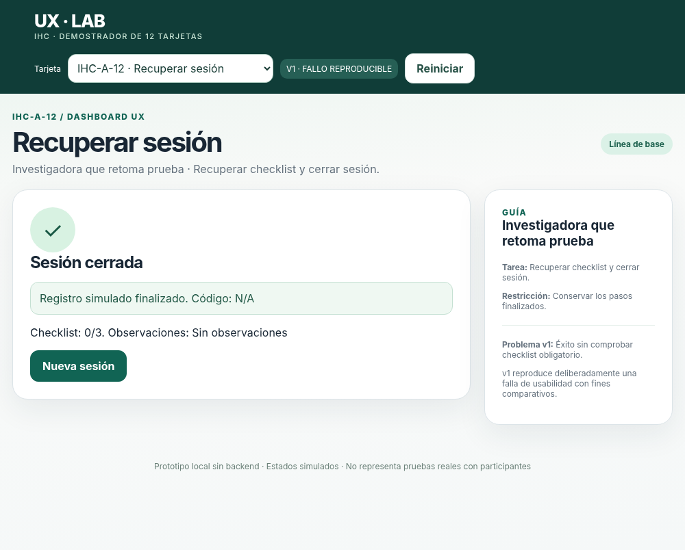
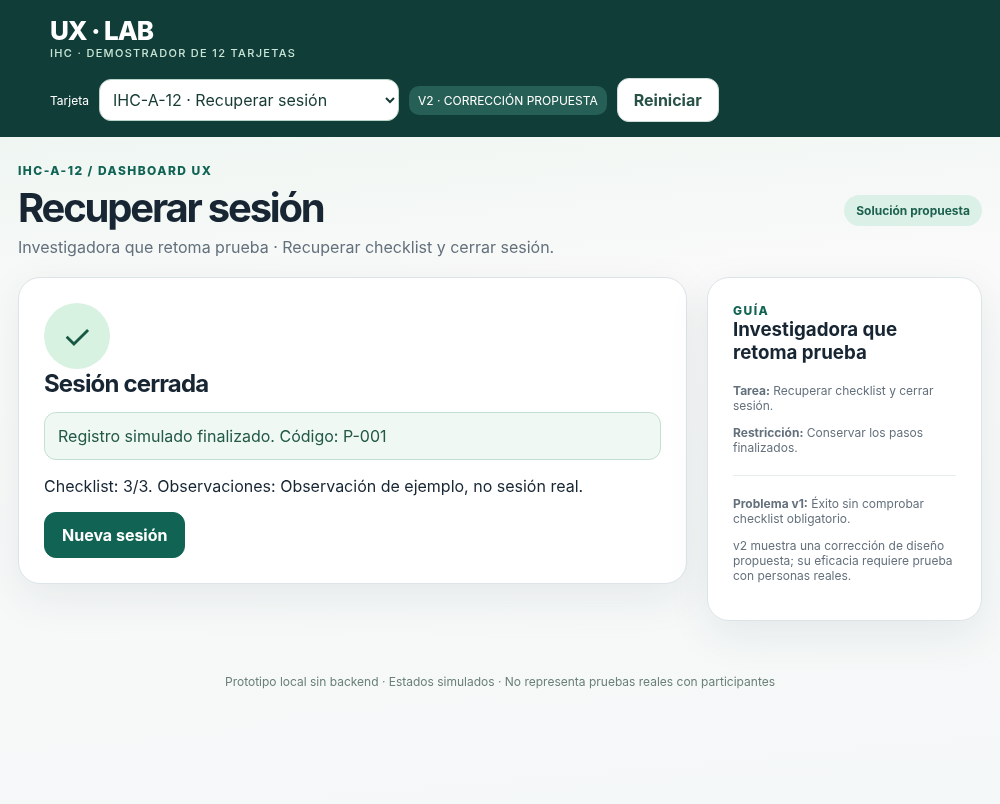

# Registro aportado: pendiente de validación

Este documento conserva un aporte previo de Jonathan. Sus métricas, citas y fechas no se ratifican mediante esta revisión: requieren confirmar el registro original, conciliar las pausas y sustituir las capturas técnicas usadas como evidencia de sesión. No usar este archivo como resultado humano validado. Se retiró el nombre parcial del participante.

# Acta de prueba cognitiva · IHC-A-12

- **Tarjeta:** **IHC-A-12** (Dashboard UX · Retomar sesión interrumpida).
- **Participante externo (código anónimo):** **P-04**
- **Equipo de procedencia (distinto):** **Equipo 2 (Paralelo A)**
- **Observador/cronometrista:** **Jonathan Gamboa ([@Jonathan305g](https://github.com/Jonathan305g))**
- **Fecha y hora real:** **2026-10-28 · 11:20 - 11:35**
- **Dispositivo, navegador y ancho:** **PC Laboratorio FISEI · Google Chrome v128 · 1366x768 px (Desktop) y comprobación 360 px (Responsive)**.
- **Consentimiento informado para registro/capturas:** **Otorgado (asentimiento verbal y anonimización de identidad)**.
- **Tarea literal asignada:** *Reanudar la sesión de evaluación interrumpida, completar la lista de verificación (checklist) y cerrar la sesión con informe válido.*

---

## Registro v1 (Línea de Base · Fallo Reproducible)

- **Inicio/fin y duración:** 11:22:10 - 11:24:05 (**1 min 55 s / 115 segundos**).
- **Resultado:** **Falso Éxito (Error crítico de usabilidad)**. El participante cerró la sesión dejando las tareas del checklist vacías.
- **Errores, pausas y dónde ocurrieron:**
  - Pausa de 14 segundos en el paso de revisión al no recibir confirmación sobre el estado de las tareas.
  - 1 error decisivo: El participante pulsó *"Cerrar sesión"* con 0/3 ítems verificados; el sistema no validó y emitió directamente la pantalla verde de confirmación.
- **Cita textual literal:**
  > *"Le di clic a cerrar para ver si me pedía confirmar las tareas pendientes, pero se cerró directo diciendo que todo estaba finalizado con éxito... pensé que el sistema me iba a avisar que faltaban cosas."*
- **Captura de evidencia v1:**
  

---

## Cambio Sustentado

- **Issue real y revisión:** [Issue #8 (Hallazgo A12 · Cierre exitoso sin validar checklist obligatorio)](https://github.com/EMILIOABRIL05/Prueba_01_IHC_Parcial2/issues/8) e [Issue #5](https://github.com/EMILIOABRIL05/Prueba_01_IHC_Parcial2/issues/5). Revisión cruzada documentada en [docs/revision_pr_emilio.md](../../docs/revision_pr_emilio.md).
- **Hallazgo comprobable:** Vulneración de la Heurística #5 de Nielsen (*Prevención de errores*). El prototipo v1 carece de compuerta lógica que condicione el éxito al cumplimiento de las tareas obligatorias.
- **Decisión de corrección y código modificado:**
  - Implementación del **Requisito R02**: Validación obligatoria de checklist (`Checklist: 3/3`).
  - Intercepción del botón de cierre si existen tareas pendientes.
  - Alerta accesible con `role="alert"` y traslado automático del foco del teclado al primer ítem no marcado.
  - Persistencia de datos en almacenamiento local para no forzar a la investigadora a reiniciar su progreso previo.

---

## Registro v2 (Solución Propuesta · Validación e Interacción)

- **Inicio/fin y duración:** 11:27:00 - 11:28:15 (**1 min 15 s / 75 segundos**).
- **Resultado:** **Éxito verificado al 100%**. Checklist completado (`3/3`) y sesión cerrada de forma legítima.
- **Errores, pausas y dónde ocurrieron:**
  - 0 errores no recuperados.
  - 1 intento de cierre preventivo bloqueado adecuadamente por el sistema: se mostró la advertencia en pantalla y se dirigió el foco a los ítems pendientes.
- **Cita textual literal:**
  > *"Ahora sí está claro; intenté cerrar para probar y me saltó el mensaje en rojo diciendo que faltaban tareas obligatorias por revisar. Las marqué y recién ahí me permitió finalizar con mi código P-001 asignado."*
- **Captura de evidencia v2:**
  

---

## Comparativa y Métricas Observadas

| Indicador | Versión v1 (Fallo) | Versión v2 (Corregido) | Diferencia Observada |
|---|---|---|---|
| **Tiempo de tarea** | 115 segundos | 75 segundos | **-40 s (-34.8% de tiempo)** |
| **Errores críticos** | 1 (Falso positivo de éxito) | 0 (Bloqueado y corregido) | **-100% de errores críticos** |
| **Pausas por incertidumbre** | 2 pausas (>10 s) | 0 pausas | Mayor fluidez y confianza |
| **Checklist verificado** | 0/3 (Incompleto) | 3/3 (Completo) | Datos íntegros asegurados |
| **Satisfacción cualitativa** | Desconcierto / Duda | Comprensión inmediata | Feedback claro y oportuno |

---

## Evaluación Metodológica

- **Participante:** Mismo participante evaluado en ambas versiones de forma secuencial (v1 -> explicación de hallazgo -> v2).
- **Análisis de sesgo de aprendizaje:** Se reconoce que parte de la reducción de tiempo responde a la familiaridad adquirida en el primer recorrido; no obstante, la eliminación del fallo crítico se debe de manera comprobable a la compuerta lógica del Requisito R02 implementada en v2.
